# Lente · Auditoría de cajas 3D sin par 2D de cámara en Waymo Open Dataset v2

*Una lista priorizada y un aviso de cámaras con huecos para que una persona revise primero las cajas 3D de peatones y ciclistas que probablemente no tienen su par 2D.*

**Curso:** MLY1101 Machine Learning · **Evaluación:** EP3 y Evaluación Final Transversal (la base de EP2 sigue en las secciones 1 a 15) · **Caso:** Waymo Open Dataset v2, target `sin_camara` · **Fecha:** 2026-11-24

| Ficha del proyecto | Dato |
|---|---|
| Caso | Waymo Open Dataset v2 |
| Equipo | Maicol Hernández (rama `maicolhernandez`) y Francis Moya (rama `francismoya`) |
| Solución | v3 congelada el 2026-11-14 (regla «menos puntos top» en dos pasos; hashes en [`artefactos_ep3/manifest_v3.json`](artefactos_ep3/manifest_v3.json)) |
| Aplicación | Lente (Streamlit), sección [16](#16-lente-la-aplicación-y-su-despliegue) |

**En breve**

- **Problema.** Algunas cajas 3D de peatones y ciclistas no tienen su par 2D de cámara (`sin_camara`: 21,2 % de las 80.571 cajas de 41 segmentos) y solo se sabe cuáles son revisándolas una por una.
- **Qué hace Lente.** Flujo en dos pasos: un detector marca las cámaras con hueco (se atienden aparte) y una regla ordena el resto de las cajas por menos puntos del sensor superior; una persona revisa y decide.
- **Resultado (en muestra: 41 segmentos, parámetros del detector ajustados con los mismos datos; post hoc, no pre-declarado; sin validación con datos nuevos).** Para encontrar el 80 % de las cajas sin pareja se revisa el 29,6 % de las cajas en dos pasos, en vez del 44,6 % en uno; revisando el 20 %, se encuentran 70,9 de cada 100 frente a 61,9. Con un supuesto de 20 s por caja (supuesto, no medido): 358 h sin orden, 200 h en un paso y 132 h en dos.
- **Límites.** El recall de la regla es 80,6 % en peatones y 44,3 % en ciclistas (115 casos en 14 segmentos); un segmento concentra el 54,8 % de los positivos del test de EP2; los dos pasos se midieron en muestra; con 4 segmentos nuevos reales solo se probó que la aplicación funciona (1 de 4 trae un posible hueco; no se estima su frecuencia) y la validación externa sellada sigue sin ejecutarse.

**Cómo verlo**

| Qué | Cómo |
|---|---|
| Ejecutar la aplicación (Lente) | `.venv\Scripts\python.exe app\lanzar.py --server.address localhost --server.port 8501 --browser.gatherUsageStats false` (o `scripts\ep3\arrancar_app.bat`) |
| Reproducir el resultado oficial de EP2 | `.venv\Scripts\python.exe -X utf8 scripts\verificar_congelados.py` y luego el notebook 10 con el kernel `ep2` (comandos completos en la sección 14) |
| Correr las pruebas | `.venv\Scripts\python.exe -m pytest tests/ep3 -q --no-cov -p no:cacheprovider` (EP3); `pytest -q` corre además las de EP2 y regenera README e informe de EP2 |
| Aplicación desplegada | Despliegue en AWS Academy |

[Informe técnico de EP3](docs/ep3/informe_tecnico_EP3.md) · [Informe de EP2](docs/informe_tecnico_EP2.md) · [Plan de evaluación congelado](docs/plan_evaluacion_test.md) · [Log de trabajo](docs/log_trabajo_ep2.md) · [README de EP1](docs/README_EP1.md)

**Siglas.** IC: intervalo de confianza del 95 % (bootstrap por segmentos); AUC: área bajo la curva ROC; PR-AUC: área bajo la curva precisión-recall; LR: regresión logística; LR3: regresión logística con 3 variables; RF: Random Forest; HGB: HistGradientBoosting; XGB y LGBM: XGBoost y LightGBM; E1 a E4: ensambles (definidos en 8.2); ECE: error de calibración esperado; ARI: índice de Rand ajustado (concordancia entre agrupaciones); OOF: fuera de fold.

**Mapa de la pauta**

**A. Secciones mínimas del informe**

| Sección pedida | Dónde está | Notebook | Evidencia |
|---|---|---|---|
| Problema de negocio | [2](#2-contexto-valor-de-negocio-objetivos-y-kpis) | 07 | Tabla de KPIs de la sección 2 |
| Objetivos | [2](#2-contexto-valor-de-negocio-objetivos-y-kpis) | 07 | Balance de objetivos (sección 12) |
| KPIs | [2](#2-contexto-valor-de-negocio-objetivos-y-kpis) | 07 y 10 | Tabla de KPIs de la sección 2 |
| Fuentes de datos | [4](#4-datos) | 00, 02, 03 | Tabla de fuentes y herramientas de la sección 4 |
| Preparación y EDA | [5](#5-eda-y-calidad-de-datos) y [6](#6-preparación-y-transformación) | 06 y 08 | Figuras 08 de la sección 5 |
| Metodología CRISP-DM | [7](#7-metodología-crisp-dm) | todos | Tabla CRISP-DM de la sección 7 |
| Desarrollo de los modelos | [8](#8-modelos-supervisados) | 09 y 09b | Figura 09_comparacion_modelos |
| Hiperparámetros y ensambles | [8.1](#81-optimización-de-hiperparámetros-ie9) y [8.2](#82-técnicas-de-ensamble-ie10) | 12 (EP3) | Tablas de `artefactos_ep3/f3_*` y `f4_*` |
| Evaluación con métricas apropiadas | [8.3](#83-capacidad-de-generalización-ie11), [10](#10-evaluación-final-en-el-test) y [12.1](#121-solución-elegida-y-justificación-ie12) | 10 y 13 (EP3) | Tablas de `f5_*` y `f6_*` |
| Conclusiones, limitaciones y recomendaciones | [12](#12-interpretación-y-recomendaciones) y [15](#15-mapa-de-la-pauta-referencias-equipo-y-limitaciones) | 10 | Balance de objetivos y limitaciones |

**B. Indicadores de evaluación**

| Indicador | Peso en la EFT | Peso en EP3 | Dónde se demuestra | Nivel de evidencia |
|---|---|---|---|---|
| IE1: Fuentes de datos y herramientas colaborativas | 5 % | — | [4](#4-datos) | tabla |
| IE2: Manipulación de datos en Python | 5 % | — | [4](#4-datos) | notebook |
| IE3: EDA y calidad de datos | 5 % | — | [5](#5-eda-y-calidad-de-datos) | figura |
| IE4: Sesgos, ética y privacidad | 5 % | — | [13](#13-ética-sesgos-y-privacidad) | tabla |
| IE5: Metodología | 10 % | — | [7](#7-metodología-crisp-dm) | tabla |
| IE6: Modelos supervisados | 10 % | — | [8](#8-modelos-supervisados) | figura y tabla |
| IE7: Aprendizaje no supervisado | 10 % | — | [9](#9-aprendizaje-no-supervisado) | figura |
| IE8: Interpretación del desempeño | 10 % | — | [10 a 12](#10-evaluación-final-en-el-test) | figura y tabla |
| IE9: Optimización de hiperparámetros | 10 % | 20 % | [8.1](#81-optimización-de-hiperparámetros-ie9) | tabla |
| IE10: Técnicas de ensamble | 10 % | 30 % | [8.2](#82-técnicas-de-ensamble-ie10) | tabla |
| IE11: Capacidad de generalización | 10 % | 20 % | [8.3](#83-capacidad-de-generalización-ie11) | tabla y notebook |
| IE12: Selección de la solución óptima | 10 % | 30 % | [12.1](#121-solución-elegida-y-justificación-ie12) | tabla y prueba automática |

**Índice:** [Resumen](#1-resumen) · [Contexto](#2-contexto-valor-de-negocio-objetivos-y-kpis) · [Qué hicimos en EP1](#3-qué-hicimos-en-ep1) · [Datos](#4-datos) · [EDA y calidad de datos](#5-eda-y-calidad-de-datos) · [Preparación y transformación](#6-preparación-y-transformación) · [Metodología (CRISP-DM)](#7-metodología-crisp-dm) · [Modelos supervisados](#8-modelos-supervisados) · [Aprendizaje no supervisado](#9-aprendizaje-no-supervisado) · [Evaluación final en el test](#10-evaluación-final-en-el-test) · [Hallazgo post hoc](#11-hallazgo-post-hoc-el-segmento-anómalo-y-la-auditoría-por-cámara) · [Interpretación y recomendaciones](#12-interpretación-y-recomendaciones) · [Ética](#13-ética-sesgos-y-privacidad) · [Estructura del repositorio](#14-estructura-del-repositorio-reproducción-y-pruebas) · [Mapa de la pauta](#15-mapa-de-la-pauta-referencias-equipo-y-limitaciones) · [Lente](#16-lente-la-aplicación-y-su-despliegue) · [Mejoras incorporadas desde EP1 y EP2](#17-mejoras-incorporadas-desde-ep1-y-ep2)
**Lectura rápida:** secciones [1](#1-resumen), [8.1](#81-optimización-de-hiperparámetros-ie9), [8.2](#82-técnicas-de-ensamble-ie10), [8.3](#83-capacidad-de-generalización-ie11), [12.1](#121-solución-elegida-y-justificación-ie12) y [16](#16-lente-la-aplicación-y-su-despliegue).

*Generado por `scripts/generar_readme.py` el 2026-11-24 20:38. Cada cifra sale de los CSV, JSON y notebooks ejecutados (`data/08_reporting/`, `artefactos_ep3/`) o de las funciones de la aplicación; los resultados post hoc llevan la etiqueta «post hoc, no pre-declarado».*

## 1. Resumen

> En la comparación principal, la regla de una línea «menos puntos del LiDAR superior (puntos top) primero» ordena bien las cajas sin par en train; en el test oficial ese resultado no se sostiene y ningún modelo supera a la regla.

- **Problema.** Algunas cajas 3D etiquetadas (`lidar_box`) de peatones y ciclistas no tienen su par 2D de cámara, y hoy solo se sabe cuáles son revisándolas una por una. Es como un archivo de expedientes al que a algunos les falta el anexo.
- **Qué hicimos.** Predecimos `sin_camara` (20,7 % de las cajas de la población principal de train), con validación por segmento, tres modelos contra reglas simples y un test de 8 segmentos sellado con un plan congelado (sha256). (En EP3 esos 41 segmentos (33 de entrenamiento y 8 de test de EP2, 80.571 cajas) son datos de desarrollo de la solución v3; la única prueba ciega son los segmentos nuevos (sección 8.3).)
- **Resultado oficial (pre-declarado).** Regresión logística frente a la regla: AUC 0,698 contra 0,684. La diferencia (modelo menos regla) es +0,014 y su IC 95 % por bootstrap de segmentos, -0,014 a +0,029, incluye 0: el modelo no se distingue de la regla. El punto A (recall objetivo 0,80) dio un recall de 0,590 (IC 0,383 a 0,924) y no se sostiene.
- **Hallazgo (post hoc, no pre-declarado).** El segmento `257766998801` aporta el 54,8 % de los positivos del test; sin él, el AUC de la regla es 0,931 (IC 0,897 a 0,982) y el recall del punto A 0,879. En ese segmento la cámara 3 (frontal der.) no tiene pares. El 54,8 % es la parte del segmento `257766998801` en los positivos del test (2.046 de 3.734); solo la celda de la cámara 3 de ese segmento explica el 35,8 % (1.338 de 3.734).

**Recomendación (en una frase).** Antes de revisar caja por caja, revisar cámara por cámara; recién después, ordenar las cajas con la regla de puntos LiDAR. Siempre con una persona que revisa y decide.

- **Paso 1: buscar cámaras con hueco.** En cada segmento (video), ver cuáles de las 5 cámaras casi no tienen pares aunque hay objetos en su campo de visión. Esas cámaras se atienden aparte, de una sola vez (completar sus etiquetas o reportar el dato que falta), no caja por caja.
- **Paso 2: ordenar las cajas de las cámaras sanas.** En las cámaras que sí tienen pares con normalidad, ordenar las cajas poniendo primero las que tienen menos puntos LiDAR, y revisar desde arriba.
- **Por qué en ese orden.** En una cámara con hueco todas las cajas salen sin par aunque estén bien vistas, y la regla se equivoca (pasó en el segmento 257766998801, donde el AUC de la regla es 0,443). Separándolas, la regla vuelve a funcionar (AUC 0,931 sin ese segmento; post hoc, no pre-declarado).
- **Alcance.** El paso 1 es una propuesta que nace de un hallazgo post hoc (no pre-declarada) y falta validarla con segmentos nuevos. La lista ordena la revisión; no la reemplaza.

| Métrica de la regla por puntos top | Train (fuera de fold) | Test oficial | Test sin el segmento 257766998801 (post hoc, no pre-declarado) |
|---|---|---|---|
| AUC | 0,862 (IC 0,814 a 0,906) | 0,684 (IC 0,482 a 0,958) | 0,931 (IC 0,897 a 0,982) |
| Fracción para 80 % | 37,8 % (IC 26,6 % a 46,7 %) | 79,0 % (IC 14,8 % a 88,3 %) | 22,1 % (IC 8,3 % a 31,1 %) |
| Recall en el punto A | 0,806 (IC 0,760 a 0,869) | 0,590 (IC 0,383 a 0,924) | 0,879 (IC 0,858 a 0,967) |
| % de cajas revisadas en el punto A | 37,9 % (IC 34,0 % a 42,2 %) | 33,1 % (IC 23,8 % a 39,7 %) | 30,0 % (IC 20,2 % a 41,9 %) |

**Nota sobre el IC de la Fracción para 80 % del test (14,8 % a 88,3 %).** Es muy ancho y bimodal: depende de si la réplica del bootstrap por segmentos incluye el segmento `257766998801`. El notebook 10 (K.2) lo midió para la regresión logística (IC 15,4 % a 88,4 %): en las 657 réplicas que incluyen el segmento la mediana es 83,4 % y en las 343 que no lo incluyen es 23,1 %. Para la regla top el notebook no desglosa las réplicas; la tabla muestra una separación del mismo tipo: 79,0 % con el segmento y 22,1 % sin él (post hoc, no pre-declarado). Por eso las conclusiones se apoyan en las diferencias pareadas modelo menos regla y no en el IC de un método solo.

> **Actualización de EP3 sobre el alcance.** El «alcance» de arriba es el de EP2. En EP3 el paso 1 (detector de huecos) se midió con los 41 segmentos de desarrollo y se probó en la aplicación con 4 segmentos nuevos reales: 1 de 4 trae un posible hueco (sección [16](#16-lente-la-aplicación-y-su-despliegue)). Esa prueba de funcionamiento no valida el paso 1 estadísticamente; la validación externa sellada sigue sin ejecutarse.

## 2. Contexto, valor de negocio, objetivos y KPIs

> Quien revisa y valida las etiquetas de percepción gana tiempo si revisa primero las cajas que probablemente no tienen par 2D, pero esa ganancia fue clara en train y no se sostuvo en el test oficial.

**Quién lo usaría.** Un equipo que revisa y audita los datos etiquetados de percepción y necesita saber qué cajas 3D quedaron sin su par 2D antes de entrenar o de comparar métricas por cámara.
**Costo de no usarlo.** Sin una lista priorizada, la única opción es revisar al azar: para encontrar el 80 % de las cajas sin par hay que revisar el 80 % de todas las cajas. Con la regla de puntos top, en train bastaba revisar el 37,8 %. Es como buscar un expediente incompleto abriendo carpetas sin orden.
**Por qué importa a escala.** Un segmento dura 20 segundos (cerca de 200 frames) y el inventario del conjunto de entrenamiento de Waymo que revisamos tiene 798 segmentos, es decir, unas 4,4 horas de video (798 × 20 s). La revisión a mano crece en línea recta con los datos: el doble de segmentos, el doble de horas. Como ilustración de train, con el supuesto de 20 s por revisión (no medido): revisar todas las cajas de un segmento de nuestra muestra (64.509 cajas ÷ 33 segmentos) tomaría unas 10,9 h, y ordenar con la regla de puntos top en lugar de revisar al azar ahorraría unas 4,6 h por segmento. Esa ganancia no se sostuvo en el test oficial. El paso 1 (auditoría por cámara) es el que mejor escala: basta contar pares por segmento y cámara, y detecta problemas que afectan a muchas cajas a la vez (el hueco del segmento 257766998801 reúne el 35,8 % de los positivos del test).

**Objetivo general.** Construir y evaluar, con validación por segmento y un test sellado, una lista priorizada de las cajas 3D etiquetadas de peatones y ciclistas, para encontrar las que no tienen par 2D de cámara revisando menos que al azar, y decir con intervalos de confianza si un modelo aporta algo frente a una regla simple.

**Objetivos específicos (medibles).**

1. Predecir `sin_camara` en la población principal con un AUC fuera de fold de al menos 0,70 y una diferencia entre PR-AUC y prevalencia de al menos 0,10 (metas del 07).
2. Reducir la fracción de cajas que hay que revisar para encontrar el 80 % de las cajas sin par frente al azar (80 %) y frente a la regla más simple. Un modelo solo se recomienda si baja esa fracción al menos 5 puntos con IC pareado que excluya 0 y su AUC sube al menos 0,03.
3. Fijar con train un punto de operación para un recall de 0,80 y comprobar en el test que el recall es al menos 0,75.
4. Medir estabilidad, calibración y equidad: AUC mínimo por fold de al menos 0,75, mediana del AUC por segmento de al menos 0,80, ECE de a lo sumo 0,05 tras calibrar, y las brechas por momento del día y ubicación con su IC.

| KPI | Definición | Por qué importa al negocio | Meta fijada antes | Train (fuera de fold) | Test oficial |
|---|---|---|---|---|---|
| AUC | Probabilidad de que una caja sin par reciba un puntaje mayor que una con par | Dice si la lista ordena bien, sin depender de un corte | AUC >= 0,70 (criterio de B en el 07, `decision_target_ep2.csv`) | Regla top 0,862 (0,814 a 0,906); LR 0,825 (0,774 a 0,883) | Regla top 0,684 (0,482 a 0,958); LR 0,698 (0,503 a 0,961) |
| PR-AUC | Área bajo la curva precisión-recall | Mide cuántas de las cajas marcadas son realmente sin par, con una clase minoritaria | PR-AUC menos prevalencia >= 0,10 (07) | Regla top 0,704 (0,597 a 0,785); LR 0,657 (0,553 a 0,755) (prevalencia 0,207) | Regla top 0,558 (0,430 a 0,795); LR 0,565 (0,451 a 0,826) (prevalencia 0,232) |
| Fracción para 80 % | Fracción de cajas a revisar, en el orden del puntaje, para encontrar el 80 % de las cajas sin par | Es el esfuerzo de revisión: menos es mejor (al azar sería ~80 %) | Un modelo se recomienda solo si baja al menos 5 puntos frente al baseline con IC pareado que excluya 0 y su AUC sube al menos 0,03 (plan v2) | Regla top 0,378 (0,266 a 0,467); LR 0,437 (0,309 a 0,523) | Regla top 0,790 (0,148 a 0,883); LR 0,774 (0,154 a 0,884) |
| Recall en el punto A | Fracción de las cajas sin par que quedan dentro de lo que se revisa con el corte fijado en train | Cuántas lagunas se encuentran con el presupuesto de revisión elegido | Objetivo 0,80; sostenido en test si el recall es al menos 0,75 | Regla top 0,806 (0,760 a 0,869); LR 0,810 (0,761 a 0,874) | Regla top 0,590 (0,383 a 0,924); LR 0,621 (0,413 a 0,958) |
| % de cajas revisadas en el punto A | Fracción de las cajas que quedan por encima del corte | Es el costo de revisión del punto A | Sin meta numérica para A; el punto B usa un presupuesto de 20 % | Regla top 0,379 (0,340 a 0,422); LR 0,389 (0,352 a 0,438) | Regla top 0,331 (0,238 a 0,397); LR 0,356 (0,257 a 0,449) |
| ECE (calibración) | Diferencia media entre la probabilidad predicha y la frecuencia observada, en 10 grupos por cuantiles | Si se publican probabilidades, tienen que significar lo que dicen | ECE <= 0,05 tras calibrar (09) | LR crudo 0,044; con Platt 0,013 | LR crudo 0,079; con Platt congelado 0,080 |
| Estabilidad por fold | AUC mínimo entre los 5 folds de train | Un resultado que depende de un fold no se puede esperar en datos nuevos | AUC mínimo por fold >= 0,75 (09) | Regla top 0,821; LR 0,811 | No aplica: el test no tiene folds |
| Estabilidad por segmento | Mediana del AUC dentro de cada segmento | Los segmentos son escenas distintas; el promedio puede esconder segmentos donde falla | Mediana >= 0,80 (09) | Regla top 0,890; LR 0,888 (14 segmentos) | Regla top 0,903; LR 0,885 (mediana de 4 segmentos con al menos 50 positivos; mínimo 0,443 y 0,459) |

> **Cómo leer estos KPI en EP3.** Las metas de esta tabla son las de EP2, que evaluó 33 segmentos de entrenamiento. Las cifras de EP3 (41 segmentos, otra validación) están en la sección [8.1](#81-optimización-de-hiperparámetros-ie9) y en las secciones 8.3 y 12; no son comparables una a una con las de la sección 8 (ver el recuadro de 8.1).

**Valor cuantificado (ilustración con supuestos).** Las horas son cajas × 20 s ÷ 3.600. Los 20 s por revisión no se calcularon ni se midieron: son un supuesto editable que fijamos en el notebook 07 (`SEGUNDOS_POR_REVISION`), sin fuente citada, y que el 09 y el 10 repiten como constante; las horas son solo una ilustración.

| Escenario (train, población principal) | Cajas a revisar | Horas con 20 s por revisión |
|---|---|---|
| Revisar todo | 64.509 (100 %) | 358,4 |
| Al azar, hasta el mismo recall (0,806) | 51.994 (80,6 %) | 288,9 |
| Regla por puntos top, punto A (recall 0,806) | 24.449 (37,9 %) | 135,8 |

**Unidad de revisión: la caja, no el frame.** Las fracciones y las horas se calculan por fila de la tabla de modelado, es decir, por **caja** (un peatón o ciclista etiquetado en un frame): 64.509 cajas repartidas en 5.302 frames de train de la población principal. Los notebooks 07, 09 y 10 y sus CSV llaman «frame» a esa fila (en el 07, «frame (caja 3D etiquetada)»); aquí decimos caja. Revisar una caja no equivale a revisar un frame completo, y el esfuerzo por frame no se midió.
**Lectura honesta en el test.** En el resultado oficial la ganancia no se sostiene: la regla necesita revisar el 79,0 % de las cajas para encontrar el 80 % de las cajas sin par, frente a 80 % al azar, y el punto A queda en recall 0,590 (IC 0,383 a 0,924). En el test, el punto A cuesta 29,5 h frente a 89,2 h de revisar todo, pero con menos recall del prometido. El motivo (un segmento) está en la [sección 11](#11-hallazgo-post-hoc-el-segmento-anómalo-y-la-auditoría-por-cámara).

## 3. Qué hicimos en EP1

> En EP1 construimos y probamos el pipeline de datos y descubrimos que `tiene_camara` mezclaba la clase del objeto con la cobertura de cámaras; por eso EP2 cambió el target.

**Pipeline de Kedro.** 10 nodos (7 de limpieza del CSV sintético y 3 de ingesta de Waymo) y 14 pruebas, todas pasan, con 90,0 % de cobertura medida en el commit de cierre de EP1 (`scripts/medir_pruebas_ep1.py`). El README de EP1 declara 7 nodos de preprocesamiento (coincide).

**Notebooks 00 a 05 (EP1):**

- `00_exploracion_bucket_waymo.ipynb`: Exploración del bucket de Waymo y selección de segmentos.
- `01_exploracion_csv.ipynb`: EDA completo del CSV sintético: calidad de datos, distribuciones, relaciones a conservar, tabla de decisiones con 12 defectos y limpieza en funciones puras.
- `02_exploracion_waymo.ipynb`: EDA de los 4 segmentos reales de Waymo: estructura de `lidar_box`, construcción del target `tiene_camara` cruzando con `camera_to_lidar_box_association`, comparación contra el CSV sintético.
- `03_fuentes_y_colaboracion.ipynb`: Clasificación de las fuentes de datos del proyecto (estructurada/semiestructurada, formato, licencia), checklist de privacidad por fuente, y el acuerdo de trabajo colaborativo del equipo.
- `04_estructuras_y_almacenamiento.ipynb`: Por qué el pipeline guarda los datos intermedios en Parquet y no en CSV, con memoria y velocidad medidas sobre los datos reales del proyecto (lista vs NumPy, tipos de columna, CSV vs Parquet).
- `05_etica_sesgos_privacidad.ipynb`: Sesgo de muestreo, de procesamiento y de clase en el target, riesgo de reidentificación, y la ficha de dataset (datasheet) completa.

**Notebook 06 (de EP1, prepara EP2):** `06_eda_y_preparacion_modelamiento.ipynb` repite el EDA de EP1 (target `tiene_camara`) con los 41 segmentos de EP2 y deja el split por segmento; el cambio de target lo decide el 07.
**Datos de EP1.** 4 segmentos reales de Waymo elegidos por contraste, 34.098 detecciones y 15,7 % de positivos de `tiene_camara` (5.352 de 34.098). La selección de segmentos, la ética y los benchmarks de almacenamiento (Parquet frente a CSV) quedaron en los notebooks 00, 03, 04 y 05.
**Qué aprendimos y qué cambió.** `tiene_camara` en todos los objetos queda dominado por la clase: en train, los vehículos y las señales nunca son positivos (cifra del notebook 07, sin archivo de salida). La pregunta con incertidumbre es qué peatones y ciclistas no tienen par: ese es `sin_camara`, el target de EP2 (notebook 07). El detalle de EP1 está en [docs/README_EP1.md](docs/README_EP1.md).

## 4. Datos

> Evaluamos 91 segmentos, usamos 41 y dejamos 8 sellados como test; la población principal excluye la franja de 100 a 120° porque ahí la ausencia de par es geométrica.

- **Selección.** De 91 segmentos evaluados (`registro_verificacion_ep2.csv`), 41 cumplen etiquetado denso y asociación cámara-LiDAR no vacía; los otros 50 se descartaron: 27 por asociación vacía, 21 por etiquetado ralo (menos de 5,5 % de frames etiquetados) y 2 por pocas asociaciones (menos de 50). Los 5 segmentos de lluvia no forman parte de esos 91: son un estrato aparte (4 con asociación vacía y 1 con etiquetado ralo) y no se usaron en el modelado; solo en un análisis descriptivo post hoc (sección 9).
- **Split por segmento.** 33 segmentos de train y 8 de test: un segmento es una escena de 20 segundos, y si fotogramas vecinos cayeran en lados distintos el modelo «reconocería» la escena. Los 5 folds se estratificaron por `tiene_camara` (el target de EP1), no por `sin_camara`, así que su tasa por fold varía de 16,8 % a 28,7 %.
- **Test sellado.** Los 8 segmentos de test no se abrieron hasta el notebook 10; antes solo se contaron filas y positivos. En EP3 esos 41 segmentos (33 de entrenamiento y 8 de test de EP2, 80.571 cajas) son datos de desarrollo de la solución v3; la única prueba ciega son los segmentos nuevos (sección 8.3).

| Población | Train: filas | Train: sin_camara | Test: filas | Test: sin_camara |
|---|---|---|---|---|
| Principal (azimut absoluto <= 100°) | 64.509 | 13.368 | 16.062 | 3.734 |
| 120° (principal más franja 100-120°) | 68.555 | 15.884 | 17.297 | 4.378 |

La población principal tiene 64.509 de 68.555 filas de train. `train.parquet` y `test.parquet` incluyen todas las clases de objeto; el target solo existe para peatones y ciclistas.

**Fuentes y herramientas colaborativas (IE1).**

| Fuente o herramienta | Para qué la usamos | Por qué esa y no otra |
|---|---|---|
| GitHub: ramas `main`, `maicolhernandez` y `francismoya` | Trabajo en paralelo y revisión por rama (acuerdo del [notebook 03](notebooks/03_fuentes_y_colaboracion.ipynb), bloque 6) | Deja historial revisable y evita pisarse; el acuerdo prohíbe empujar directo a `main` |
| Bucket de Waymo v2 con `gsutil` desde Google Colab | Descargar solo `lidar_box` y `camera_to_lidar_box_association` de cada segmento ([notebooks 00 y 00b](notebooks/00_exploracion_bucket_waymo.ipynb)) | Es donde publica Waymo; los archivos son grandes y solo hacen falta dos componentes |
| Kedro | Pipelines de ingesta y preprocesamiento (`kedro run`, [README de EP1](docs/README_EP1.md)) | Estructura reproducible por nodos; guarda en Parquet, que conserva tipos |
| pytest | Pruebas de pipelines, README, informe y página (sección 14) | Detectan cifras que se desincronizan entre documentos |
| sha256 de archivos congelados | `scripts/verificar_congelados.py` y `verificar_congelados_v3.py` | Prueba que modelos y planes no cambiaron antes de abrir el test |
| Streamlit | Lente, la aplicación (sección 16) | Una página interactiva en Python, sin escribir front-end; probada con `AppTest` |

Reparto de ramas: `git branch -a` lista `main`, `maicolhernandez` y `francismoya` (también en `origin`). No usamos MLflow (decisión DEC-6 de [`ESTADO.md`](docs/ep3/ESTADO.md)); S3 solo aparece en la guía orientativa de despliegue ([`despliegue.md`](docs/ep3/despliegue.md)), que no se ejecutó.

**Manipulación de datos en Python (IE2).** [Notebook 04](notebooks/04_estructuras_y_almacenamiento.ipynb): listas frente a NumPy, tipos de columna (ahorro de memoria de 47,4 %), CSV frente a Parquet (5,52 MB frente a 1,90 MB) y la ingesta con Kedro (`src/waymo_evaluacion/pipelines`).

## 5. EDA y calidad de datos

> Cuatro hallazgos explican casi todo: pocos puntos LiDAR, el borde de 100° del azimut, la distancia y la clase, y que dentro de un mismo objeto el par aparece cuando hay más puntos.

1. **Puntos LiDAR.** La tasa de `sin_camara` baja de 80,5 % con 0-5 puntos a 9,4 % con más de 100. Es como una persona que casi no aparece en la foto: no recibe recuadro.
2. **Azimut y franja 100-120°.** La tasa es 20,7 % dentro de 100° y 62,2 % entre 100° y 120°: ahí la ausencia de par es en buena parte geométrica y no una laguna de etiquetado.
3. **Distancia y clase.** La tasa va de 10,9 % en el quintil más cercano a 32,9 % en el más lejano (calculado con train). Los ciclistas son pocos: 1.483 filas, con tasa 7,6 %.
4. **Dentro de un mismo objeto.** El 80,0 % de los objetos que a veces tienen par y a veces no tienen más puntos en los frames con par (Wilcoxon p = 1,9e-29): el efecto no es solo del tipo de objeto.

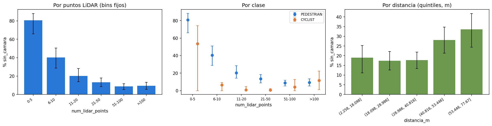
*Figura: Tasa de sin_camara por puntos LiDAR, clase y distancia (08, población de 120°). Archivo: `images/08_tasa_por_puntos_clase_distancia.png`.*

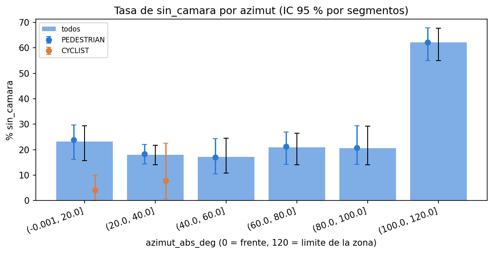
*Figura: Tasa de sin_camara por azimut: el salto está entre 100° y 120° (08). Archivo: `images/08_tasa_por_azimut.png`.*

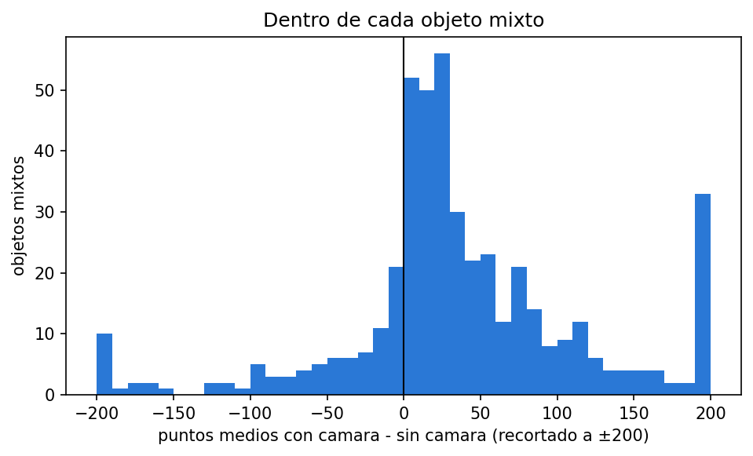
*Figura: Dentro de los objetos que a veces tienen par: más puntos en los frames con par (08). Archivo: `images/08_pareado_objetos_mixtos.png`.*

**Calidad de datos.**

| Chequeo | Resultado |
|---|---|
| Nulos en las 16 variables (población principal de train) | 0 |
| Duplicados por llave (segmento, frame, objeto) | 0 |
| Cajas con cero puntos LiDAR (reales: objetos que el LiDAR casi no vio) | 6,2 % |
| Filas conservadas al filtrar frames sin etiquetas (06) | 93,4 % |
| Atípicos (fuera de 1,5 IQR): rango entre variables no binarias | de 0,0 % a 11,9 % según la variable; no se eliminan |

## 6. Preparación y transformación

> Dieciséis variables de la caja 3D, ninguna del par 2D, escaladas solo con datos de entrenamiento de cada fold.

| Variable | Definición | Tratamiento en la regresión logística |
|---|---|---|
| `box_center_x` | Coordenada x del centro de la caja 3D (m), en el marco del vehículo | estandarización |
| `box_center_y` | Coordenada y del centro de la caja 3D (m) | estandarización |
| `box_center_z` | Coordenada z del centro de la caja 3D (m) | estandarización |
| `azimut_abs_deg` | Valor absoluto del ángulo del centro de la caja respecto del eje x, en grados (derivada de x e y) | estandarización |
| `distancia_m` | Distancia euclidiana al sensor: raíz de x al cuadrado más y al cuadrado | estandarización |
| `box_length` | Largo de la caja (m) | estandarización |
| `box_width` | Ancho de la caja (m) | estandarización |
| `box_height` | Alto de la caja (m) | estandarización |
| `volumen_caja` | Largo por ancho por alto | log1p y estandarización |
| `num_lidar_points` | Puntos LiDAR dentro de la caja | log1p y estandarización |
| `num_top_lidar_points` | Puntos dentro de la caja captados por el LiDAR superior | log1p y estandarización |
| `densidad_puntos` | Puntos LiDAR divididos por el volumen de la caja | log1p y estandarización |
| `speed_mps` | Norma de la velocidad horizontal (x, y) de la etiqueta (m/s) | estandarización |
| `heading_sin` | Seno del rumbo de la caja | estandarización |
| `heading_cos` | Coseno del rumbo de la caja | estandarización |
| `es_ciclista` | 1 si la clase es ciclista, 0 si es peatón | estandarización |

- **Variables creadas:** densidad (puntos por volumen), volumen, distancia, azimut y rumbo (seno y coseno). Las variables de oclusión y temporales se probaron en el 08 y no mejoraron el resultado.
- **Logaritmo y escalado:** La regresión logística aplica `log1p` y luego estandariza 4 variables (`num_lidar_points`, `num_top_lidar_points`, `densidad_puntos`, `volumen_caja`) y solo estandariza las otras 12; los árboles (HGB y Random Forest) usan las variables sin transformar; el aprendizaje no supervisado usa los logaritmos de puntos, densidad y volumen. El escalado es parte del `Pipeline` de cada fold. No eliminamos atípicos: son objetos reales (cajas lejanas, cajas grandes).
- **Prevención de fuga:** ninguna variable viene del par 2D ni de la asociación; los identificadores (`key.laser_object_id`, marca de tiempo) no son variables; el split es por segmento; el notebook 08 lo comprueba con un `assert`. Más detalle en el [informe](docs/informe_tecnico_EP2.md#3-datos-preparación-y-calidad).

## 7. Metodología (CRISP-DM)

> Fijamos los criterios antes de mirar resultados, validamos por segmento y congelamos modelos y umbrales con sha256 antes de abrir el test.

| Fase | Qué se hizo | Sección y notebook |
|---|---|---|
| 1. Entendimiento del negocio | Problema (auditar cajas 3D sin par 2D), objetivos, KPIs con metas fijadas antes, elección del target entre cinco candidatas | Secciones del informe: 2 y 5; notebook 07 |
| 2. Entendimiento de los datos | Selección de segmentos, EDA, tasa de `sin_camara` por puntos, azimut, distancia y clase; geometría de cámaras; franja 100-120° | Secciones del informe: 3 y 6; notebooks 00, 02, 06 y 08 |
| 3. Preparación de los datos | Ingesta con Kedro, filtro de frames etiquetados, población principal, variables derivadas, split por segmento con 5 folds | Secciones del informe: 3 y 6; ingesta (Kedro) y notebooks 06 y 08 |
| 4. Modelado | Baselines simples, regresión logística, HGB y Random Forest con búsqueda anidada por segmento; aprendizaje no supervisado | Secciones del informe: 7 y 8; notebooks 08 y 09 |
| 5. Evaluación | Criterios fijados antes, plan de evaluación congelado con sha256, test sellado, influencia, equidad y sensibilidad | Secciones del informe: 4 y 9; notebooks 09b y 10 |
| 6. Despliegue | Recomendación de uso: cámara por cámara primero, luego cajas por puntos top, con una persona en el circuito; monitoreo y reproducibilidad (scripts, pruebas, paquete de entrega); en EP3, la aplicación Lente (sección 16) | Secciones del informe: 10 a 13 |

```
 Waymo v2 (41 segmentos)           split por segmento (33 train / 8 test sellado)
         |                                      |
 filtros y variables  ------>  5 folds por segmento (train) ------>  baselines + LR/HGB/RF
 (sin variables del par 2D)         (búsqueda anidada por segmento)           |
                                                                             v
                   criterios fijados antes  ------>  plan de evaluación congelado (14 archivos con sha256)
                                                                             |
                                                                             v
                                       test (8 segmentos) -> resultado oficial pre-declarado -> apéndices post hoc
```

**Criterios fijados antes.** «Vale la pena»: la fracción para 80 % baja al menos 5 puntos con IC pareado que excluya 0 y el AUC sube al menos 0,03. Estabilidad: AUC mínimo por fold de 0,75 y mediana por segmento de 0,80. Punto A: recall objetivo 0,80, sostenido en test si es al menos 0,75. Calibración: ECE de a lo sumo 0,05. Los intervalos son bootstrap por segmentos.
**Por qué baselines simples.** Un modelo complejo solo se justifica si supera a una regla que se explica en una línea; es como justificar un instrumento nuevo frente a medir a ojo. Los baselines son menos puntos LiDAR, menos puntos de la parte alta (la regla por puntos top), una regla geométrica y un modelo mínimo de 3 variables.

## 8. Modelos supervisados

> En la comparación principal (población principal, fuera de fold), ningún modelo supera a la regla por puntos top con el criterio fijado antes; la regresión logística es el modelo más interpretable y queda como comparación, y la sensibilidad a 120° se resume en la sección 10.

| Método | AUC | PR-AUC | Captura@20 % | Fracción para 80 % |
|---|---|---|---|---|
| Prevalencia (trivial) | 0,500 (0,500 a 0,500) | 0,207 (0,167 a 0,245) | 0,199 (0,194 a 0,202) | 0,802 (0,795 a 0,807) |
| Regla: menos puntos LiDAR | 0,858 (0,810 a 0,901) | 0,698 (0,580 a 0,778) | 0,646 (0,575 a 0,738) | 0,385 (0,275 a 0,471) |
| Regla: menos puntos top | 0,862 (0,814 a 0,906) | 0,704 (0,597 a 0,785) | 0,649 (0,580 a 0,741) | 0,378 (0,266 a 0,467) |
| Regla geométrica (azimut > 105 primero) | 0,858 (0,810 a 0,901) | 0,698 (0,580 a 0,778) | 0,646 (0,575 a 0,738) | 0,385 (0,275 a 0,471) |
| Modelo mínimo (LR 3 variables) | 0,855 (0,800 a 0,906) | 0,702 (0,573 a 0,798) | 0,636 (0,555 a 0,741) | 0,384 (0,266 a 0,478) |
| Regresión logística | 0,825 (0,774 a 0,883) | 0,657 (0,553 a 0,755) | 0,581 (0,500 a 0,708) | 0,437 (0,309 a 0,523) |
| HGB | 0,805 (0,753 a 0,871) | 0,655 (0,562 a 0,746) | 0,589 (0,498 a 0,709) | 0,529 (0,326 a 0,623) |
| Random Forest | 0,836 (0,779 a 0,893) | 0,690 (0,556 a 0,791) | 0,620 (0,532 a 0,719) | 0,430 (0,283 a 0,533) |

**Por qué dos filas son idénticas.** «Regla geométrica» y «Regla: menos puntos LiDAR» dan las mismas métricas porque el puntaje de la geométrica es `1e6*(azimut_abs_deg > 105) - num_lidar_points`: pone primero las cajas con azimut mayor que 105°, y la población principal solo tiene cajas hasta 100° (máximo en train), así que su orden queda igual al de menos puntos LiDAR. Las dos reglas solo se distinguen en la población de 120° (sensibilidad), donde la geométrica es el mejor baseline simple.

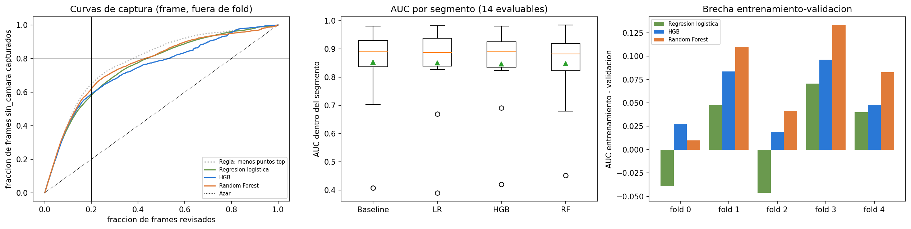
*Figura: Comparación de modelos y baselines en train, fuera de fold, con IC por segmentos (09). Archivo: `images/09_comparacion_modelos.png`.*

**Por qué estos algoritmos.** La regresión logística es la referencia lineal; el HGB captura interacciones; el Random Forest da robustez. Elegimos hiperparámetros con búsqueda anidada por segmento y no usamos SMOTE (la prevalencia de 20,7 % no es extrema). Detalle en el [informe](docs/informe_tecnico_EP2.md#8-modelos-supervisados).
**De EP1 a EP2.** El README de EP1 (sección 6) proponía Random Forest o XGBoost con SMOTE para `tiene_camara` (15,7 % de positivos). En EP2 el target pasó a `sin_camara`, con una prevalencia de 20,7 % en la población principal, y comparamos regresión logística, HGB (`HistGradientBoostingClassifier`, el boosting de árboles de scikit-learn) y Random Forest. No usamos SMOTE: evaluamos `class_weight` en vez de sobremuestrear (HGB 0,719 sin peso frente a 0,719 balanceado; regresión logística 0,713 frente a 0,711) e `imbalanced-learn` no está instalado en el entorno. XGBoost no se entrenó en EP2: no figura en `requirements.txt` ni en el código de los notebooks 07 a 10; el 06 solo imprime un `scale_pos_weight` de 5,95 para `tiene_camara`. En EP3 sí se entrena y se optimiza (secciones 8.1 y 8.2).

**Hiperparámetros** (valores buscados, tomados del código del notebook 09, y valor elegido, de `hiperparametros_B.json`):

<details>
<summary>Tabla de hiperparámetros buscados y elegidos (EP2)</summary>

| Modelo | Hiperparámetro | Valores buscados | Elegido (ajuste final en todo train) |
|---|---|---|---|
| Regresión logística | C (regularización) | 0,00001 / 0,0001 / 0,001 / 0,01 / 0,1 / 1 / 10 / 100 | 0,001 |
| Regresión logística | class_weight | sin peso / balanceado | sin peso |
| HGB | learning_rate (tasa de aprendizaje) | log-uniforme de 0,02 a 0,2 | 0,0305 |
| HGB | max_depth | 2 / 3 / 4 / sin tope | sin tope |
| HGB | max_leaf_nodes (hojas) | 4 / 6 / 8 / 15 | 4 |
| HGB | min_samples_leaf (muestras por hoja) | 100 / 200 / 400 / 800 | 100 |
| HGB | l2_regularization | log-uniforme de 0,001 a 100 | 9,61 |
| HGB | class_weight | sin peso / balanceado | sin peso |
| HGB | mono (monotonía) | no / sí | no |
| HGB | max_iter (iteraciones) | de 10 en 10 hasta 300, por la curva interna | 90 |
| Random Forest | max_depth | 3 / 4 / 6 / 8 | 6 |
| Random Forest | min_samples_leaf | 20 / 50 / 100 / 200 | 200 |
| Random Forest | max_features | sqrt / 0,3 / 0,5 | sqrt |

</details>

Configuraciones evaluadas por fold: regresión logística 16 (grilla completa), HGB 12 y Random Forest 6 (muestras aleatorias fijas); se elige la de mayor PR-AUC con 3 folds internos por segmento. Los Random Forest usan 200 árboles y sin `class_weight`.

**Qué pesa en la regresión logística** (odds ratio por desviación estándar; menos de 1 significa menos probabilidad de `sin_camara`):

<details>
<summary>Odds ratios de la regresión logística (EP2)</summary>

| Variable | OR (+1 DE) | Significativa |
|---|---|---|
| num_top_lidar_points | 0,46 (0,39 a 0,53) | sí |
| num_lidar_points | 0,53 (0,46 a 0,59) | sí |
| densidad_puntos | 0,62 (0,53 a 0,71) | sí |
| distancia_m | 0,78 (0,71 a 0,93) | sí |
| box_length | 0,86 (0,69 a 1,14) | no |

</details>

**Por qué `distancia_m` tiene un odds ratio menor que 1.** Vale 0,78 (IC 0,71 a 0,93), pero en el EDA (sección 5) la tasa de `sin_camara` sube con la distancia, de 10,9 % a 32,9 %.

La distancia y los puntos LiDAR están muy correlacionados (correlación de Spearman -0,735 entre `distancia_m` y `num_lidar_points`): lo lejano tiene pocos puntos. Con los puntos ya en el modelo, la distancia suma en sentido contrario: en el tercio de cajas con menos puntos, la tasa baja de 55,2 % entre las más cercanas a 40,6 % entre las más lejanas (cálculo hecho para este README con train, post hoc, no pre-declarado). Por eso cada coeficiente se lee con las demás variables fijas, no como efecto aislado.

**Calibración (fuera de fold):**

| Versión | ECE | Brier |
|---|---|---|
| Crudo | 0,044 | 0,115 |
| Platt | 0,013 | 0,104 |
| Isotónica | 0,030 | 0,105 |

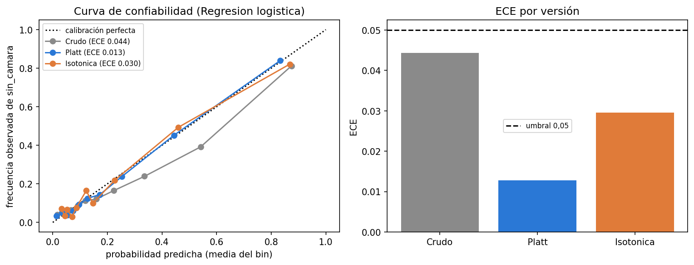
*Figura: Curva de confiabilidad de la regresión logística, cruda y calibrada (09). Archivo: `images/09_calibracion.png`.*

**Diagnóstico agrupado frente a por fold y por segmento.** El AUC agrupado mezcla las predicciones de cinco modelos (uno por fold) y puede castigar a los modelos más que a las reglas. Por fold, la diferencia de AUC de la regresión logística frente a la regla va de -0,010 a +0,005 (IC por segmentos -0,010 a +0,033); por segmento, la mediana de la diferencia es -0,001 (IC -0,008 a +0,002). Los IC incluyen 0: el modelo no se distingue de la regla.

### 8.1 Optimización de hiperparámetros (IE9)

> **Por qué las cifras de esta sección no son las de la sección 8.** EP2 evaluó los 33 segmentos de entrenamiento, con folds estratificados por `tiene_camara`, y su regresión logística quedó ajustada (`C` = 0,001). EP3 evalúa los 41 segmentos de desarrollo con `StratifiedGroupKFold` de 5 estratificado por `sin_camara`, y compara la regresión logística por defecto con la optimizada por una búsqueda anidada nueva. Lo que más mueve a la regla (de 0,862 a 0,823) es la población, no el método: la misma regla da 0,862 fuera de fold sobre los 33 segmentos de entrenamiento y 0,684 sobre los 8 de test, que incluyen el segmento con la cámara 3 sin pares. Las dos series no son comparables una a una.

| Serie | Dónde está | Cifras (AUC fuera de fold) |
|---|---|---|
| EP2: 33 segmentos de entrenamiento (test de 8 aparte) | secciones [8](#8-modelos-supervisados) y [10](#10-evaluación-final-en-el-test) | regla 0,862 y regresión logística ajustada (0,825) en entrenamiento; regla 0,684 en el test |
| EP3: 41 segmentos de desarrollo (los 33 más los 8 del test de EP2) | secciones [8.1](#81-optimización-de-hiperparámetros-ie9) a 8.3 y 12.1 | regla 0,823; regresión logística por defecto 0,797 y optimizada 0,775 |

> Optimizar mejora a XGBoost y LightGBM y no mejora a Regresión logística, Random Forest ni a HistGradientBoosting; ni siquiera el XGBoost optimizado supera a la regla de una línea.

**Método.** Búsqueda aleatoria **anidada por segmento**: dentro de cada uno de los 5 folds externos (por segmento), la elección usa solo los segmentos de entrenamiento, con una validación interna `GroupKFold` de 3 y la PR-AUC como criterio de selección; el conjunto de variables cuenta como un hiperparámetro más. Fueron 30 configuraciones y 1 repetición, una desviación del plan (DEV-1, [`plan_v3_desviaciones.md`](artefactos_ep3/plan_v3_desviaciones.md)). «Mejora» exige subir la PR-AUC al menos 0,010 con un IC pareado por segmentos que excluya 0. Es como afinar un instrumento: ayuda si estaba desafinado y no si ya sonaba bien.

| Modelo | AUC por defecto (IC) | AUC optimizado (IC) | Fracción para 80 %: defecto a optimizado | Dif. PR-AUC (IC) | Veredicto |
|---|---|---|---|---|---|
| Regresión logística (LR) | 0,797 (0,701 a 0,889) | 0,775 (0,681 a 0,872) | 0,467 a 0,535 | -0,018 (-0,051 a +0,018) | no mejora |
| Random Forest (RF) | 0,798 (0,704 a 0,881) | 0,746 (0,657 a 0,848) | 0,472 a 0,657 | -0,040 (-0,077 a +0,003) | no mejora |
| HistGradientBoosting (HGB) | 0,794 (0,706 a 0,872) | 0,772 (0,670 a 0,867) | 0,494 a 0,574 | +0,014 (-0,021 a +0,047) | no mejora |
| XGBoost (XGB) | 0,791 (0,705 a 0,869) | 0,800 (0,704 a 0,884) | 0,491 a 0,488 | +0,059 (+0,034 a +0,085) | mejora |
| LightGBM (LGBM) | 0,796 (0,708 a 0,874) | 0,794 (0,699 a 0,878) | 0,491 a 0,531 | +0,036 (+0,012 a +0,060) | mejora |

Fuente: [`artefactos_ep3/f3_defecto_vs_optimizado.csv`](artefactos_ep3/f3_defecto_vs_optimizado.csv) y [`f3_bordes.csv`](artefactos_ep3/f3_bordes.csv). Los IC son por bootstrap de segmentos.

**Bordes de la grilla.** Tocan el borde: LGBM `n_estimators` en el máximo de la grilla en 5 de 5 folds. El plan permite una sola extensión de grilla y ya se usó en LightGBM `min_child_samples`: queda como limitación declarada.

**Qué decidimos y por qué.**
- **Regularizar fuerte.** Los tres modelos de EP2 terminaron regularizados: regresión logística con `C` = 0,001 (penalización fuerte), HGB con `max_leaf_nodes` = 4 y `min_samples_leaf` = 100, Random Forest con `max_depth` = 6 y `min_samples_leaf` = 200. Con pocos segmentos y variables muy correlacionadas (los puntos del LiDAR), un modelo simple generaliza mejor.
- **Optimizar no cambia la elección.** El mejor modelo único optimizado, XGBoost, queda 0,023 de AUC bajo la regla (IC -0,039 a -0,004 de la diferencia modelo menos regla). La regla no tiene hiperparámetros que buscar: solo dos umbrales congelados.
- Hipótesis sin verificar: la búsqueda interna puede aprovechar particularidades de los segmentos de entrenamiento y no sostenerse en el fold de validación.

### 8.2 Técnicas de ensamble (IE10)

> Ningún ensamble aporta: E1 queda dentro del ruido sobre su mejor componente, E2 empata con la regla porque la contiene, y E3 y E4 quedan por debajo.

Promediar compañeros solo ayuda si se equivocan en cosas distintas; aquí todos miran lo mismo, los puntos del LiDAR. «Aporta» exige +0,010 de AUC sobre el mejor componente con un IC pareado por segmentos que excluya 0; «vale la pena» frente a la regla (O2) exige bajar la fracción para 80 % al menos 5 puntos y subir el AUC 0,03.

| Técnica | Qué combina | AUC (IC) | Fracción para 80 % (IC) | Dif. AUC frente a su mejor componente (IC) | Dif. fracción para 80 % frente a la regla (IC) | ¿Vale la pena? |
|---|---|---|---|---|---|---|
| Random Forest (bagging) | muchos árboles sobre muestras distintas de las filas; promedia sus votos | 0,798 (0,704 a 0,881) | 0,472 (0,318 a 0,720) | — | +0,026 (-0,029 a +0,085) | no vale la pena (O2) |
| HistGradientBoosting (boosting) | árboles en secuencia: cada uno corrige el error del anterior | 0,794 (0,706 a 0,872) | 0,494 (0,327 a 0,696) | — | +0,048 (-0,011 a +0,078) | no vale la pena (O2) |
| XGBoost (boosting) | boosting regularizado de árboles | 0,800 (0,704 a 0,884) | 0,488 (0,294 a 0,766) | — | +0,042 (-0,022 a +0,105) | no vale la pena (O2) |
| LightGBM (boosting) | boosting de árboles por hojas | 0,794 (0,699 a 0,878) | 0,531 (0,294 a 0,762) | — | +0,084 (-0,006 a +0,136) | no vale la pena (O2) |
| E1 · voto suave | Ensamble de voto suave de LR, RF y HGB. | 0,803 (0,704 a 0,890) | 0,462 (0,291 a 0,767) | +0,005 (-0,007 a +0,020) frente a Random Forest | +0,016 (-0,032 a +0,062) | no aporta |
| E2 · promedio de rangos con la regla | Ensamble que promedia los rangos de E1 y de la regla de puntos del sensor superior. | 0,824 (0,720 a 0,907) | 0,421 (0,271 a 0,702) | +0,001 (-0,005 a +0,008) frente a la regla de puntos del sensor superior | -0,025 (-0,048 a +0,008) | no aporta |
| E3 · apilamiento de cinco modelos | Ensamble por apilamiento (stacking) de LR, RF, HGB, XGB y LGBM, con una regresión logística final entrenada con predicciones fuera de partición (GroupKFold de 3 por segmento). | 0,789 (0,693 a 0,877) | 0,523 (0,310 a 0,815) | -0,011 (-0,021 a -0,000) frente a XGBoost | +0,077 (+0,012 a +0,128) | no aporta |
| E4 · apilamiento por tres vistas | Ensamble por apilamiento de tres vistas (observación, tamaño y posición): un modelo por vista y una regresión logística final. | 0,773 (0,678 a 0,858) | 0,610 (0,326 a 0,840) | -0,019 (-0,038 a -0,003) frente a la vista de observación | +0,164 (+0,031 a +0,241) | no aporta |

Fuente: [`f4_candidatos_metricas.csv`](artefactos_ep3/f4_candidatos_metricas.csv), [`f4_ensambles_aporta.csv`](artefactos_ep3/f4_ensambles_aporta.csv) y [`f6_tabla_seleccion.csv`](artefactos_ep3/f6_tabla_seleccion.csv). Un valor positivo en la fracción significa revisar más cajas que la regla.

**Qué decidimos y por qué.** El mejor modelo único es XGBoost (AUC 0,800) y la regla lo supera (0,823). E2 tiene el AUC más alto (0,824), pero su diferencia frente a la regla es +0,001 (IC -0,005 a +0,008) y además la incluye como componente: no hay mejora distinguible y elegirlo costaría una pieza más. Mostramos el resultado negativo porque la rúbrica pide demostrar el aporte, y aquí el aporte medido es nulo. Detalle: [informe de EP3, sección 10.2](docs/ep3/informe_tecnico_EP3.md).

### 8.3 Capacidad de generalización (IE11)

> La regla se sostiene fuera de fold (AUC 0,823, IC 0,725 a 0,900), y la única debilidad es un fold con un segmento sin pares en una cámara.

**Validación usada.** `StratifiedGroupKFold` de 5 folds (estratificado por `sin_camara`, agrupado por segmento, semilla 42): un segmento son unos 20 segundos de video con casi 200 fotogramas parecidos entre sí, así que una escena repartida entre entrenamiento y prueba haría trampa. Los IC salen de remuestrear segmentos completos (1.000 réplicas) y la búsqueda de hiperparámetros va anidada (8.1). Con 41 segmentos los IC son anchos. Las cifras de esta sección no son las de la sección 8 (EP2 evaluó 33 segmentos): ver el recuadro de [8.1](#81-optimización-de-hiperparámetros-ie9).

| AUC por fold | Fold 0 | Fold 1 | Fold 2 | Fold 3 | Fold 4 | Mínimo |
|---|---|---|---|---|---|---|
| Regla de puntos del sensor superior | 0,647 | 0,837 | 0,848 | 0,904 | 0,899 | 0,647 |
| Regresión logística con 3 variables | 0,651 | 0,841 | 0,842 | 0,903 | 0,896 | 0,651 |
| XGBoost | 0,685 | 0,854 | 0,841 | 0,862 | 0,889 | 0,685 |
| E2 · promedio de rangos | 0,648 | 0,844 | 0,851 | 0,908 | 0,909 | 0,648 |

Fuente: [`f5_auc_por_fold.csv`](artefactos_ep3/f5_auc_por_fold.csv). El fold 0 es el más bajo de todos porque contiene el segmento `257766998801`, con la cámara 3 sin pares. Con el brazo B (sin las celdas marcadas) el mínimo por fold sube a 0,842 (en muestra: 41 segmentos, parámetros del detector ajustados con los mismos datos; post hoc, no pre-declarado; sin validación con datos nuevos).

- **Por segmento** (dejando uno fuera, regla): mediana del AUC 0,898; de 22 segmentos evaluables, 2 quedan bajo 0,55 (mínimo 0,408).
- **Brecha ajuste-validación.** La regla no aprende, así que no tiene brecha real. XGBoost con todos los segmentos de entrenamiento: ajuste 0,917, validación 0,815, brecha 0,102 que no se cierra con más segmentos ([`f5_brecha_XGB.csv`](artefactos_ep3/f5_brecha_XGB.csv)).
- **Calibración.** Con Platt, el ECE de la regla es 0,044.
- **Uno frente a dos pasos** (en muestra: 41 segmentos, parámetros del detector ajustados con los mismos datos; post hoc, no pre-declarado; sin validación con datos nuevos): revisar el 29,6 % de las cajas para el 80 % (IC 20,2 a 39,4 %) en vez del 44,6 %; la ganancia sale de 2 celdas cámara por segmento ([`f5_brazoC.csv`](artefactos_ep3/f5_brazoC.csv)).
- **Test de EP2 y qué cambió.** En EP2 el test de 8 segmentos estuvo sellado. En EP3 los 41 segmentos (33 de entrenamiento y los 8 de test de EP2, 80.571 cajas) son **datos de desarrollo** de la solución v3: ya los miramos varias veces. La única prueba ciega son los segmentos nuevos: la validación externa sellada ([`plan_seleccion_ep3.json`](artefactos_ep3/plan_seleccion_ep3.json)) está preparada y **no se ha ejecutado**. La prueba de la aplicación con 4 segmentos nuevos reales (sección 16) es una prueba de funcionamiento, no una validación estadística: no estima la frecuencia de los huecos ni reemplaza a la validación externa sellada.

## 9. Aprendizaje no supervisado

> Con k = 2, el 76,7 % de las cajas cae en un cluster «a distancia media, de densidad media y ocluidos» (tasa de `sin_camara` 26,1 %) y el resto en uno «a distancia media, densos y sin oclusores» (tasa 13,6 %); las tasas son muy distintas, pero los clusters no mejoran la predicción.

> **Dos resultados con k = 2, dos poblaciones.** Los de esta sección (EP2, notebook 08) se calcularon sobre las 68.555 filas de train con |azimut| de hasta 120°, con seis variables (incluida la oclusión). La aplicación (Validación › Tipos de caso, notebook 15, post hoc, no pre-declarado) usa las 80.571 cajas de la población principal (|azimut| hasta 100°) de los 41 segmentos de desarrollo, con cinco variables (sin oclusión): 37.094 cajas con tasa de `sin_camara` de 8,9 % y 43.477 cajas con tasa de `sin_camara` de 31,8 %. Para el informe de EP2 vale este; para la página, el de EP3.

**Técnicas.** KMeans, mezcla gaussiana (GMM) y agrupamiento jerárquico sobre distancia, azimut, puntos (en logaritmo), densidad, volumen y oclusión. Elegimos k = 2 por máximo silhouette de KMeans; el BIC del GMM no se usó porque no es una curva interpretable (covarianzas degeneradas en las variables discretas, confirmado post hoc en el informe).

| k | Silhouette | Davies-Bouldin |
|---|---|---|
| 2 | 0,387 | 1,045 |
| 3 | 0,298 | 1,264 |
| 4 | 0,251 | 1,422 |
| 5 | 0,227 | 1,480 |

**Estabilidad.** ARI medio 0,953 al remuestrear segmentos (mínimo 0,301); las tres técnicas coinciden (ARI entre 0,997 y 1,000).

**Perfiles y cruce con el target (k = 2, IC 95 % por segmentos):**

| Cluster | Filas | Tasa de sin_camara | IC inferior | IC superior | Perfil |
|---|---|---|---|---|---|
| 0 | 52.611 | 0,261 | 0,218 | 0,306 | a distancia media, de densidad media y ocluidos |
| 1 | 15.944 | 0,136 | 0,096 | 0,171 | a distancia media, densos y sin oclusores |

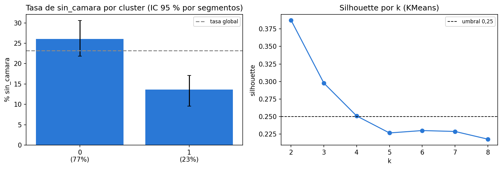
*Figura: Tasa de sin_camara por cluster con IC 95 % por segmentos (08). Archivo: `images/08_clusters_tasa.png`.*

**IsolationForest** marca 686 cajas atípicas (1 %) en 28 segmentos, con tasa de `sin_camara` de 80,3 % frente a 22,6 % en el resto.
**Lectura de negocio.** Usamos k = 4, que es una exploración y no el k elegido (el k elegido es 2): con k = 2 el cluster mayoritario promedia una tasa de 26,1 % y esconde un tramo mucho más alto, que solo aparece al separar más clusters. Con k = 4, el cluster «lejanos, poco densos y ocluidos» reúne 19,8 % de las cajas y tiene una tasa de 62,7 %: es el tramo de la cola de revisión donde cerca de 6 de cada 10 cajas no tienen par. Los clusters ayudan a explicar y comunicar, no a predecir: la probabilidad media del modelo en ese cluster (0,617) ya sigue su tasa.
**Límites.** Los clusters se calcularon con la población de 120°; el análisis con los segmentos de lluvia (post hoc, no pre-declarado) compara cajas con todos los frames contra train con solo los etiquetados y no es una comparación pareja (ver el [informe](docs/informe_tecnico_EP2.md#7-aprendizaje-no-supervisado-notebook-08-sección-d-y-exploración-con-k--3-y-4)).

## 10. Evaluación final en el test

> El resultado oficial pre-declarado es que el modelo no se distingue de la regla y que el punto A no se sostiene; que la caída frente a train se concentra en un segmento es una lectura post hoc, no pre-declarada.

| Método | AUC | PR-AUC | Captura@20 % | Fracción para 80 % |
|---|---|---|---|---|
| Regresión logística | 0,698 (0,503 a 0,961) | 0,565 (0,451 a 0,826) | 0,517 (0,364 a 0,887) | 0,774 (0,154 a 0,884) |
| Regla: menos puntos top | 0,684 (0,482 a 0,958) | 0,558 (0,430 a 0,795) | 0,503 (0,346 a 0,875) | 0,790 (0,148 a 0,883) |

Diferencia de Regresión logística menos la regla por puntos top: AUC +0,014 (IC -0,014 a +0,029) y Fracción para 80 % -1,7 puntos (IC -4,2 a +4,1): ambos IC incluyen 0 y «vale la pena» no se cumple.

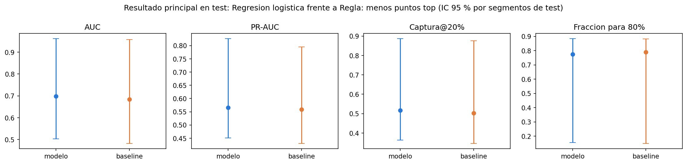
*Figura: Resultado principal en test: modelo frente a regla, con IC por segmentos de test (10). Archivo: `images/10_resultado_principal.png`.*

**Punto A** (corte fijado con train para un recall de 0,80; sostenido si el recall es al menos 0,75): 0 de 7 métodos lo sostienen.

| Método | Umbral | Recall | Precisión | % de cajas revisadas |
|---|---|---|---|---|
| Regla: menos puntos top | -24 | 0,590 (IC 0,383 a 0,924) | 0,414 (IC 0,303 a 0,567) | 33,1 % (IC 23,8 % a 39,7 %) |
| Regresión logística | 0,146 | 0,621 (IC 0,413 a 0,958) | 0,406 (IC 0,316 a 0,543) | 35,6 % (IC 25,7 % a 44,9 %) |

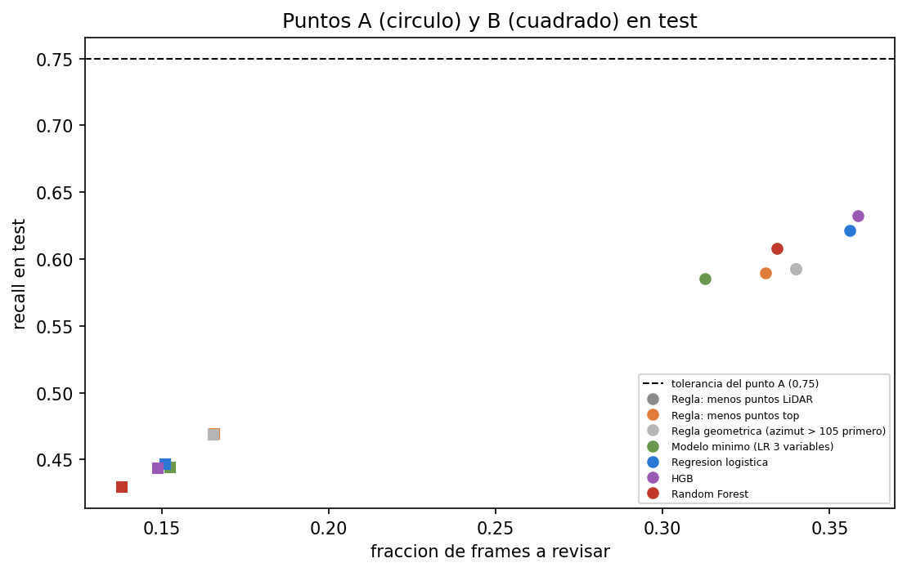
*Figura: Puntos de operación A y B de los siete métodos en test (10). Archivo: `images/10_puntos_de_operacion.png`.*

**Influencia.** Son 12 cálculos sobre los 8 segmentos de test: 1 con todos, 2 quitando cada uno de los dos más grandes, 1 quitando ambos y 8 quitando un segmento a la vez (los dos más grandes figuran también entre estos 8). La diferencia de AUC entre modelo y regla va de -0,004 a +0,020 y la de fracción para 80 % de -2,4 a +1,3 puntos; ningún segmento cambia el veredicto.

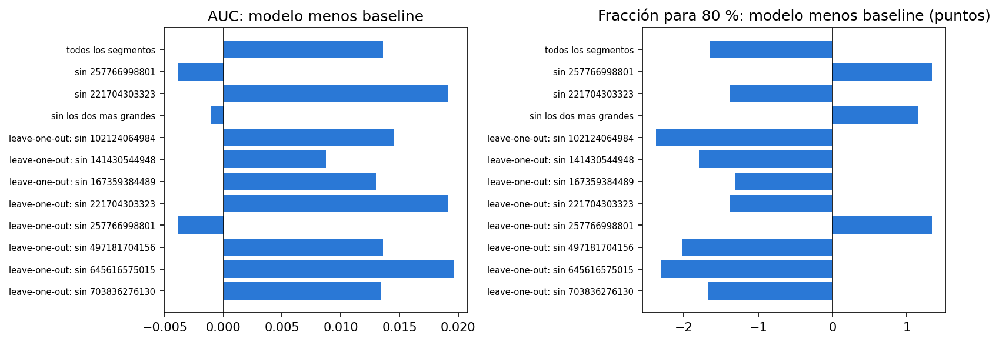
*Figura: Influencia de cada segmento en la comparación principal (10). Archivo: `images/10_influencia.png`.*

**Sensibilidad a 120° (secundaria, en el test).** Con la población ampliada (principal más la franja de 100 a 120°) el baseline adecuado es la regla geométrica, que ahí sí se distingue de la de puntos. El HGB y el Random Forest cumplen «vale la pena» frente a la regla por puntos top, pero no frente a la regla geométrica; la regresión logística no lo cumple frente a ninguna de las dos. El criterio «robusto» del plan (vale la pena en la población principal y en la de 120° frente al mejor baseline de cada una) da ninguno. Es una sensibilidad: no cambia el resultado principal.

| Método | Frente a | Dif. de AUC | Dif. de Fracción para 80 % (puntos) | ¿Vale la pena? |
|---|---|---|---|---|
| Regresión logística | Regla geométrica (azimut > 105 primero) | +0,005 (-0,054 a +0,042) | -8,5 (-10,1 a +14,3) | no |
| Regresión logística | Regla: menos puntos top | +0,072 (-0,012 a +0,124) | -14,7 (-20,7 a +2,4) | no |
| HGB | Regla geométrica (azimut > 105 primero) | +0,019 (+0,007 a +0,040) | -5,0 (-8,6 a +1,2) | no |
| HGB | Regla: menos puntos top | +0,085 (+0,062 a +0,117) | -11,3 (-18,3 a -4,2) | sí |
| Random Forest | Regla geométrica (azimut > 105 primero) | +0,015 (+0,003 a +0,046) | -4,6 (-12,6 a +3,4) | no |
| Random Forest | Regla: menos puntos top | +0,082 (+0,057 a +0,130) | -10,8 (-20,0 a -2,1) | sí |

**Equidad descriptiva** (regla top, sin pruebas de hipótesis; Night y Dawn/Dusk tienen un solo segmento de test). Sin el segmento 257766998801 (post hoc, no pre-declarado), el recall al punto A de la regla top pasa de 0,495 a 0,903 en Day y de 0,515 a 0,861 en San Francisco; las brechas por momento del día y por ubicación estaban confundidas con ese segmento (de día y de San Francisco).

<details>
<summary>Equidad descriptiva por grupo (test de EP2)</summary>

| Grupo | Segmentos (oficial) | Recall A oficial | Recall A sin el segmento (post hoc, no pre-declarado) |
|---|---|---|---|
| Dawn/Dusk | 1 | 1,000 | 1,000 |
| Day | 6 | 0,495 | 0,903 |
| Night | 1 | 0,854 | 0,854 |
| location_other | 2 | 0,946 | 0,946 |
| location_phx | 3 | 0,879 | 0,879 |
| location_sf | 3 | 0,515 | 0,861 |

</details>

**Por qué el test cae respecto de train.** El AUC de la regla pasa de 0,862 en train a 0,684 en el test oficial. El AUC agrupado del test mezcla segmentos muy distintos; sin el segmento 257766998801 (post hoc, no pre-declarado) es 0,931. En los modelos únicos del test no hay la penalización de mezclar cinco modelos de los folds, de modo que la comparación con train debe leerse con cuidado.

## 11. Hallazgo post hoc: el segmento anómalo y la auditoría por cámara

> *Post hoc, no pre-declarado:* un segmento de San Francisco de día concentra el problema y su cámara 3 (frontal der.) no tiene pares; la auditoría por cámara encuentra otro caso en train, pero con pocos casos no podemos estimar su frecuencia.

- **El segmento.** `257766998801` tiene 6.474 filas y 2.046 positivos (54,8 % de los del test). El AUC de la regla dentro del segmento es 0,443 y el de la regresión logística 0,459. El 54,8 % es la parte del segmento `257766998801` en los positivos del test (2.046 de 3.734); solo la celda de la cámara 3 de ese segmento explica el 35,8 % (1.338 de 3.734).
- **Cajas bien observadas sin par.** 936 de 2.046 cajas sin par tienen al menos 100 puntos LiDAR, frente a 1 de 1.688 en los otros 7 segmentos de test: la regla las ordena como si tuvieran par.
- **Cámaras.** La cámara 3 (frontal der.) tiene una tasa de pares de 0,000 dentro de su rango de azimut en ese segmento. La auditoría por cámara en 41 segmentos (criterios escritos después de ver el segmento y antes de calcular la auditoría) halla 2 pares (segmento, cámara) con hueco: uno en train (cámara 5 (lateral der.)) y uno en test; las celdas con hueco reúnen el 35,8 % de los positivos del test y el 1,7 % de train.
- **Sin el segmento (post hoc, no pre-declarado).** AUC de la regla 0,931 (IC 0,897 a 0,982), recall del punto A 0,879 (IC 0,858 a 0,967).

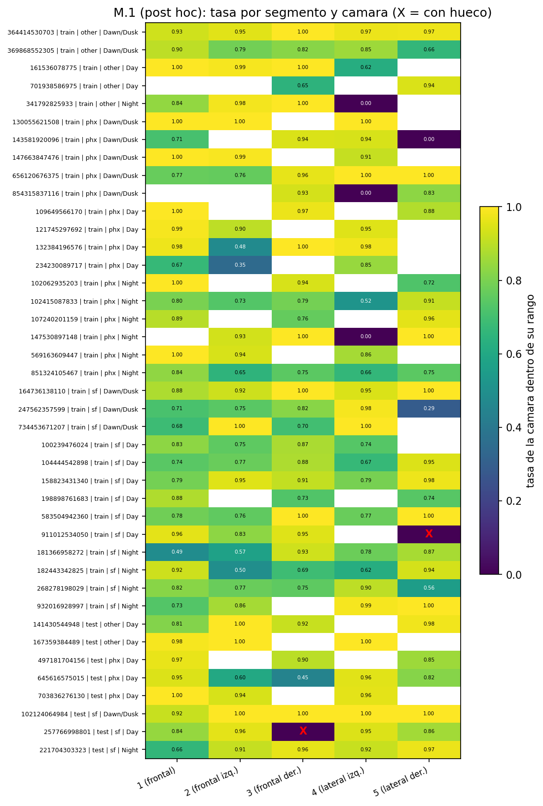
*Figura: Tasa de pares por segmento y cámara; X marca los pares con hueco (post hoc, no pre-declarado, 10). Archivo: `images/10_M_mapa_calor.png`.*

**Advertencias.** Los criterios del apéndice se escribieron después de ver el segmento, así que no confirman el hallazgo de forma independiente; los dos casos son de San Francisco de día; el hueco puede ser de etiquetado o de los datos de esa cámara y con estos archivos no se distingue; los rangos de azimut por cámara son empíricos.

## 12. Interpretación y recomendaciones

> Primero revisar cámara por cámara y después ordenar las cajas de las cámaras sanas con la regla por puntos top, siempre con una persona que revisa y decide.

1. **Nivel 1 (paso 1): auditar por segmento y cámara.** Produce la lista de pares (segmento, cámara) con hueco: para cada segmento nuevo, calcular la tasa de pares de cada cámara dentro de su rango de azimut y marcar las que caen muy por debajo de su mediana. Esas cámaras se atienden aparte, de una sola vez (hipótesis post hoc, no pre-declarada; requiere validación con `camera_calibration`).
2. **Nivel 2 (paso 2): priorizar cajas con la regla por puntos top.** Produce la lista de cajas a revisar, ordenadas por menos puntos LiDAR, solo en las cámaras sin hueco (sanas), con una persona en el circuito.

Se hace en ese orden porque en una cámara con hueco la regla se equivoca.

**Balance de objetivos** (metas de la [sección 2](#2-contexto-valor-de-negocio-objetivos-y-kpis); «sí» si pasan todos los chequeos, «no» si no pasa ninguno y «parcial» si pasan algunos; las metas de AUC y PR-AUC son las de train y se aplican también al test como referencia):

| Objetivo | Train (fuera de fold) | Test oficial | ¿Se cumple? |
|---|---|---|---|
| Objetivo 1 · Predecir `sin_camara` | AUC: regla top 0,862, LR 0,825 | AUC: regla top 0,684, LR 0,698 | parcial |
| Objetivo 2 · Reducir la fracción para 80 % frente al azar y a la regla | Regla top 37,8 % (IC 26,6 % a 46,7 %) frente a 80 % al azar | Regla top 79,0 % (IC 14,8 % a 88,3 %) | parcial |
| Objetivo 3 · Punto de operación con recall objetivo | Regla top: recall 0,806 con 37,9 % de las cajas | Regla top: recall 0,590 con 33,1 % de las cajas | parcial |
| Objetivo 4 · Estabilidad, calibración y equidad | AUC mínimo por fold: 0,821 (regla), 0,811 (LR) | Sin folds | parcial |

<details>
<summary>Detalle de cada objetivo (qué pasa y qué no pasa)</summary>

| Objetivo (sección 2) | Train (fuera de fold) | Test oficial | ¿Se cumple? |
|---|---|---|---|
| 1. Predecir `sin_camara` | AUC: regla top 0,862, LR 0,825; PR-AUC menos prevalencia: 0,497, 0,450 | AUC: regla top 0,684, LR 0,698; PR-AUC menos prevalencia: 0,326, 0,333 | parcial. Pasa: en train el AUC alcanza la meta de 0,70 (regla top 0,862; LR 0,825); en train la diferencia entre PR-AUC y prevalencia alcanza la meta de 0,10 (regla top 0,497; LR 0,450); en test la diferencia entre PR-AUC y prevalencia alcanza la meta de 0,10 (regla top 0,326; LR 0,333); no pasa: en test el AUC queda bajo la meta de 0,70 (regla top 0,684; LR 0,698). |
| 2. Reducir la fracción para 80 % frente al azar y a la regla | Regla top 37,8 % (IC 26,6 % a 46,7 %) frente a 80 % al azar; LR 43,7 % | Regla top 79,0 % (IC 14,8 % a 88,3 %); LR menos regla -1,7 puntos (IC -4,2 a +4,1) | parcial. Pasa: en train la regla top necesita revisar el 37,8 % de las cajas (IC 26,6 % a 46,7 %), por debajo del 80 % del azar; no pasa: en test el IC de la regla top (14,8 % a 88,3 %) no queda por debajo del 80 % del azar; ningún modelo cumple «vale la pena» frente a la regla, ni en train (3 modelos) ni en test (4 modelos, incluido el modelo mínimo). |
| 3. Punto de operación con recall objetivo | Regla top: recall 0,806 con 37,9 % de las cajas; LR 0,810 | Regla top: recall 0,590 con 33,1 % de las cajas; LR 0,621 | parcial. Pasa: en train el corte A se fijó con un recall sobre el objetivo de 0,80 (regla top 0,806; LR 0,810); no pasa: en test el recall del punto A queda bajo el mínimo de 0,75 (regla top 0,590; LR 0,621). |
| 4. Estabilidad, calibración y equidad | AUC mínimo por fold: 0,821 (regla), 0,811 (LR); mediana por segmento: 0,890, 0,888; ECE con Platt 0,013; 2 brechas con IC, ninguna excluye 0 | Sin folds; mediana por segmento: 0,903, 0,885; ECE con Platt congelado 0,080; brechas descriptivas, sin IC | parcial. Pasa: en train el AUC mínimo por fold alcanza 0,75 (regla top 0,821; LR 0,811); en train la mediana del AUC por segmento alcanza 0,80 (regla top 0,890; LR 0,888); en test la mediana del AUC por segmento alcanza 0,80 (regla top 0,903; LR 0,885); en train el ECE con Platt es 0,013, dentro del máximo de 0,05; en train las brechas por momento del día y ubicación se calcularon con su IC (2 brechas; ninguna excluye 0); no pasa: en test el ECE con Platt es 0,080, sobre el máximo de 0,05; en test las brechas son descriptivas y no llevan IC. |

</details>

**Qué esperar.** Con el corte A: en train, recall 0,806 (IC 0,760 a 0,869) revisando 37,9 % de las cajas; en el test oficial, recall 0,590 (IC 0,383 a 0,924) revisando 33,1 %. Con el corte B (20 % de revisión): recall 0,469 (IC 0,331 a 0,783) en test.

- **Monitoreo.** Vigilar el recall por segmento (no solo el promedio), la tasa de `sin_camara` y la tasa de pares de cada cámara; recalibrar el corte si el recall por segmento baja de 0,75.
- **Datos que ayudarían.** `camera_calibration` (validar el borde de 100° y los rangos por cámara), más segmentos, más ciclistas y etiquetas por cámara.

> **Lo que NO afirmamos.** Que `sin_camara` mida visibilidad física; que el resultado generalice más allá de 8 segmentos de test; nada sólido sobre ciclistas ni sobre Night y Dawn/Dusk (un segmento cada uno); que el hueco de cámara sea de etiquetado y no de los datos de esa cámara; ni que un modelo supere a la regla, porque con el criterio fijado antes no ocurrió.

> **Lo que tampoco afirmamos en EP3.** La frecuencia ni la causa de los huecos de cámara, ni que la solución generalice más allá de los 41 segmentos de desarrollo y de los 4 segmentos nuevos de la prueba de funcionamiento (sección 16, sin validación estadística).

### 12.1 Solución elegida y justificación (IE12)

> La solución elegida es la regla «menos puntos top» en dos pasos (auditar cámaras y luego ordenar la cola), porque ninguna alternativa más compleja la supera de forma distinguible.

Los criterios se fijaron antes de ver resultados ([`plan_v3.md`](artefactos_ep3/plan_v3.md)): O1 AUC mínimo y PR-AUC sobre la prevalencia; O2 «vale la pena» frente a la regla; O3 recall mínimo en el punto A; O4 estabilidad por fold y calibración.

| Alternativa | O1 | O2 | O3 | O4 | Dif. AUC frente a la regla (IC) | Veredicto |
|---|---|---|---|---|---|---|
| Regla de una línea (puntos del sensor superior) | sí | no | sí | no | referencia | elegida (la más simple) |
| Regresión logística con 3 variables | sí | no | sí | no | -0,015 (-0,022 a -0,003) | peor que la regla |
| Regresión logística con 16 variables | sí | no | sí | no | -0,026 (-0,038 a -0,004) | peor que la regla |
| Random Forest | sí | no | sí | no | -0,025 (-0,048 a -0,004) | peor que la regla |
| HistGradientBoosting | sí | no | sí | no | -0,028 (-0,044 a -0,010) | peor que la regla |
| XGBoost | sí | no | sí | no | -0,023 (-0,039 a -0,004) | peor que la regla |
| LightGBM | sí | no | sí | no | -0,028 (-0,044 a -0,009) | peor que la regla |
| E1 · voto suave | sí | no | sí | no | -0,020 (-0,033 a -0,002) | peor que la regla |
| E2 · promedio de rangos con la regla | sí | no | sí | no | +0,001 (-0,005 a +0,008) | no distinguible de la regla |
| E3 · apilamiento de cinco modelos | sí | no | sí | no | -0,034 (-0,047 a -0,017) | peor que la regla |
| E4 · apilamiento por tres vistas | sí | no | sí | no | -0,050 (-0,073 a -0,024) | peor que la regla |
| Versión de un paso (brazo A) | — | — | — | — | — | fracción para 80 %: 44,6 % |
| Versión de dos pasos (brazo C) | — | — | — | — | — | fracción para 80 %: 29,6 % (en muestra: 41 segmentos, parámetros del detector ajustados con los mismos datos) |

Fuente: [`f6_tabla_seleccion.csv`](artefactos_ep3/f6_tabla_seleccion.csv) y [`f6_seleccion.json`](artefactos_ep3/f6_seleccion.json). Ningún candidato cumple O4 (el fold 0, ver 8.3) y ninguno cumple O2.

**Qué decidimos y por qué.** Ningún candidato cumple O4 (regla de reserva DEV-2); entre los 11 candidatos que cumplen O1 y O3, el mejor AUC OOF es 0,824; los que quedan a menos de 0,010 son Regla top, E2; el más simple es Regla top. Aplicamos una regla de reserva (DEV-2, post hoc, no pre-declarada): el plan manda elegir entre los que cumplen O1, O3 y O4, pero nadie cumple O4, así que elegimos por simplicidad entre los que cumplen O1 y O3 y declaramos la estabilidad como limitación de todos.
**Por qué es la óptima.** Empata en desempeño con todo lo más complejo, se explica en una línea, no tiene hiperparámetros que se desajusten y es auditable caja por caja. Frente a los objetivos de negocio (en muestra: 41 segmentos, parámetros del detector ajustados con los mismos datos; post hoc, no pre-declarado; sin validación con datos nuevos): con un presupuesto del 20 %, se encuentran 70,9 de cada 100 cajas sin pareja en dos pasos frente a 61,9 en uno, y para el 80 % se revisa el 29,6 % en vez del 44,6 %; con 20 s por caja (supuesto) son 132 h en vez de 358 h sin orden. El punto de equilibrio es 6.059 cajas por auditoría: no inventamos un costo de auditar.
**Por qué no un modelo más complejo.** Probamos cinco algoritmos, una regresión logística de tres variables y cuatro ensambles (uno de ellos con la regla): ninguno cumple O2 y todos salvo E2 quedan significativamente peores que la regla en AUC. Un modelo más complejo cuesta mantenimiento, explicación y riesgo de sobreajuste con 41 segmentos, sin una mejora medible que lo pague.

## 13. Ética, sesgos y privacidad

> Usamos solo cajas 3D y tablas de pares, con licencia que prohíbe redistribuir, y el principal riesgo ético no es la privacidad sino el uso: esto no es una alerta de seguridad.

- **Privacidad.** Usamos `lidar_box` y `camera_to_lidar_box_association`, sin imágenes. Según el notebook 05 no hay identificadores directos; el riesgo es la reidentificación indirecta (`key.laser_object_id` más la marca de tiempo), por eso esos campos no son variables del modelo. El 05 indica que la licencia es no comercial y prohíbe redistribuir, y por eso `data/` está en `.gitignore`.
- **Sesgos medidos.** Ubicación, momento del día y ciclistas (informe, secciones 9 y 11; en train el recall del punto A de la regresión logística es 0,790 en San Francisco y 0,914 en Phoenix). Las brechas por momento del día y por ubicación del test oficial estaban confundidas con un solo segmento (post hoc, no pre-declarado); las cifras están en la [sección 10](#10-evaluación-final-en-el-test).
- **Riesgo de uso.** `sin_camara` es cobertura de etiquetado, no visibilidad física: una persona revisa; nunca se decide nada dentro de un vehículo con esto.

**La aplicación (Lente).** Procesa tablas derivadas por caja (identificadores de objeto y marcas de tiempo, sin imágenes). «Puntuar datos nuevos» trabaja en memoria y no guarda los archivos que se suben; hoy corre solo en `localhost`. Al desplegarla cambia el supuesto: el servidor recibe los archivos, así que no deben subirse datos que no puedan compartirse con él, y la licencia no comercial de Waymo exige no redistribuir datos. Los textos para el modo publicado (`MODO_DESPLIEGUE`) son borradores sin activar. Decidir qué datos viajan sigue pendiente (sección 16).

## 14. Estructura del repositorio, reproducción y pruebas

> Todo se regenera con scripts desde datos derivados; los archivos `lidar_box` originales de Waymo no se distribuyen; el zip lleva solo el subconjunto derivado y las tablas de asociación, para uso académico del docente.

```
waymo-evaluacion/
├── .streamlit/    configuración y tema de la página
├── app/           la aplicación Lente (Streamlit)
├── artefactos_ep3/ tablas agregadas, manifests y planes de EP3 (versionables)
├── conf/          catálogo y parámetros de Kedro
├── data/          (fuera de git) 01_raw a 09_app_ep3: datos, modelos y tablas; 06_models hace de models/ (EP2 congelado, EP3 en 06_models_ep3)
├── datos_demo/    (fuera de git) segmentos nuevos reales para la demostración en vivo
├── docs/          informes, planes y guías; ep3/ (informe técnico, plan v3, estado) y seleccion_segmentos/
├── images/        figuras con el número del notebook que las genera; app/ (capturas del README) y ep3/
├── notebooks/     notebooks 00 a 15 (tabla siguiente)
├── scripts/       scripts de EP2 (informe, README, mediciones) y ep3/ (datos, detector, ajuste, página, demostración, README)
├── src/           paquete waymo_evaluacion (pipelines de Kedro y ep3/)
├── tests/         pruebas de EP1, EP2 y del README; ep3/ (página, detector, selección) y pipelines/
├── Dockerfile, docker-compose.yml, .dockerignore, requirements.txt, requirements_app.txt, requirements_ep3.txt, constraints_ep3.txt, pyproject.toml, .gitignore: imagen de la aplicación, entornos (EP2, aplicación, EP3, versiones fijadas) y reglas de git
├── README.md, CLAUDE.md, entrega_EP2.zip, entrega_EP3.zip, entrega_EP3.sha256: este archivo (lo genera scripts/generar_readme.py), instrucciones del asistente y (fuera de git) los paquetes entregados
```

**Notebooks.** 00 a 05 (EP1), 06 (de EP1, prepara EP2), 07 a 10 (EP2) y 11 a 15 (EP3), más dos «00b» de selección de segmentos que se corren en Colab. La columna «Orden» es el orden recomendado; para reproducir el resultado oficial de EP2 basta el 10 (sección 14) y para EP3 los notebooks 11 a 15 leen lo que dejan `scripts/ep3/`.

| Orden | Notebook | Etapa | Qué hace | Ejecución (según los archivos y los registros) |
|---|---|---|---|---|
| 1 | [`00_exploracion_bucket_waymo.ipynb`](notebooks/00_exploracion_bucket_waymo.ipynb) | EP1 | explora el bucket de Waymo v2 con gsutil desde Colab y elige segmentos | Colab; sin salidas guardadas (no se ejecuta aquí) |
| 2 | [`01_exploracion_csv.ipynb`](notebooks/01_exploracion_csv.ipynb) | EP1 | exploración y calidad del CSV sintético del docente | salidas guardadas (34 de 42 celdas); sin registro de re-ejecución |
| 3 | [`02_exploracion_waymo.ipynb`](notebooks/02_exploracion_waymo.ipynb) | EP1 | exploración de datos reales de Waymo v2 | salidas guardadas (15 de 16 celdas); sin registro de re-ejecución |
| 4 | [`03_fuentes_y_colaboracion.ipynb`](notebooks/03_fuentes_y_colaboracion.ipynb) | EP1 | fuentes de datos, licencias y acuerdo de trabajo del equipo (IE1) | salidas guardadas (9 de 10 celdas); sin registro de re-ejecución |
| 5 | [`04_estructuras_y_almacenamiento.ipynb`](notebooks/04_estructuras_y_almacenamiento.ipynb) | EP1 | listas frente a NumPy, tipos de columna y CSV frente a Parquet (IE2) | salidas guardadas (12 de 12 celdas); sin registro de re-ejecución |
| 6 | [`05_etica_sesgos_privacidad.ipynb`](notebooks/05_etica_sesgos_privacidad.ipynb) | EP1 | ética, sesgos y privacidad de las fuentes (IE4) | salidas guardadas (12 de 13 celdas); sin registro de re-ejecución |
| 7 | [`00b_seleccion_segmentos_ep2.ipynb`](notebooks/00b_seleccion_segmentos_ep2.ipynb) | EP2 | mide y selecciona los segmentos de EP2 (ampliación de 4 a 41) | salidas guardadas (23 de 25 celdas, Colab) |
| 8 | [`06_eda_y_preparacion_modelamiento.ipynb`](notebooks/06_eda_y_preparacion_modelamiento.ipynb) | EP1 a EP2 | EDA ampliado con los 41 segmentos; prepara EP2 | salidas guardadas (23 de 24 celdas); sin registro de re-ejecución |
| 9 | [`07_decision_target_ep2.ipynb`](notebooks/07_decision_target_ep2.ipynb) | EP2 | por qué EP2 usa `sin_camara` como target | salidas guardadas (61 de 62 celdas); sin registro de re-ejecución |
| 10 | [`08_analisis_observabilidad_sin_camara.ipynb`](notebooks/08_analisis_observabilidad_sin_camara.ipynb) | EP2 | variables, geometría de cámaras y aprendizaje no supervisado de EP2 | salidas guardadas (30 de 31 celdas); sin registro de re-ejecución |
| 11 | [`09_modelos_supervisados_sin_camara.ipynb`](notebooks/09_modelos_supervisados_sin_camara.ipynb) | EP2 | baselines y modelos con búsqueda anidada por segmento | reentrenado en copia limpia: un umbral del Random Forest cambió en el último decimal (sección 14) |
| 12 | [`09b_enmiendas_plan_test_v2.ipynb`](notebooks/09b_enmiendas_plan_test_v2.ipynb) | EP2 | enmiendas al plan de evaluación del test (v2) | salidas guardadas (6 de 6 celdas); sin registro de re-ejecución |
| 13 | [`10_evaluacion_final_sin_camara.ipynb`](notebooks/10_evaluacion_final_sin_camara.ipynb) | EP2 | evaluación final en el test congelado y hallazgo post hoc | verificado: reproducido en copia limpia con 15 CSV idénticos por sha256 (sección 14) |
| 14 | [`11_ep3_datos_y_deteccion.ipynb`](notebooks/11_ep3_datos_y_deteccion.ipynb) | EP3 | datos de desarrollo (41 segmentos) y detector de huecos | ejecutado con nbconvert (DEC-70 de `docs/ep3/ESTADO.md`) |
| 15 | [`12_ep3_tuning_y_ensambles.ipynb`](notebooks/12_ep3_tuning_y_ensambles.ipynb) | EP3 | hiperparámetros y ensambles (IE9 e IE10) | ejecutado con nbconvert (DEC-70) |
| 16 | [`13_ep3_generalizacion_y_seleccion.ipynb`](notebooks/13_ep3_generalizacion_y_seleccion.ipynb) | EP3 | generalización y selección (IE11 e IE12) | ejecutado con nbconvert (DEC-70) |
| 17 | [`14_ep3_dos_pasos_y_app.ipynb`](notebooks/14_ep3_dos_pasos_y_app.ipynb) | EP3 | solución en dos pasos y la aplicación | ejecutado con nbconvert (DEC-70); no se puede volver a ejecutar en una copia (lee un lidar_box crudo) |
| 18 | [`15_ep3_no_supervisado.ipynb`](notebooks/15_ep3_no_supervisado.ipynb) | EP3 | aprendizaje no supervisado (descriptivo, post hoc) | ejecutado con nbconvert (DEC-70) |
| 19 | [`00b_seleccion_segmentos_ep3.ipynb`](notebooks/00b_seleccion_segmentos_ep3.ipynb) | EP3 | selección sellada de los segmentos nuevos de la validación externa | Colab; sin salidas guardadas: la validación externa no se ha ejecutado |

**El paquete `entrega_EP2.zip`.** Lo arma `scripts/empaquetar_entrega.py` y queda en la raíz del repositorio (carpeta interior `waymo-evaluacion-EP2/`), unos 120 MB. No está en git, porque figura en `.gitignore` (es un archivo grande y `data/` se ignora por la licencia no comercial de Waymo), así que se entrega aparte del repositorio, por el AVA / Moodle del curso MLY1101 (DuoC UC).

Trae el código, los notebooks ejecutados, `docs/`, `images/` y los datos derivados mínimos para re-ejecutar (`data/05_model_input`, `data/06_models`, `data/08_reporting` y las predicciones). El zip incluye datos derivados y las tablas `camera_to_lidar_box_association` y `waymo_con_target.parquet`, solo para uso académico del docente, y no debe redistribuirse ni publicarse (licencia no comercial de Waymo).

**Reproducir el resultado oficial: ejecutar el notebook 10 con los modelos congelados.** Python 3.10.11 (probado); con otras versiones puede haber diferencias. Se crea un kernel propio dentro del entorno para que Jupyter no use otro Python de la máquina. Windows (Git Bash o PowerShell):

```
python -m venv .venv
.venv/Scripts/python.exe -m pip install -r requirements.txt
.venv/Scripts/python.exe -m ipykernel install --prefix .venv --name ep2
.venv/Scripts/python.exe -X utf8 scripts/verificar_congelados.py
.venv/Scripts/python.exe -m nbconvert --to notebook --execute --inplace --ExecutePreprocessor.kernel_name=ep2 notebooks/10_evaluacion_final_sin_camara.ipynb
.venv/Scripts/python.exe -X utf8 scripts/generar_informe_tecnico.py
.venv/Scripts/python.exe -X utf8 scripts/generar_readme.py
```

Linux y Mac (no los probamos): los mismos pasos con el ejecutable del entorno (`generar_informe_tecnico.py` y `generar_readme.py` se ejecutan igual con `.venv/bin/python`):

```
python3 -m venv .venv && .venv/bin/python -m pip install -r requirements.txt
.venv/bin/python -m ipykernel install --prefix .venv --name ep2
.venv/bin/python scripts/verificar_congelados.py
.venv/bin/python -m nbconvert --to notebook --execute --inplace --ExecutePreprocessor.kernel_name=ep2 notebooks/10_evaluacion_final_sin_camara.ipynb
```

`verificar_congelados.py` comprueba los sha256 del plan v2 antes de ejecutar el 10, que hace la misma comprobación. En la verificación en copia limpia, el 10 dio los 15 CSV idénticos por sha256 a los de la primera ejecución; repetirlo es una re-ejecución sobre el test, no una evaluación nueva.

- **Reentrenar (opcional; no hace falta para el resultado oficial).** Los notebooks 08 (variables), 09 (modelos) y 09b (plan v2) se pueden volver a ejecutar, pero **sobrescriben** `data/05_model_input` y `data/06_models`, incluidos los modelos y el plan congelados. Hay que hacerlo en una copia (descomprimir el zip en otra carpeta), con los mismos comandos `nbconvert` sobre `notebooks/08_analisis_observabilidad_sin_camara.ipynb`, `notebooks/09_modelos_supervisados_sin_camara.ipynb` y `notebooks/09b_enmiendas_plan_test_v2.ipynb`, en ese orden.
- **Advertencia sobre el sha256:** en la verificación en copia limpia, el 09 reentrenó los modelos con archivos idénticos, pero un umbral del Random Forest cambió en el último decimal; el sha256 de `hiperparametros_B.json` dejó de coincidir con el del plan y el 09b y el 10 se detuvieron. Si se reentrena, hay que devolver los archivos congelados antes del 10.
- **Desde datos crudos:** descargar los segmentos de Waymo (licencia no comercial) y ejecutar `kedro run`, como se explica en el [README de EP1](docs/README_EP1.md).

**Pruebas y cobertura** (`scripts/medir_pruebas.py`): 81 pasadas, 0 falladas, 0 omitidas; cobertura total 92,7 %. Se ejecutan con `.venv/Scripts/python.exe -m pytest -q` (Linux y Mac: `.venv/bin/python -m pytest -q`); las del informe y del README se omiten si faltan los archivos de `data/`. Cubren los nodos de ingesta y preprocesamiento, el informe y este README. **Ignorado por git:** `data/**`, `data/01_raw/waymo_real/`, `data/02_intermediate/*`, `data/03_primary/*`, `data/04_feature/*`, `data/01_raw/waymo/`, `entrega_EP2.zip`.

**Remedición de las pruebas de EP2** (2026-11-24 20:35, en una copia temporal del repositorio, `pytest --ignore=tests/ep3`): 81 pasadas, 0 falladas, 0 omitidas. La cobertura de EP2 sigue siendo la medida en EP2, arriba: en la copia el paquete se importa del repositorio real y la medición no sería fiable.
**Pruebas de EP3.** 415 pruebas recolectadas en `tests/ep3` (`scripts/ep3/contar_pruebas.py`); última corrida (2026-11-24 20:38, `scripts/ep3/medir_pruebas_ep3.py`): 415 pasadas, 0 falladas, 0 omitidas, cobertura de `src/waymo_evaluacion/ep3` 86,5 %. Comando: `.venv\Scripts\python.exe -m pytest tests/ep3 -q --no-cov -p no:cacheprovider`.

## 15. Mapa de la pauta, referencias, equipo y limitaciones

> Cada indicador de la pauta de EP2 tiene su lugar en el README, el informe y los notebooks, y cada entregable tiene su archivo.

El mapa completo de EP3 y de la Evaluación Final (IE1 a IE12, con sus pesos) está al inicio de este README; esta sección conserva el de EP2. La pauta de EP2 es la de «Evaluación Parcial N°2» de MLY1101 Machine Learning (archivo «EP2_Instrucciones y Pauta PRESENTACIÓN_Estudiante.pdf»): actividad grupal con defensa individual, ponderación de 40 % y presentación de 10 minutos; la defensa no es un archivo, así que no aparece en las tablas.

| Indicador de la pauta | Ponderación | README | Informe | Notebooks |
|---|---|---|---|---|
| IE5: Aplicación de la metodología para el desarrollo del modelo | 20 % | Secciones 2 a 7 | 2 a 6 (CRISP-DM en la 4) | 06 a 08 |
| IE6: Construcción de modelos de aprendizaje supervisado | 30 % | Secciones 8 y 10 | 8 y 9 | 09, 09b y 10 |
| IE7: Implementación de modelos de aprendizaje no supervisado | 30 % | Sección 9 | 7 | 08 |
| IE8: Interpretación del desempeño del modelo | 20 % | Secciones 10 a 13 | 10 a 12 | 10 y 05 |

| Entregable de la pauta | Dónde está |
|---|---|
| Informe técnico en Markdown (.md), como un README reproducible, con problema de negocio, objetivos, KPIs, fuentes de datos, preparación y EDA, y metodología CRISP-DM | [`docs/informe_tecnico_EP2.md`](docs/informe_tecnico_EP2.md) (problema, objetivos y KPIs: sección 2; fuentes, preparación y EDA: 3 y 6; CRISP-DM: 4) y este README (secciones 2 a 7) |
| Notebook .ipynb documentado, organizado y ejecutable, que reproduce las etapas del informe | [`notebooks/`](notebooks): una serie numerada (00 a 10) y no un único archivo; el 10 reproduce el resultado oficial (sección 14) |
| Datos y archivos complementarios para ejecutar de nuevo sin modificaciones | `entrega_EP2.zip` (sección 14); los archivos `lidar_box` originales de Waymo no se distribuyen; el zip lleva solo el subconjunto derivado y las tablas de asociación, para uso académico del docente |
| Carpeta organizada (`data/`, `notebooks/`, `models/`, `images/`, `README.md`) | `data/`, `notebooks/`, `images/` y `README.md` en la raíz; `models/` equivale a `data/06_models` por la convención de Kedro; además `conf/`, `src/`, `scripts/`, `tests/` y `docs/` |

**Referencias.**

- Sun, P., et al. (2020). Scalability in Perception for Autonomous Driving: Waymo Open Dataset. CVPR 2020. arXiv:1912.04838. https://arxiv.org/abs/1912.04838
- página oficial del dataset: https://waymo.com/open/about/
- NHTSA, publicaciones 813727 y 813818 (2023), usadas en el 07 solo como contexto: https://crashstats.nhtsa.dot.gov/Api/Public/ViewPublication/813727; https://crashstats.nhtsa.dot.gov/Api/Public/ViewPublication/813818

**Equipo.** Maicol Hernández (rama `maicolhernandez`) y Francis Moya (rama `francismoya`). **Curso:** MLY1101.
**Limitaciones.** 8 segmentos de test, pocos ciclistas, un segmento concentra el problema, rangos de azimut por cámara empíricos y causa del hueco de cámara no distinguible; más en la [sección 12 del informe](docs/informe_tecnico_EP2.md#12-limitaciones-y-desviaciones-del-plan).

## 16. Lente: la aplicación y su despliegue

> Lente convierte el resultado en una herramienta de trabajo: un supervisor ve qué cámaras tienen huecos, un analista revisa la cola en orden y una persona siempre decide.

**Qué es y para quién.** Una aplicación Streamlit para supervisores de cámaras y analistas que manejan cientos de segmentos al día. Sigue el flujo en dos pasos y no etiqueta ni borra nada:

```
 segmentos nuevos --> 1 · Filtro: detector de huecos --> celdas marcadas (se auditan aparte)
                              |
                              +--> 2 · Priorización: regla de puntos top --> cola ordenada --> una persona revisa y decide
```

| Página | Qué responde | A quién sirve | Evidencia que muestra |
|---|---|---|---|
| Resumen | Estado de las cámaras del día y las primeras cajas de la cola | quien abre la herramienta a diario | Indicadores, alertas de cámara y cola prioritaria |
| Auditoría de cámaras | Qué cámaras tienen huecos en qué segmentos; esas celdas se atienden aparte de la cola. | supervisores de cámaras | Mapa de calor segmento por cámara y celdas marcadas |
| Cola de revisión | Qué cajas revisar y en qué orden. Se revisa de arriba hacia abajo. | analistas que revisan cajas | Curvas de captura y lista descargable en CSV |
| Validación | Qué se probó para elegir la regla, qué tan bien funciona y qué falta por demostrar. | quien decide si se confía en la regla | Resultados con IC, alternativas, ensambles y tablas de apoyo |
| Explica una caja | Cambiando los datos de una caja se ve qué lugar ocuparía en la cola y si se revisaría. | analistas que dudan de una caja | Lugar que ocuparía la caja en la cola y si se revisaría |
| Puntuar datos nuevos | Puntúa un segmento nuevo en memoria y entrega sus celdas marcadas y su cola | quien recibe segmentos nuevos | Resultado descargable; no se guarda nada |
| Ética y límites | Ficha del sistema: propósito, datos, desempeño, límites, consideraciones éticas y entorno de ejecución. | quien audita el uso del sistema | Propósito, datos, desempeño, límites y dónde corre |
| Ayuda y glosario | Flujo de revisión, glosario y preguntas frecuentes. | quien usa la herramienta por primera vez | Tres pasos, glosario con buscador y preguntas frecuentes |

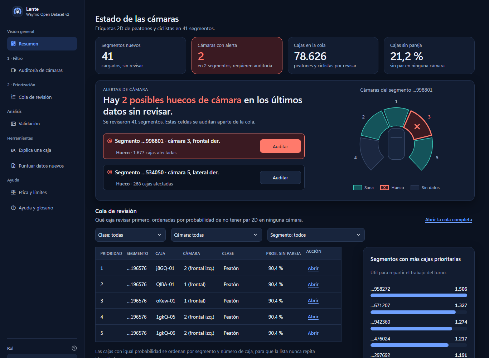
*Figura: Resumen de Lente: indicadores, alertas de cámara y cola prioritaria. Archivo: `images/app/lente_resumen.png`.*

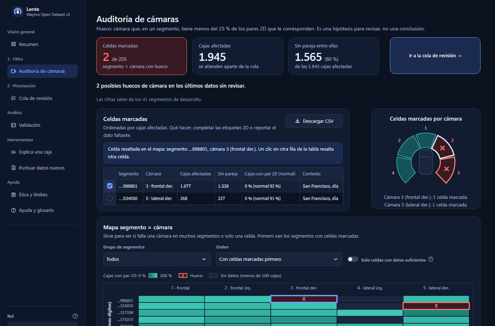
*Figura: Auditoría de cámaras: mapa de calor segmento por cámara y celdas marcadas. Archivo: `images/app/lente_auditoria.png`.*

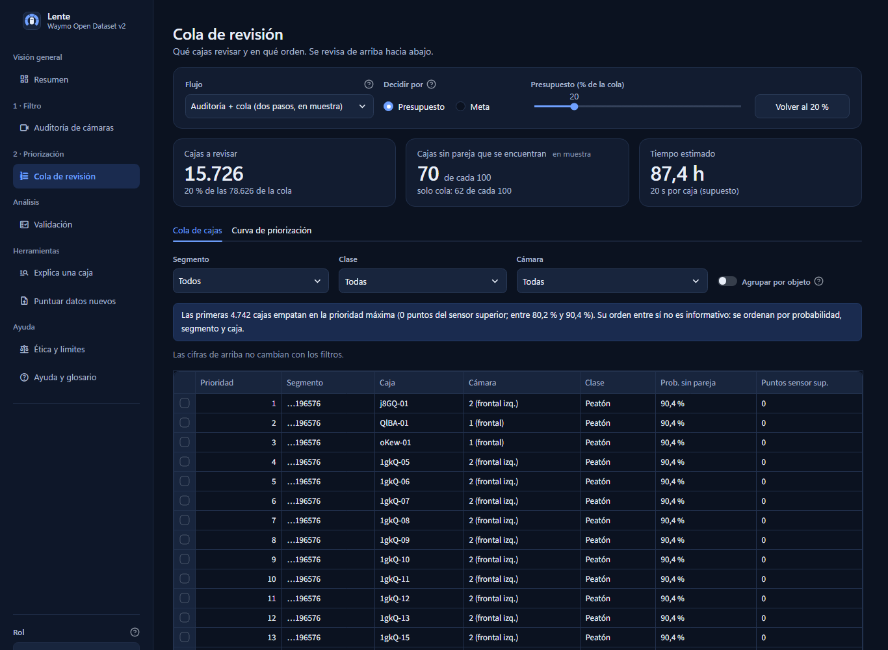
*Figura: Cola de revisión: tarjetas, curva de captura y lista de cajas. Archivo: `images/app/lente_cola.png`.*

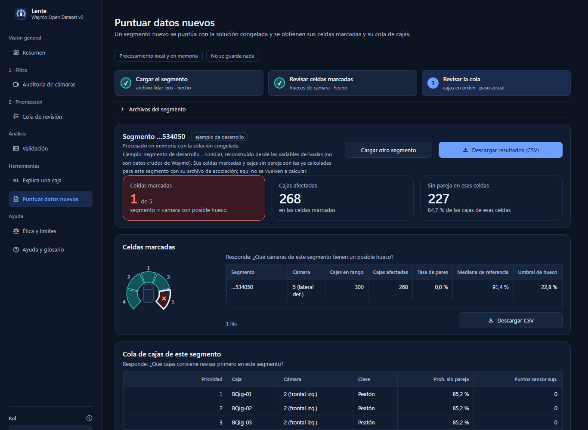
*Figura: Puntuar datos nuevos con el segmento de desarrollo de ejemplo y su celda marcada. Archivo: `images/app/lente_puntuar_ejemplo.png`.*

**Cifras de la app** (calculadas por las mismas funciones que muestra la página; son de desarrollo, en muestra: 41 segmentos, parámetros del detector ajustados con los mismos datos; post hoc, no pre-declarado; sin validación con datos nuevos):

| Cifra | Valor |
|---|---|
| Segmentos de desarrollo | 41 |
| Cajas de peatones y ciclistas (población principal) | 80.571 |
| Celdas segmento × cámara | 205 |
| Celdas marcadas por el detector | 2 |
| Cajas en las celdas marcadas | 1.945 |
| Cajas en la cola | 78.626 |

**Ejecutarla.** `.venv\Scripts\python.exe app\lanzar.py --server.address localhost --server.port 8501 --browser.gatherUsageStats false` (o `scripts\ep3\arrancar_app.bat`); escucha solo en `localhost`.

### Prueba con segmentos nuevos

Se puntuaron en la aplicación 4 segmentos reales **nuevos** (split `validation` del bucket de Waymo v2; los 41 de desarrollo y los candidatos del plan sellado son del split `training`), con sus archivos originales sin modificar. Los resultados salen de las mismas funciones que usa la página y están en [`docs/ep3/prueba_segmentos_nuevos.json`](docs/ep3/prueba_segmentos_nuevos.json), junto con el sha256 de cada archivo de entrada.

| Segmento | ID en la página | Cajas puntuadas | Celdas marcadas | Detalle de la celda marcada |
|---|---|---|---|---|
| `10689101165701914459_2072_300_2092_300` | …011657 | 938 | 0 | — |
| `13356997604177841771_3360_000_3380_000` | …976041 | 7.854 | 0 | — |
| `16229547658178627464_380_000_400_000` | …476581 | 3.161 | 1 | 5 (lateral der.): 225 cajas en el rango, 197 afectadas, 175 sin pareja (88,8 %), tasa de pares 0,0 % frente a una mediana de referencia de 91,4 % (umbral 22,8 %) |
| `2551868399007287341_3100_000_3120_000` | …839900 | 5.314 | 0 | — |

- Es una **prueba de funcionamiento**, no una validación estadística. Con 4 segmentos no se estima la frecuencia de los huecos.
- 1 de 4 segmentos nuevos trae un **posible hueco** de cámara, del mismo tipo que los dos casos de desarrollo (cámara 5 (segmento …534050) y cámara 3 (segmento …998801)). Con estos archivos no se distingue si es un problema de etiquetado o de los datos de esa cámara.
- Los parámetros del detector son los congelados en v3 ([`detector_params_v3.json`](artefactos_ep3/detector_params_v3.json)); no se reajustaron. La validación externa sellada ([`plan_seleccion_ep3.json`](artefactos_ep3/plan_seleccion_ep3.json)) sigue sin ejecutarse; es independiente de esta prueba.
**Cómo se hace en vivo.** En «Puntuar datos nuevos» se cargan los dos archivos del segmento (el 1, `lidar_box`, y el 2, `camera_to_lidar_box_association`, en cualquier orden) y se pulsa **«Puntuar segmento»**. Sin el archivo 2 se puntúa igual, pero el paso «Revisar celdas marcadas» sale «omitido» y no se buscan huecos. Los archivos viven en `datos_demo/`, que no se versiona ni va en la imagen.
**Despliegue en AWS Academy.** Estado: **en preparación** (modo `local`, registrado el 2026-11-24; archivo [`docs/despliegue.json`](docs/despliegue.json), que este README lee). La licencia de Waymo es no comercial y sin redistribución: antes de publicar hay que decidir qué datos viajan (la aplicación usa `cajas_oof.parquet`, derivado por caja con identificadores y marcas de tiempo; [`f36_verificacion_despliegue.json`](docs/ep3/f36_verificacion_despliegue.json)). Guía y textos del modo publicado: [`despliegue.md`](docs/ep3/despliegue.md).
**Fase 6 de CRISP-DM.** La aplicación es el despliegue de la sección [7](#7-metodología-crisp-dm). Informe de la página: [`informe_tecnico_EP3.md`](docs/ep3/informe_tecnico_EP3.md), sección 13.

## 17. Mejoras incorporadas desde EP1 y EP2

> Cada cambio de EP3 responde a algo que detectamos en EP1 o EP2, y todos tienen su evidencia en el repositorio.

| Qué se detectó o se sugirió | Qué cambió | Dónde se ve |
|---|---|---|
| En EP1 el target era `tiene_camara` | En EP2 pasó a `sin_camara`, tras comparar cinco candidatas | Notebook 07 y [sección 2](#2-contexto-valor-de-negocio-objetivos-y-kpis) |
| EP2 sellaba un test de 8 segmentos con un plan congelado | En EP3 el plan v3 se congeló antes de experimentar y la prueba ciega pasó a ser la validación externa sellada | Sección 8.3; `artefactos_ep3/plan_v3.json` y `plan_seleccion_ep3.json` |
| En EP2 ningún modelo superó a una regla de una línea | En EP3 la regla es la solución elegida y se justifica con criterios fijados antes | Sección [12.1](#121-solución-elegida-y-justificación-ie12) |
| En EP2 un segmento concentró el problema (hallazgo post hoc) | La auditoría por cámara pasó a ser el paso 1, con un detector de huecos de parámetros congelados | Sección 11; `artefactos_ep3/detector_params_v3.json` |
| El docente ofreció tres opciones ante el segmento anómalo: excluirlo, usarlo como filtro de errores o el esquema propuesto por el equipo | El equipo adoptó su esquema: filtro de cámaras aparte con su lista de revisión (paso 1) y priorización sobre los segmentos normales (paso 2) | Secciones 11, 12 y 16; `artefactos_ep3/detector_params_v3.json` |
| EP2 comparó tres modelos con sus hiperparámetros, sin ensambles | EP3 agrega XGBoost, LightGBM, búsqueda anidada y cuatro ensambles, con el resultado negativo declarado | Secciones 8.1 y 8.2 |
| En EP2 el resultado vivía en notebooks e informe | Lente: una aplicación con el flujo en dos pasos | Sección 16 |
| La validación de la solución solo con segmentos de desarrollo | Prueba de funcionamiento con 4 segmentos nuevos reales y validación externa sellada preparada | Secciones 8.3 y 16; `docs/ep3/prueba_segmentos_nuevos.json` |

Esta tabla recoge las mejoras documentadas en el repositorio y en `docs/log_trabajo_ep2.md`.
