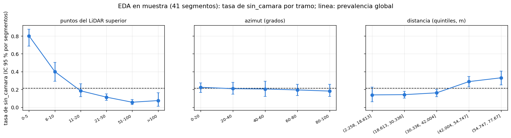
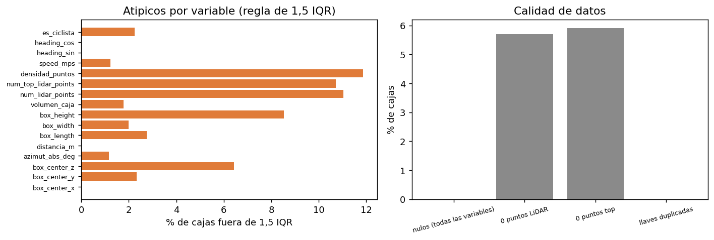

# Informe técnico EP3: de la lista de cajas a una solución en tres capas

*Generado por `scripts/ep3/generar_docs_ep3.py` a partir de `data/08_reporting_ep3`, `data/09_app_ep3`, `data/06_models_ep3` y `docs/seleccion_segmentos`; ninguna cifra está escrita a mano. Todo lo que no estaba en el plan v3 lleva la etiqueta **post hoc, no pre-declarado**. Las cifras son **fuera de fold sobre los 41 segmentos de desarrollo** salvo que se diga otra cosa. Fecha de las corridas: 2026-11-14. Las desviaciones del plan se llaman DEV-n y las decisiones DEC-n.*

## 0. Capa ejecutiva (una página)
**Problema.** Un equipo que revisa etiquetas de un auto autónomo tiene cajas 3D (LiDAR) de peatones y ciclistas y debe decidir cuáles no tienen su pareja 2D de cámara (`sin_camara`). Revisar todo es caro. En la población principal (|azimut| <= 100°) hay 80.571 cajas y 17.102 sin pareja (21,2 %).

**Qué construimos.** Una solución en **tres capas**: (1) un **filtro 1** que detecta huecos de cámara por segmento y los manda a auditoría; (2) una **regla o modelo** que ordena las cajas de las celdas sanas; (3) una **persona que revisa y decide**. Además, una página (Streamlit, solo local) y su despliegue.

**Resultado principal (fuera de fold, IC 95 % por segmentos).**
- La solución elegida es la **regla «menos puntos del LiDAR superior primero»**: AUC 0,823 (0,725 a 0,900), recall 0,798 en el punto A y captura de 61,9 % de los positivos al revisar el 20 % de las cajas (al azar, 20 %).
- **Ningún modelo ni ensamble supera a la regla de forma distinguible.** Optimizar hiperparámetros mejora a XGB, LGBM respecto de su propio punto de partida, pero su AUC (0,800 y 0,794) queda bajo el de la regla; su PR-AUC es apenas mayor (0,677 y 0,675 contra 0,672), una diferencia que no probamos con IC pareado. E2 (promedio de rangos de E1 y la regla) tiene AUC 0,824 contra 0,823 de la regla, PR-AUC 0,696 contra 0,672, Fracción para 80 % 0,421 contra 0,446 (IC de la diferencia -0,048 a 0,008) y ECE 0,069 (> 0,05); además **contiene a la regla como componente**. No hay una diferencia distinguible y por eso la elección se hizo por simplicidad, como manda la regla del plan.
- **Flujo en dos pasos** *(en muestra: 41 segmentos, parámetros del detector ajustados con los mismos datos; post hoc, no pre-declarado; sin validación con datos nuevos)*: revisar el 29,6 % de las cajas para el 80 % de los positivos, frente al 44,6 % en un paso; con 20 s por caja (no medido), 132 h contra 200 h. Empata con un paso si una auditoría cuesta 6.059 cajas (IC 1.227 a 13.258). **La ganancia del brazo C sale de 2 celdas cámara x segmento, una de ellas en el segmento donde se descubrió el hueco.** La diferencia pareada (dos pasos menos un paso) es -0,150 con IC -0,490 a 0,000: no excluye 0.
- **Aprendizaje no supervisado** (descriptivo, post hoc): los clusters separan casos lejanos y poco densos (tasa 31,8 %) de cercanos y densos (8,9 %), pero **no mejoran la predicción de la regla**.

**Qué no podemos afirmar.** Que el flujo en dos pasos supere al de un paso fuera de muestra; que un modelo complejo no sirva en otros datos; que los huecos sean errores de etiquetado. Los 8 segmentos de test de EP2 ya no son ciegos. La validación con segmentos nuevos (P9) está preparada, sellada y **pendiente**.

## 1. Mapa de la pauta
| Sección mínima pedida | Dónde está en este informe |
|---|---|
| Problema de negocio, objetivos y KPIs | 2 |
| Fuentes de datos y licencia | 3 |
| EDA, calidad de datos y preparación | 4 |
| Metodología (CRISP-DM) | 5 |
| Antecedentes (EP1 y EP2) y qué cambió | 6 |
| Diseño del experimento (plan v3, desviaciones y decisiones) | 7 |
| Modelado: filtro 1 (detector) | 8 |
| Aprendizaje no supervisado | 9 |
| **IE9** optimización de hiperparámetros y **IE10** técnicas de ensamble | 10 |
| **IE11** generalización | 11 |
| **IE12** selección justificada del modelo | 12 |
| Aplicación (página) y despliegue | 13 |
| Validación externa | 14 |
| Conclusiones y recomendaciones para el negocio | 15 |
| Ética, sesgos y privacidad | 16 |
| Limitaciones | 17 |
| Reproducción | 18 |
| Anexos: fuentes (A) y análisis en muestra 12.1 y 12.2 (B) | A, B |

## 2. Problema de negocio, objetivos y KPIs
**Negocio.** Los equipos que curan datos de percepción pierden horas revisando cajas 3D. Interesa encontrar primero las que probablemente no tienen su par 2D, porque suelen indicar una etiqueta faltante o una cámara sin datos. *Analogía:* antes de revisar recibo por recibo, miramos si falta una carpeta completa de recibos de un mes. **Objetivos:** O1 a O4 del plan v3 (con los umbrales de EP2). **Quién usa qué:** el analista de revisión usa la cola; el responsable de calidad de datos usa la auditoría de cámaras; el ingeniero consumidor puntúa segmentos nuevos.

| KPI | Meta (fijada antes) | Valor | Estado | Fuente |
|---|---|---|---|---|
| O1: AUC fuera de fold | >= 0,70 | 0,823 | cumple | f5_metricas_candidatos.csv |
| O1: PR-AUC menos prevalencia | >= 0,10 | 0,460 | cumple | f6_tabla_seleccion.csv |
| O2: «vale la pena» frente a la regla | Fracción 80 % baja >= 5 puntos (IC excluye 0) y AUC sube >= 0,03 | ningún candidato | no se cumple | f6_tabla_seleccion.csv |
| O3: recall en el punto A | >= 0,75 | 0,798 | cumple | f5_metricas_candidatos.csv |
| O4: AUC mínimo por fold | >= 0,75 | 0,647 (sobre celdas sanas: 0,842, post hoc) | no se cumple | f5_metricas_candidatos.csv, f12_auc_por_fold_brazos.csv |
| O4: mediana del AUC por segmento | >= 0,80 | 0,898 | cumple | f5_metricas_candidatos.csv |
| O4: ECE con Platt | <= 0,05 | 0,044 | cumple | f5_metricas_candidatos.csv |
| Captura al revisar el 20 % de las cajas | referencia: 20 % al azar | 61,9 % | informativo | f5_metricas_candidatos.csv |
| Fracción de cajas para 80 % de recall (un paso) | referencia: 80 % al azar | 44,6 % (en muestra; post hoc; sin validación con datos nuevos) | informativo | f5_metricas_candidatos.csv |
| Horas para 80 % de recall con 20 s por caja (un paso) | supuesto no medido | 200 h (al azar 358 h) (en muestra; post hoc; sin validación con datos nuevos) | informativo | derivado de la fracción; editable en la página |

## 3. Fuentes de datos
- **Waymo Open Dataset v2** (formato parquet por componente). Se usaron `lidar_box` (cajas 3D, puntos LiDAR, velocidad, rumbo) y `camera_to_lidar_box_association` (pares caja 3D - caja 2D por cámara). No se usó `camera_calibration` (no está en los datos locales) ni `vehicle_pose` (carpeta vacía).
- **Licencia:** uso no comercial; los datos no se redistribuyen. Por eso nada de Waymo sale del equipo y las imágenes Docker no llevan datos (secciones 13 y 16).
- **De 798 a 41 segmentos.** El inventario tiene 798 segmentos (`docs/seleccion_segmentos/inventario_segmentos.csv`), 5 con lluvia (excluidos). EP2 verificó 91: 41 seleccionados y 50 descartados (27 por asociacion vacia, 21 por etiquetado ralo, 2 por pocas asociaciones) (`registro_verificacion_ep2.csv`). Los 41 son 33 de train y 8 de test de EP2; por ubicación: location_phx 18, location_sf 16, location_other 7; por momento: Day 18, Night 12, Dawn/Dusk 11.
- **Sesgo de selección declarado:** el criterio «etiquetado ralo» (menos de 5,5 % de las cajas LiDAR de frames etiquetados con par) deja fuera segmentos con etiquetado 2D muy escaso.

**Sesgo de selección a escala de segmento** (descriptivo; `f18_seleccion_motivos.csv`, `f18_seleccion_rendimiento.csv`, desde `registro_verificacion_ep2.csv`). De los 798 segmentos del inventario, EP2 evaluó **91** y dejó **41**; **descartó 50**: 27 por asociación vacía, 21 por etiquetado ralo y 2 por pocas asociaciones. El rendimiento (seleccionados sobre evaluados) fue de 67 % de día (18 de 27), 50 % en amanecer o atardecer (11 de 22) y 29 % de noche (12 de 42); por ubicación, 53 % en San Francisco, 45 % en Phoenix y 33 % en otras (de noche en otras ubicaciones, 1 de 12). **La causa (etiquetado o publicación de los datos) se declara desconocida.** Consecuencia: el detector solo se evaluó en segmentos con etiquetado denso, y no sabemos cómo se comporta en los segmentos que EP2 descartó.

## 4. EDA, calidad de datos y preparación *(post hoc, descriptivo, 41 segmentos, población principal)*
**Variables.** Las 16 de EP2 (`V16`: posición, azimut, distancia, tamaño, volumen, puntos LiDAR, puntos top, densidad, velocidad, rumbo y clase), y dos conjuntos más pequeños declarados en el plan: `V_OBS` (4 variables de observabilidad) y `V_OBS_TAM` (10). El conjunto es un hiperparámetro de la búsqueda. **Folds:** StratifiedGroupKFold(5) por segmento, estratificado por `sin_camara`, semilla 42; ningún segmento queda repartido entre folds.

**Qué explica `sin_camara`.** La tasa cae con los puntos del LiDAR superior: 80,1 % con 0 a 5 puntos (10.362 cajas), 40,0 % con 6 a 10, 18,5 % con 11 a 20, 11,4 % con 21 a 50 y 5,7 % con 51 a 100 (IC por segmentos en la tabla). Por azimut dentro de la población principal casi no cambia (22,4 % en 0 a 20° contra 18,2 % en 80 a 100°). Sube con la distancia: 13,9 % en el quintil más cercano contra 33,1 % en el más lejano. Los peatones tienen 21,6 % y los ciclistas 6,3 % (solo 1.815 cajas de ciclistas, en 14 segmentos). *Analogía:* una caja con pocos puntos es una foto borrosa; es más difícil que alguien la haya pareado.

| Variable | Tramo | Cajas | Cajas sin pareja | Proporción sin pareja | IC 95 % por segmentos | Segmentos |
|---|---|---|---|---|---|---|
| Puntos del sensor superior | 0-5 | 10.362 | 8.303 | 80,1 % | 68,8 % a 87,5 % | 40 |
| Puntos del sensor superior | 6-10 | 5.521 | 2.211 | 40,0 % | 29,4 % a 50,3 % | 40 |
| Puntos del sensor superior | 11-20 | 10.781 | 1.992 | 18,5 % | 12,0 % a 26,3 % | 41 |
| Puntos del sensor superior | 21-50 | 20.657 | 2.349 | 11,4 % | 7,8 % a 14,9 % | 41 |
| Puntos del sensor superior | 51-100 | 13.720 | 779 | 5,7 % | 2,9 % a 8,6 % | 40 |
| Puntos del sensor superior | >100 | 19.530 | 1.468 | 7,5 % | 1,0 % a 16,4 % | 40 |
| Azimut absoluto | 0 a 20° | 37.754 | 8.454 | 22,4 % | 16,6 % a 27,4 % | 38 |
| Azimut absoluto | 20 a 40° | 19.220 | 4.020 | 20,9 % | 14,6 % a 28,0 % | 40 |
| Azimut absoluto | 40 a 60° | 10.474 | 2.151 | 20,5 % | 12,1 % a 29,2 % | 41 |
| Azimut absoluto | 60 a 80° | 7.071 | 1.377 | 19,5 % | 13,1 % a 25,8 % | 40 |
| Azimut absoluto | 80 a 100° | 6.052 | 1.100 | 18,2 % | 12,3 % a 25,6 % | 40 |
| Distancia (quintiles) | (2,26; 18,61] m | 16.115 | 2.240 | 13,9 % | 6,1 % a 22,5 % | 38 |
| Distancia (quintiles) | (18,61; 30,34] m | 16.114 | 2.284 | 14,2 % | 10,2 % a 17,9 % | 39 |
| Distancia (quintiles) | (30,34; 42,00] m | 16.114 | 2.609 | 16,2 % | 12,0 % a 20,1 % | 37 |
| Distancia (quintiles) | (42,00; 54,75] m | 16.114 | 4.640 | 28,8 % | 23,1 % a 34,7 % | 39 |
| Distancia (quintiles) | (54,75; 77,67] m | 16.114 | 5.329 | 33,1 % | 25,0 % a 40,6 % | 39 |
| Clase | PEDESTRIAN | 78.756 | 16.987 | 21,6 % | 17,9 % a 24,7 % | 40 |
| Clase | CYCLIST | 1.815 | 115 | 6,3 % | 1,1 % a 14,0 % | 14 |

**Calidad de datos** (`f12_eda_calidad.csv`, `f12_eda_calidad_resumen.json`): nulos en las 16 variables: 0; llaves duplicadas (segmento, marca de tiempo, objeto): 0; cajas con 0 puntos LiDAR: 4.590 (5,7 %); con 0 puntos del sensor superior: 4.757 (5,9 %), de las cuales 90,5 % no tienen pareja. Atípicos fuera de 1,5 IQR: los más altos son `densidad_puntos` (11,9 %), `num_lidar_points` (11,0 %) y `num_top_lidar_points` (10,7 %): son cajas muy cercanas con muchísimos puntos, no errores; no se eliminaron.

**Puntos del sensor superior > 100: por qué la tasa sube (post hoc, no pre-declarado; `f12_eda_puntos_top_sin_huecos.csv`, `f12_eda_puntos_top_resumen.json`, `scripts/ep3/f12c_eda_puntos_top_sin_huecos.py`).** En la tabla, la tasa baja de 11,4 % (21 a 50 puntos) a 5,7 % (51 a 100) y **sube a 7,5 %** con más de 100 puntos (IC 1,0 % a 16,4 %). Se separó por celdas con hueco: en el tramo > 100 hay 1.234 cajas dentro de las 2 celdas con hueco, con tasa de 85,6 %, y concentran 71,9 % de los positivos del tramo. **Sin esas celdas la tasa del tramo es 2,3 % y la serie es decreciente:** 4,0 % (51-100), 3,1 % (101-200), 1,1 % (201-500) y 1,8 % (> 500). Queda una concentración residual en el segmento `247562357599` (184 positivos en 665 cajas con más de 100 puntos, 27,7 %): es el segmento donde aparece una celda marcada adicional cuando `frac` = 0,35; sin él, el tramo 101-200 baja a 1,3 %. *Hipótesis (no verificada):* el alza no es un efecto del sensor sino de cajas con muchos puntos que no tienen pareja porque la cámara de esa zona no tiene etiquetas (el hueco).

## 5. Metodología (CRISP-DM)
| Fase | Dónde |
|---|---|
| Comprensión del negocio | sección 2 |
| Comprensión de los datos | secciones 3 y 4; notebook 11 |
| Preparación de los datos | secciones 4 y 7; `scripts/ep3/f1_datos.py`, `datos.py` |
| Modelado | secciones 8 (detector), 9 (no supervisado) y 10 (IE9 e IE10); notebooks 12 y 15 |
| Evaluación | secciones 11, 12 y 14; notebook 13 |
| Despliegue | sección 13; notebook 14, `app/`, `Dockerfile` |

## 6. EP1 y EP2 en breve, y qué cambió
- **EP1** (`docs/README_EP1.md`): exploración del dataset, fuentes, estructuras de datos y ética; pipeline de Kedro de ingesta y preprocesamiento (`src/waymo_evaluacion/pipelines`).
- **EP2** (`docs/informe_tecnico_EP2.md`, `docs/plan_evaluacion_test.md`, `docs/evaluacion_final_B.md`, `docs/log_trabajo_ep2.md`): target `sin_camara`, población principal, tres modelos contra reglas simples con validación por segmento y un test de 8 segmentos sellado con plan congelado (14 archivos con sha256). Resultado oficial: la regresión logística no se distinguió de la regla de puntos (AUC 0,698 contra 0,684; IC de la diferencia -0,014 a +0,029). Hallazgo post hoc: el segmento `257766998801` concentraba positivos por un hueco en la cámara 3 (apéndice M).
- **Nota sobre Kedro:** el trabajo analítico de EP2 y EP3 vive en **notebooks y scripts**, no en nodos de Kedro; los pipelines de Kedro son solo los de ingesta y preprocesamiento de EP1. EP2 queda intacta (14 de 14 archivos congelados verifican).

| Tema | EP2 | EP3 |
|---|---|---|
| Datos | 33 segmentos de train; test ciego de 8 | 41 juntos; los 8 ya no son ciegos; prueba ciega con segmentos nuevos (P9) |
| Validación | GroupKFold(5) por segmento | StratifiedGroupKFold(5), estratificada; 1 repetición (DEV-1) |
| Modelos | LR, HGB, RF | + XGBoost y LightGBM, por defecto contra optimizado |
| Hiperparámetros | óptimos en el borde de la grilla | grillas más regularizadas, búsqueda anidada, revisión de bordes |
| Ensambles | ninguno | E1 a E4 con CV interna por segmento |
| Hueco de cámara | apéndice post hoc | filtro 1 del flujo, con Lista A y brazo de dos pasos |
| No supervisado | k-means, GMM, Ward, IsolationForest con variables de oclusión | mismo enfoque descriptivo sin oclusión (sección 9) |
| Entrega | informe y README | informe, notebooks, página, despliegue, validación externa sellada |

## 7. Diseño del experimento (plan v3)
El plan v3 (`plan_v3.md`, `plan_v3.json`, hash en `plan_v3.sha256`) se congeló **antes** de correr ningún experimento. Los datos de desarrollo (`dev_41.parquet`) se reconstruyeron con la lógica de EP2: los modelos congelados de EP2 reproducen `pred_test_B.parquet` con diferencia máxima de 5.6e-16 y los conteos del test coinciden con la tabla del plan (16.062 filas y 3.734 positivos). *Analogía:* los 8 segmentos de EP2 eran un examen sorpresa; ya los miramos seis veces, así que ahora son material de estudio.

**Desviaciones del plan** (`plan_v3_desviaciones.md`): **DEV-1** una repetición de la CV externa y 30 configuraciones en vez de 3 y 40 (RF tarda 45 a 100 s por ajuste); **DEV-2** regla de reserva cuando nadie cumple O4 (post hoc). **Decisiones** (`ESTADO.md`):

| Id | Decisión | Motivo |
|---|---|---|
| DEC-1 | Desviaciones en archivo aparte | no alterar el hash del plan |
| DEC-2 | Notebooks con el kernel `python3` | no existe el kernel `ep2` |
| DEC-3 | Se mantiene el cambio de `tests/test_ajustes_finales.py` (`--ignore=tests/ep3`) | no contar las pruebas de EP3 en el conteo de EP2 |
| DEC-4 | Cómputo con 6 procesos como máximo | dejar el equipo usable |
| DEC-6 | Sin MLflow; checkpoints y CSV/JSON | evitar dependencias que muevan versiones fijadas |
| DEC-7 | Umbrales A y B y Platt con scores internos de entrenamiento | sin fuga del fold de validación |
| DEC-8 | Brazo C: la auditoría no cuesta por caja; se reporta el punto de equilibrio | no inventar un costo |
| DEC-9 | Bases de los ensambles con la configuración optimizada solo si IE9 dio «mejora» | consistencia con IE9 |
| DEC-10 | Si el elegido es E2, su puntaje es un rango dentro del lote | E2 promedia rangos |
| DEC-11 | Las fases 12 y 13 son análisis en muestra, post hoc | no estaban en el plan v3 |
| DEC-12 | No supervisado: silhouette en 20.000 cajas, GMM y Ward en 15.000, estabilidad con KMeans `n_init=3` y scaler fijo | costo de cómputo |
| DEC-13 | El artefacto no supervisado tiene manifest propio y no se usa para puntuar | no tocar `manifest_v3.json` |
| DEC-14 | Aviso «en muestra» siempre visible (desde F20, un chip persistente en todas las páginas con su popover, y una etiqueta junto a cada cifra del flujo en dos pasos) | evitar leer una ganancia en muestra como resultado ciego |
| DEC-15 | El selector de referencia de la página usa las curvas ya calculadas de XGBoost y E2 | no generar predicciones nuevas |
| DEC-16 | Docker sin probar | el demonio estaba apagado |

## 8. Filtro 1: detector de huecos por cámara
Parámetros congelados de EP2, sin recalcular: rango de azimut p5-p95 por cámara con los 33 segmentos de train, mediana de la tasa por cámara con los 41, hueco si la tasa es menor al 25 % de la mediana y hay al menos 100 cajas en el rango. Marca **2 celdas**, las mismas que EP2 (diferencia máxima contra los CSV de EP2: 1.1e-16):

| Segmento | Grupo | Cámara | Tasa de pares | Cajas en el rango del detector (azimut absoluto ≤ 120°) | Cajas en la población principal (azimut absoluto ≤ 100°) | Positivos en la población principal |
|---|---|---|---|---|---|---|
| 911012534050 | train | 5 (lateral der.) | 0 % | 300 | 268 | 227 |
| 257766998801 | test | 3 (frontal der.) | 0 % | 1.677 | 1.677 | 1.338 |

*Población de cada columna:* «cajas en el rango del detector» cuenta las cajas con |azimut| hasta 120° que caen en el rango de azimut de esa cámara (300 en la celda `911012534050` cámara 5); «cajas en la población principal» cuenta solo las de |azimut| ≤ 100° (268 en esa celda; en la otra celda ambas coinciden) y los positivos se cuentan en esta última población.

Esas celdas contienen 1.565 de los 17.102 positivos (9,2 %) en 1.945 cajas. **Post hoc, no pre-declarado:** el hueco se descubrió en EP2 después de abrir el test, y los parámetros del detector se ajustaron con estos mismos segmentos. Una celda marcada puede ser un problema de etiquetado 2D o de datos de esa cámara; con estos archivos no se distingue.

**Estabilidad del conjunto marcado frente a los parámetros (post hoc, anexo B).** Se probaron 30 combinaciones: `frac` {0,15; 0,20; 0,25; 0,30; 0,35} x `min_cajas` {50, 100, 200} x mediana {con los 41 segmentos; sin el segmento candidato}. Los 2 huecos de referencia se marcan en **30 de 30** combinaciones; las celdas marcadas además de los 2 de referencia (sin verdad externa) van de 0 a 2, y con la configuración de EP2 son 0 de 111 celdas con n suficiente. Sin el segmento candidato en la mediana (variante «leave-one-out») el resultado es el mismo.

**Qué mide y qué no mide el «30 de 30» (DEV-3).** Los 2 huecos de referencia **los define el mismo detector con los parámetros de EP2**: no hay una verdad externa que diga qué celdas son huecos reales. Por eso «30 de 30» mide la **estabilidad del conjunto marcado frente a los parámetros**; no es sensibilidad ni especificidad, y las celdas adicionales no se pueden llamar «falsas alarmas» (podrían ser huecos reales que EP2 no marcó). El detector es **estadística descriptiva** (percentiles, una mediana y un umbral), no aprendizaje automático.

## 9. Aprendizaje no supervisado *(descriptivo; no está en el plan v3: post hoc, no pre-declarado)*
**Qué se hizo.** Sobre las 80.571 cajas de la población principal, con `distancia_m`, `azimut_abs_deg`, `log1p(num_lidar_points)`, `log1p(densidad_puntos)` y `log1p(volumen_caja)` estandarizadas, **sin `sin_camara` ni nada del par 2D**. EP2 usó además variables de oclusión que no están en `dev_41`, así que la comparación no es idéntica. KMeans k = 2 a 8 (`n_init=10`, semilla 42) con silhouette (muestra de 20.000), Davies-Bouldin y Calinski-Harabasz; GMM (BIC) y Ward en una muestra de 15.000; estabilidad al remuestrear segmentos (30 réplicas). Se elige k por máximo silhouette entre 2 y 6: **k = 2**, y se explora también k = 4 como en EP2.

| k | Silhouette (muestra de 20.000) | Davies-Bouldin | Calinski-Harabasz | Tamaño del cluster más chico (fracción) | BIC del GMM (muestra de 15.000) |
|---|---|---|---|---|---|
| 2 | 0,317 | 1,200 | 47.414 | 0,460 | 86.283 |
| 3 | 0,248 | 1,369 | 37.420 | 0,272 | 66.153 |
| 4 | 0,243 | 1,222 | 33.141 | 0,198 | 56.734 |
| 5 | 0,240 | 1,244 | 31.196 | 0,110 | 48.494 |
| 6 | 0,247 | 1,186 | 29.712 | 0,091 | 26.203 |
| 7 | 0,232 | 1,172 | 28.325 | 0,083 | 22.449 |
| 8 | 0,232 | 1,168 | 27.080 | 0,079 | 14.497 |

**Estructura.** Con k = 2 el silhouette es 0,317 y la estabilidad por segmentos tiene ARI medio 0,930 y mínimo 0,815; con k = 4, 0,660 y 0,401. El acuerdo entre técnicas es **bajo**: ARI KMeans contra GMM 0,008 (k = 2) y 0,265 (k = 4); KMeans contra Ward 0,426 y 0,354. Es decir, los clusters son una partición cómoda de un continuo (distancia y densidad), no grupos naturales firmes.

**Diagnóstico del ARI bajo** (post hoc, `f13_ari_diagnostico.csv` y `.json`; lo produce `scripts/ep3/f13b_diagnostico_ari.py`). EP2 reportó un ARI KMeans contra GMM de 0,997; aquí es 0,008 con k = 2. Se revisó si era un error de código: las tres técnicas se comparan sobre **las mismas 15.000 filas, en el mismo orden** (la muestra tiene 15.000 filas distintas), el ARI recalculado coincide con `f13_resumen.json` (sí) y los GMM convergieron todos (`converged_`). **No hay error.** El GMM de f13 usa covarianza `full` y `n_init=2`. Con k = 2 los tamaños de cluster son KMeans [6980, 8020], Ward [5544, 9456] y GMM `full` [10471, 4529]; con covarianza `diag` el ARI KMeans–GMM sube a 0,729 y con `spherical` a 0,884, y con k = 4 `full` da 0,265.

| k | Covarianza | Inicios (n_init) | Convergió | Iteraciones | Tamaños de los grupos | ARI contra KMeans | ARI contra Ward |
|---|---|---|---|---|---|---|---|
| 2 | full | 2 | sí | 18 | 10.471 y 4.529 | 0,008 | 0,082 |
| 2 | full | 10 | sí | 18 | 4.532 y 10.468 | 0,008 | 0,081 |
| 2 | diag | 2 | sí | 8 | 5.884 y 9.116 | 0,729 | 0,271 |
| 2 | diag | 10 | sí | 8 | 5.883 y 9.117 | 0,729 | 0,271 |
| 2 | spherical | 2 | sí | 3 | 6.533 y 8.467 | 0,884 | 0,362 |
| 2 | spherical | 10 | sí | 3 | 8.536 y 6.464 | 0,867 | 0,353 |
| 4 | full | 2 | sí | 31 | 6.730 y 2.382 y 4.469 y 1.419 | 0,265 | 0,079 |
| 4 | full | 10 | sí | 55 | 2.335 y 4.251 y 2.560 y 5.854 | 0,246 | 0,077 |
| 4 | diag | 2 | sí | 36 | 4.839 y 1.808 y 3.179 y 5.174 | 0,309 | 0,443 |
| 4 | diag | 10 | sí | 24 | 3.748 y 3.230 y 2.795 y 5.227 | 0,345 | 0,452 |
| 4 | spherical | 2 | sí | 8 | 4.511 y 4.493 y 4.012 y 1.984 | 0,683 | 0,314 |
| 4 | spherical | 10 | sí | 15 | 3.677 y 3.881 y 3.265 y 4.177 | 0,387 | 0,448 |

**Qué coincide y qué no, y qué dice EP2 (hipótesis, post hoc, no verificada).** (i) KMeans coincide con el GMM esférico (ARI 0,884) y con el diagonal (0,729); **el discrepante es el GMM de covarianza `full`**, que parte la muestra en 70 % y 30 % mientras KMeans la parte en 47 % y 53 %; Ward queda en el medio (ARI 0,426 con KMeans). Por eso el ARI de 0,008 **siempre debe leerse junto al 0,884 del GMM esférico**: no hay desacuerdo general entre técnicas, hay un GMM que modela otra forma. (ii) **Evidencia de EP2 (solo lectura):** EP2 usó variables de oclusión además de las cinco de aquí (`docs/informe_tecnico_EP2.md:408`), sus clusters se describen como «ocluidos» y «sin oclusores» (`docs/informe_tecnico_EP2.md:428-429`), y su propio diagnóstico encontró covarianzas degeneradas del GMM, con varianza mínima 1,0e-06 (el piso de scikit-learn) en las variables discretas `n_ocl`, `frac_cub` y `dist_ocl_f` (`docs/informe_tecnico_EP2.md:422`); el ARI de 0,997, 1,000 y 0,997 está en `data/08_reporting/08_no_supervisado_resumen.json:5-7`. **Hipótesis (no verificada):** el 0,997 de EP2 probablemente estaba inflado por esas variables discretas, que producen una estructura que las tres técnicas parten igual; el 0,008 de EP3 no es la anomalía: es lo que da un GMM de covarianza completa sobre cinco variables continuas sin separación natural. (iii) El BIC del GMM baja de 86.283 (k = 2) a 14.497 (k = 8) sin dar un mínimo y **no se usa para elegir k** (como en EP2, que tampoco lo usó).

**AUC de la regla dentro de cada cluster (k = 2).** Columna `AUC_regla_dentro_del_cluster` de `f13_clusters_k2.csv`:

| Cluster | Tipo de caso | Cajas | Proporción sin pareja | IC inferior | IC superior | AUC de la regla dentro del cluster |
|---|---|---|---|---|---|---|
| 0 | cercanos y densos | 37.094 | 0,089 | 0,044 | 0,147 | 0,531 |
| 1 | lejanos y poco densos | 43.477 | 0,318 | 0,254 | 0,384 | 0,837 |

*Lectura:* la regla pierde capacidad de ordenar en las cajas **cercanas y densas** (AUC 0,531, casi azar) y ordena bien en las **lejanas y poco densas** (0,837); con k = 4 el AUC por cluster es 0,416, 0,687, 0,819, 0,622 (clusters 0 a 3). No es un fallo del clustering: es dónde la regla ordena peor.

**Análisis nuevo, post hoc, no pre-declarado: ¿es por las celdas con hueco?** (`f13_auc_cluster_sin_huecos.csv`, `scripts/ep3/f13c_auc_cluster_sin_huecos.py`; descriptivo, sin IC). Se recalculó ese AUC sin las 1.945 cajas de las celdas con hueco:

| k | Cluster | Tipo de caso | Cajas | Cajas en celdas con hueco | AUC (todas las cajas) | AUC (sin celdas con hueco) | Diferencia de AUC |
|---|---|---|---|---|---|---|---|
| 2 | 0 | cercanos y densos | 37.094 | 1.772 | 0,531 | 0,748 | 0,217 |
| 2 | 1 | lejanos y poco densos | 43.477 | 173 | 0,837 | 0,842 | 0,005 |
| 4 | 0 | cercanos y densos | 20.156 | 1.230 | 0,416 | 0,750 | 0,334 |
| 4 | 1 | a distancia media y de densidad media | 15.948 | 348 | 0,687 | 0,742 | 0,055 |
| 4 | 2 | lejanos y poco densos | 19.007 | 17 | 0,819 | 0,819 | -0,000 |
| 4 | 3 | a distancia media y de densidad media | 25.460 | 350 | 0,622 | 0,652 | 0,030 |

**Resultado:** el AUC de los clusters cercanos **sube mucho**: con k = 2, de 0,531 a 0,748 (+0,217); con k = 4 (cluster 0), de 0,416 a 0,750 (+0,334); los clusters lejanos casi no cambian (0,837 a 0,842). Es decir, **la mayor parte de la pérdida de capacidad en cajas cercanas se debe a las 2 celdas con hueco** (1.772 cajas y 1.418 de los 3.285 positivos del cluster cercano caen ahí: cajas con muchos puntos y sin pareja). Aun así queda una brecha (0,748 contra 0,842): la regla sigue ordenando algo peor entre cajas cercanas. En conjunto, el AUC global de la probabilidad con Platt pasa de 0,809 a 0,871 sin esas celdas. Los positivos de las celdas con hueco son 43 % de los positivos del cluster cercano: explican buena parte de la pérdida, no toda.

**Cruce con `sin_camara` (k = 4)** y comparación con lo que predice la regla (probabilidad con Platt):

| Cluster | Tipo de caso | Cajas | Proporción sin pareja | IC inferior | IC superior | Probabilidad media de la regla (Platt) | Tasa menos probabilidad de la regla | AUC de la regla dentro del cluster |
|---|---|---|---|---|---|---|---|---|
| 0 | cercanos y densos | 20.156 | 0,081 | 0,023 | 0,167 | 0,045 | 0,036 | 0,416 |
| 1 | a distancia media y de densidad media | 15.948 | 0,148 | 0,107 | 0,186 | 0,187 | -0,040 | 0,687 |
| 2 | lejanos y poco densos | 19.007 | 0,546 | 0,451 | 0,627 | 0,529 | 0,017 | 0,819 |
| 3 | a distancia media y de densidad media | 25.460 | 0,107 | 0,072 | 0,149 | 0,125 | -0,018 | 0,622 |

Los clusters 1 y 3 de k = 4 comparten el rótulo «a distancia media y de densidad media» pero tienen tasas de 14,8 % y 10,7 %: el rótulo (basado en terciles de distancia y densidad) no los distingue. La página usa k = 2 (el `k_elegido` del artefacto), por lo que no muestra estos dos clusters.

Con k = 2: «cercanos y densos» tasa 8,9 % (IC 4,4 % a 14,7 %, 37.094 cajas), «lejanos y poco densos» tasa 31,8 % (IC 25,4 % a 38,4 %, 43.477 cajas). Los tipos de caso extremos reproducen lo que ya sabe la regla: pocos puntos y lejos significan más sin pareja. **¿Mejoran la predicción?** No: agregar el cluster a la probabilidad de la regla (regresión logística, GroupKFold por segmento, IC por segmentos) cambia el AUC en -0,0015 (IC -0,0055 a 0,0023) con k = 2 y en -0,0097 (IC -0,0150 a -0,0044) con k = 4, es decir, con k = 4 la predicción **empeora** de forma distinguible. La regla ya está bien calibrada en cada cluster (diferencias de tasa menos probabilidad entre -0,040 y 0,036).

**Por qué el AUC base de esta comparación es 0,798 y no 0,823** (`f13_aporte_cluster.csv`, verificado en `f18_definiciones.json`): el 0,823 es el AUC del puntaje crudo (menos puntos top) con todas las cajas juntas. La comparación de los clusters trabaja con la **probabilidad con Platt**, y Platt se ajusta por separado en cada fold, de modo que al juntar los 5 folds se mezclan escalas distintas: con la misma regla el AUC conjunto baja a 0,809 (dentro de cada fold el AUC es idéntico al del puntaje crudo). Luego se vuelve a ajustar una regresión logística sobre el logit con otra partición por segmentos (GroupKFold de 5, distinta de la CV externa), que lo deja en 0,798. Lo que importa es la diferencia con y sin cluster (mismo método en ambos lados), no el nivel.

**IsolationForest** (contaminación 1 %): 806 cajas atípicas (1,0 %) en 36 de 41 segmentos; tasa de `sin_camara` 68,1 % (IC 49,2 % a 84,5 %) contra 20,8 % en el resto; los tres segmentos que más aportan reúnen 34,7 % de los atípicos.

**EP2 contra EP3** (EP2 solo se lee; fuentes en la tabla):

| Medida | EP2 | EP3 | Fuente EP2 | Fuente EP3 |
|---|---|---|---|---|
| k elegido (maximo silhouette) | 2 | 2 | 08_no_supervisado_resumen.json | f13_seleccion_k.csv |
| silhouette con k=2 | 0,387 | 0,317 | 08_clusters_seleccion_k.csv | f13_seleccion_k.csv |
| silhouette con k=4 | 0,251 | 0,243 | 08_clusters_seleccion_k.csv | f13_seleccion_k.csv |
| tasa sin_camara del cluster de mayor tasa con k=4 (%) | 62,71 | 54,57 | 08_clusters_vs_franja.csv (cluster 'lejanos, poco densos y ocluidos', 13.584 filas) | f13_clusters_k4.csv (cluster 2: lejanos y poco densos, 19007 cajas) |
| IsolationForest: tasa sin_camara de atipicas (%) | 80,30 | 68,11 | 08_no_supervisado_resumen.json | f13_isolation_forest.csv |
| IsolationForest: tasa de las no atipicas (%) | 22,60 | 20,75 | 08_no_supervisado_resumen.json | f13_isolation_forest.csv |
| IsolationForest: segmentos que aportan atipicos | 28 | 36 | 08_no_supervisado_resumen.json | f13_isolation_forest.csv |
| estabilidad: ARI medio al remuestrear segmentos (k elegido) | 0,953 | 0,930 | 08_no_supervisado_resumen.json | f13_estabilidad.csv |
| estabilidad: ARI minimo (k elegido) | 0,301 | 0,815 | 08_no_supervisado_resumen.json | f13_estabilidad.csv |
| ARI KMeans vs GMM (k elegido) | 0,997 | 0,008 | 08_no_supervisado_resumen.json | f13_resumen.json |

**Lectura.** Los resultados cambian: el silhouette con k = 2 baja (0,387 a 0,317), el cluster de mayor tasa con k = 4 baja de 62,7 % a 54,6 % y los atípicos de 80,3 % a 68,1 %. Una parte probable de la diferencia es que aquí no hay variables de oclusión y que se usan 41 segmentos en vez de 33 (hipótesis, no verificada). **Qué cambió respecto de EP2 y por qué:** lo que cambia es sobre todo el acuerdo entre técnicas (ARI KMeans–GMM de 0,997 a 0,008), que el diagnóstico de arriba muestra que no es un error de filas ni de convergencia; sin oclusión, los grupos ya no son compactos y las técnicas discrepan. Con los umbrales de EP2 para llamar «estructura» (silhouette >= 0,25, ARI >= 0,8, rango de tasa >= 10 puntos), k = 2 los cumple y k = 4 no (ARI mínimo 0,401). **Los clusters no aportan a la predicción**; se usan solo para mostrar el «tipo de caso» en la página, con su tasa histórica.

## 10. Optimización de hiperparámetros y técnicas de ensamble
### 10.1 IE9: optimización de hiperparámetros
**Diseño.** Cada modelo (LR, RF, HGB, XGBoost, LightGBM) se compara **por defecto** y **optimizado** con búsqueda aleatoria **anidada**: la elección usa solo los segmentos de entrenamiento de cada fold externo, con CV interna GroupKFold(3) por segmento y criterio PR-AUC (LR: rejilla de C de 1e-5 a 100 por `class_weight`). El conjunto de variables es un hiperparámetro más. Las grillas incluyen valores **más regularizados** que los de EP2 (HGB `max_leaf_nodes` 2 y 3, `min_samples_leaf` hasta 3.200; RF `min_samples_leaf` hasta 1.600 y `max_features` 1 y 2). «Mejora» = diferencia de PR-AUC (optimizado menos defecto) >= +0,010 con IC pareado por segmentos que excluya 0. **DEV-1:** 1 repetición de la CV externa (semilla 42) y 30 configuraciones.

| Modelo | PR-AUC defecto | PR-AUC optimizado | Dif. PR-AUC (IC 95 %) | Folds donde gana | Veredicto |
|---|---|---|---|---|---|
| LR | 0,650 | 0,631 | -0,018 (-0,051 a 0,018) | 3 de 5 | no mejora |
| RF | 0,650 | 0,610 | -0,040 (-0,077 a 0,003) | 4 de 5 | no mejora |
| HGB | 0,636 | 0,650 | 0,014 (-0,021 a 0,047) | 4 de 5 | no mejora |
| XGB | 0,619 | 0,677 | 0,059 (0,034 a 0,085) | 5 de 5 | mejora |
| LGBM | 0,638 | 0,675 | 0,036 (0,012 a 0,060) | 4 de 5 | mejora |

**Lectura.** Mejoran con la búsqueda: XGB, LGBM. No mejoran: LR, RF, HGB. Es un resultado negativo que reportamos igual: LR, RF y HGB no mejoran, y LR y RF empeoran en promedio. *Hipótesis (no verificada):* con 41 segmentos y 30 configuraciones, la búsqueda interna puede elegir configuraciones que aprovechan particularidades de los segmentos de entrenamiento y no se sostienen en el fold de validación (sobreajuste de la búsqueda); en LR, el criterio interno (PR-AUC) podría preferir variables y regularización distintas de las que sirven en el fold externo. El valor de XGBoost y LightGBM viene sobre todo de **regularizar** un modelo que por defecto se sobreajusta (PR-AUC de entrenamiento 0,997 con `max_depth` 6; validación 0,644).

**Bordes de grilla.** Revisando los 5 folds, el único borde fue LightGBM `min_child_samples` (mínimo en 3 de 5 folds); se **extendió la grilla una vez** (5 y 10) y se repitió la búsqueda. Tras la extensión queda en el borde: LGBM `n_estimators` (máximo en 5 de 5 folds, etapa ext). El plan permite una sola extensión: **limitación declarada**.

**Curvas de validación** (`f3_curvas_validacion.csv`, 5 folds): en todos los modelos la PR-AUC de entrenamiento sube con la complejidad (HGB de 0,740 con 2 hojas a 0,979 con 31) y la de validación **baja o no sube** (0,686 a 0,663). La mejor validación está en los valores más regulares.

### 10.2 IE10: técnicas de ensamble
E1: voting soft de LR, RF y HGB. E2: promedio de rangos de E1 y la regla. E3: stacking de LR, RF, HGB, XGBoost y LightGBM con meta-regresión logística sobre predicciones fuera de fold calculadas con **GroupKFold(3) por segmento dentro de cada fold externo** (a mano: el CV interno por defecto de scikit-learn mezcla segmentos y filtra información). E4: stacking por vistas (observación, tamaño y posición). «Aporta» = AUC >= +0,010 sobre su mejor componente con IC pareado que excluya 0.

| Ensamble | Mejor componente | AUC ensamble | AUC mejor comp. | Dif. (IC 95 %) | Folds ganados | Segmentos ganados | Veredicto |
|---|---|---|---|---|---|---|---|
| E1 | RF | 0,803 | 0,798 | 0,005 (-0,007 a 0,020) | 3 de 5 | 21 de 31 | no aporta |
| E2 | Regla top | 0,824 | 0,823 | 0,001 (-0,005 a 0,008) | 5 de 5 | 20 de 31 | no aporta |
| E3 | XGB | 0,789 | 0,800 | -0,011 (-0,021 a -0,000) | 1 de 5 | 13 de 31 | no aporta |
| E4 | vista_obs | 0,773 | 0,792 | -0,019 (-0,038 a -0,003) | 1 de 5 | 10 de 31 | no aporta |

**Lectura.** **Ningún ensamble aporta.** E1 queda 0,005 sobre su mejor componente con IC que incluye 0; E2 empata con la regla (0,001, y la contiene); E3 y E4 quedan por debajo de su mejor componente. El ensamble principal declarado en el plan (mayor AUC entre E1 y E4) es **E1**. *Analogía:* promediar compañeros solo ayuda si se equivocan en cosas distintas; aquí todos miran lo mismo (los puntos del LiDAR).

## 11. IE11: generalización
| Candidato | AUC (IC 95 %) | PR-AUC | Captura@20 % | Fracción 80 % | Recall A | ECE (Platt) | AUC mín. fold | Mediana AUC seg. |
|---|---|---|---|---|---|---|---|---|
| Regla top | 0,823 (0,725 a 0,900) | 0,672 | 0,619 | 0,446 | 0,798 | 0,044 | 0,647 | 0,898 |
| LR3 | 0,808 (0,703 a 0,896) | 0,660 | 0,608 | 0,468 | 0,810 | 0,060 | 0,651 | 0,908 |
| LR | 0,797 (0,701 a 0,889) | 0,650 | 0,589 | 0,467 | 0,820 | 0,053 | 0,641 | 0,901 |
| RF | 0,798 (0,704 a 0,881) | 0,650 | 0,575 | 0,472 | 0,806 | 0,071 | 0,668 | 0,880 |
| HGB | 0,794 (0,706 a 0,872) | 0,636 | 0,564 | 0,494 | 0,832 | 0,046 | 0,645 | 0,867 |
| XGB | 0,800 (0,704 a 0,884) | 0,677 | 0,609 | 0,488 | 0,801 | 0,039 | 0,685 | 0,880 |
| LGBM | 0,794 (0,699 a 0,878) | 0,675 | 0,611 | 0,531 | 0,819 | 0,045 | 0,682 | 0,872 |
| E1 | 0,803 (0,704 a 0,890) | 0,666 | 0,581 | 0,462 | 0,812 | 0,044 | 0,649 | 0,890 |
| E2 | 0,824 (0,720 a 0,907) | 0,696 | 0,619 | 0,421 | 0,809 | 0,069 | 0,648 | 0,900 |
| E3 | 0,789 (0,693 a 0,877) | 0,662 | 0,604 | 0,523 | 0,803 | 0,037 | 0,664 | 0,875 |
| E4 | 0,773 (0,678 a 0,858) | 0,659 | 0,609 | 0,610 | 0,774 | 0,039 | 0,685 | 0,848 |

- **Estabilidad.** La mediana del AUC por segmento cumple en todos (0,848 a 0,908); el mínimo por fold **no lo cumple ninguno** (0,641 a 0,685) por el fold 0. **Post hoc (anexo B):** el fold 0 contiene 7 segmentos y 14.968 cajas, entre ellos `257766998801` con la cámara 3 sin pares. Con el brazo B (solo celdas sanas) el AUC mínimo por fold sube a **0,842** (regla; LR3 0,842; XGBoost 0,841), es decir, **el brazo B sí cumple 0,75**: el fallo de estabilidad se debe a la celda con hueco, no a la regla en general. En el fold 0 el AUC de la regla pasa de 0,647 (brazo A) a 0,842 con la celda con hueco fuera (brazo B). **Esto explica la inestabilidad por fold, no cambia la elección ni la regla de reserva DEV-2, que se aplicó sobre el brazo A.** Los criterios del detector no usan el AUC, pero los huecos se descubrieron por un AUC bajo: post hoc, en muestra. (en muestra: 41 segmentos, parámetros del detector ajustados con los mismos datos; post hoc, no pre-declarado; sin validación con datos nuevos.)
- **Leave-one-segment-out** (regla): AUC global 0,823 (IC 0,725 a 0,900); mediana por segmento 0,898; 2 de 22 segmentos evaluables con AUC < 0,55 (mínimo 0,408). LR3 y XGBoost: 0,812 y 0,802.
- **Brecha ajuste-validación.** La regla no aprende: no tiene brecha real. XGBoost con todos los segmentos de entrenamiento (promedio de los folds de 32 y 34 segmentos): ajuste 0,917, validación 0,815, brecha 0,102 que no se cierra con más segmentos. Con 41 segmentos las curvas son ruidosas.
- **Calibración.** Con Platt, ECE de la regla 0,044 (<= 0,05) y Brier 0,112.

## 12. IE12: selección justificada
Objetivos (los de EP2): O1 AUC >= 0,70 y PR-AUC menos prevalencia >= 0,10; O2 «vale la pena» frente a la regla (Fracción 80 % baja >= 5 puntos con IC pareado que excluye 0 y AUC sube >= 0,03); O3 recall >= 0,75 en el punto A; O4 estabilidad y ECE <= 0,05.

| Candidato | O1 | O2 | O3 | O4 | Dif. Fracción 80 % vs regla (IC) | Dif. AUC vs regla |
|---|---|---|---|---|---|---|
| Regla top | sí | no | sí | no | 0,000 (0,000 a 0,000) | 0,000 |
| LR3 | sí | no | sí | no | 0,021 (-0,008 a 0,064) | -0,015 |
| LR | sí | no | sí | no | 0,020 (-0,038 a 0,112) | -0,026 |
| RF | sí | no | sí | no | 0,026 (-0,029 a 0,085) | -0,025 |
| HGB | sí | no | sí | no | 0,048 (-0,011 a 0,078) | -0,028 |
| XGB | sí | no | sí | no | 0,042 (-0,022 a 0,105) | -0,023 |
| LGBM | sí | no | sí | no | 0,084 (-0,006 a 0,136) | -0,028 |
| E1 | sí | no | sí | no | 0,016 (-0,032 a 0,062) | -0,020 |
| E2 | sí | no | sí | no | -0,025 (-0,048 a 0,008) | 0,001 |
| E3 | sí | no | sí | no | 0,077 (0,012 a 0,128) | -0,034 |
| E4 | sí | no | sí | no | 0,164 (0,031 a 0,241) | -0,050 |

Un valor **positivo** en la columna de Fracción 80 % significa que el candidato necesita revisar **más** cajas que la regla; en E3 y E4 el IC excluye 0, es decir, son significativamente **peores** que la regla en esa medida.

**Decisión.** Ningún candidato cumple O4 (regla de reserva DEV-2); entre los 11 candidatos que cumplen O1 y O3, el mejor AUC OOF es 0,824; los que quedan a menos de 0,010 son Regla top, E2; el más simple es Regla top. **Elegida: la regla «menos puntos top».** *Regla de reserva DEV-2 (post hoc, no pre-declarada):* el plan define la elección «entre los que cumplen O1, O3 y O4», pero nadie cumple O4; por analogía con lo que el plan dice para O2, se aplicó la misma regla de simplicidad entre los que cumplen O1 y O3 y se reporta la estabilidad como limitación de todos. El análisis post hoc de estabilidad (brazo B, sección 11 y anexo B) **explica la inestabilidad por fold pero no cambia la elección ni la regla de reserva DEV-2, que se aplicó sobre el brazo A.** **O2 no lo cumple ningún candidato.** E2 (promedio de rangos de E1 y la regla) tiene AUC 0,824 contra 0,823 de la regla, PR-AUC 0,696 contra 0,672, Fracción para 80 % 0,421 contra 0,446 (IC de la diferencia -0,048 a 0,008) y ECE 0,069 (> 0,05); además **contiene a la regla como componente**. No hay una diferencia distinguible y por eso la elección se hizo por simplicidad, como manda la regla del plan. La elegida es la regla porque es la más simple y no es superada de forma distinguible por nada más complejo.

**Brazos A, B y C** *(en muestra: 41 segmentos, parámetros del detector ajustados con los mismos datos; post hoc, no pre-declarado; sin validación con datos nuevos)*. A: un paso. B: solo celdas sanas (AUC 0,879, PR-AUC 0,711). C: dos pasos: revisar el 29,6 % de las cajas para el 80 % de recall (IC 20,2 % a 39,4 %) contra el 44,6 % de A, y captura 70,9 % (contra 61,9 %) al revisar el 20 %; la auditoría cubre 1.565 positivos. **Punto de equilibrio:** C empata con A si cada auditoría cuesta 6.059 cajas (34 h con 20 s por caja; IC 1.227 a 13.258). **La ganancia del brazo C sale de 2 celdas cámara x segmento, una de ellas en el segmento donde se descubrió el hueco.** Diferencia pareada C menos A en Fracción para 80 %: -0,150 (IC -0,490 a 0,000; **no excluye 0**; 88,1 % de las réplicas favorece a C y el resto no contiene ningún segmento con hueco). En el fold 1 (donde cae `911012534050`) C baja la fracción de 0,315 a 0,174; en el fold 0, de 0,805 a 0,236; en los folds 2, 3 y 4 no hay celdas con hueco y C es igual a A.

**Cómo leer la ganancia del brazo C** *(en muestra: 41 segmentos, parámetros del detector ajustados con los mismos datos; post hoc, no pre-declarado; sin validación con datos nuevos)*. (a) *Casi por construcción:* en cajas revisadas, el brazo C no puede ser peor que A casi por construcción, porque la auditoría quita cajas de la cola sin costo por caja (sus positivos cuentan como hallados); por eso el signo de la diferencia no es un resultado: lo único que se mide es su tamaño. (b) *Por qué el límite superior del IC de C menos A es exactamente 0:* en las réplicas del bootstrap por segmentos que no contienen ninguno de los 2 segmentos con hueco (11,9 % de las 1.000 réplicas) la Lista A queda vacía y C es igual a A. La probabilidad exacta de ese evento en este diseño (41 segmentos muestreados con reemplazo entre 41 (conteos multinomiales); ((41-2)/41)^41) es **12,87 %**; el 11,9 % observado es compatible con ella (diferencia de 0,9 errores estándar con 1.000 réplicas). Es decir, que el IC «llegue a 0» describe el diseño del bootstrap, no es evidencia a favor ni en contra de C. (c) *Lo informativo:* el punto de equilibrio (6.059 cajas por auditoría; IC 1.227 a 13.258) y la **tasa de celdas marcadas del detector y su estabilidad**, que con solo 2 celdas marcadas únicamente se pueden medir con datos nuevos. (`f12b_hechos_brazoC.json`, `scripts/ep3/f12b_hechos_brazoC.py`.)

**Dos definiciones de «20 %» (verificado en `f18_definiciones.json`).** En este informe, el 20 % del brazo C es el 20 % del **total** de cajas (80.571): 16.115 cajas revisadas una por una, porque las cajas de la Lista A se auditan sin ese costo (`RankingDosPasos.metricas`, `scripts/ep3/f5_generalizacion.py`). En la página es el 20 % de la **cola** de celdas sanas (78.626 cajas): 15.726 cajas (`cola_segmento` en `app_logica.py` y `curva_cola.csv`, `scripts/ep3/f7_preparar_app.py`). Hay 389 cajas de diferencia, y de ahí el 70,9 % del informe contra el 70,2 % de la curva de la página y el 70,3 % del conteo observado. Con las 16.115 cajas del informe, el conteo observado da 70,7 %; lo que falta hasta 70,9 % (menos de 0,2 puntos) es el desempate de cajas con el mismo puntaje (aleatorio en el informe y la curva, orden estable en el conteo observado). En el brazo A ambas definiciones coinciden (61,9 % contra 61,9 %) porque no hay cajas auditadas sin costo.

### Cuadro «Modelo escogido»: regla «menos puntos top»
| Medida | Valor | IC 95 % por segmentos |
|---|---|---|
| AUC | 0,823 | 0,725 a 0,900 |
| PR-AUC | 0,672 | 0,558 a 0,769 |
| Captura al revisar el 20 % | 0,619 | 0,533 a 0,723 |
| Fracción de cajas para 80 % de recall | 0,446 | 0,279 a 0,704 |
| Recall en el punto A (objetivo 0,80) | 0,798 | 0,676 a 0,900 |
| Precisión en el punto A | 0,376 |  |
| Recall en el punto B (20 %) | 0,629 | 0,535 a 0,728 |
| Precisión en el punto B | 0,641 |  |
| ECE (Platt) | 0,044 |  |
| Brier (Platt) | 0,112 |  |
| AUC mínimo por fold | 0,647 |  |
| Mediana del AUC por segmento | 0,898 |  |
| F1 en A (solo referencia) | 0,511 |  |
| Accuracy en A (solo referencia) | 0,676 |  |

Accuracy y F1 son solo referencia: con una clase minoritaria de 21,2 %, un clasificador trivial ya tiene accuracy alto.

**Solución final en tres capas.** (1) **Filtro 1**: detector de huecos con parámetros congelados (`detector_params_v3.json`). (2) **Regla**: menos puntos del LiDAR superior primero, con umbrales A = 32 y B = 11 (se marcan las cajas con ese número de puntos o menos) y calibración Platt. (3) **Persona** que revisa y decide. v3 está congelado con sha256 en `manifest_v3.json` (modelo_final_v3.joblib, umbrales_v3.json, detector_params_v3.json); se verifica con `scripts/ep3/verificar_congelados_v3.py`.

## 13. La página y su despliegue
`app/app.py` (Streamlit, solo local; producto «Auditor de etiquetas 3D», rediseñado en F20 como una consola interna de revisión: guía de estilo en `guia_estilo_pagina.md` y auditoría de diseño en `auditoria_diseno_pagina.md`) es el marco de la página: navegación agrupada (`st.navigation`) con 8 páginas (Resumen, Cola de revisión, Explica una caja, Auditoría de cámaras, Validación, Puntuar datos nuevos, Ética y límites y Ayuda y glosario), el rol al pie de la barra lateral y un único chip de estado. En **Cola de revisión** (maestro-detalle) se decide con un presupuesto (parte en 20 %) o con una meta («quiero encontrar X %», interpolación de la curva guardada) y se elige el flujo, de un paso o de dos pasos; el resultado se dice en lenguaje simple con ambos flujos («con auditoría previa, unas 70 de cada 100; solo cola, unas 62 de cada 100»); al seleccionar una fila se abre el detalle de esa caja (probabilidad calibrada, posición en la cola, tipo de caso, advertencia para ciclistas), hay una vista «Agrupar por objeto» y filtros por clase y cámara, y los supuestos y la confiabilidad van en un popover, junto a un selector de modelo de referencia (XGBoost o E2). Tres roles y un **modo presentación** que oculta los identificadores y agranda la letra. Usa predicciones **fuera de fold**, y el estado «en muestra» está en un chip persistente en todas las páginas, con el texto completo en su popover: «en muestra: 41 segmentos, parámetros del detector ajustados con los mismos datos; post hoc, no pre-declarado; sin validación con datos nuevos. La ganancia del brazo C sale de 2 celdas cámara x segmento, una de ellas en el segmento donde se descubrió el hueco.». Pruebas: 177 en `tests/ep3` (incluye una prueba de humo de las 8 páginas por 3 roles, con el modo presentación activado y desactivado, con `streamlit.testing.v1.AppTest`). Despliegue: local (`scripts/ep3/arrancar_app.bat`, que usa `app/lanzar.py` para precargar la solución congelada y los datos antes de la primera visita) y Docker (lista blanca que excluye `data/`, volúmenes de solo lectura); **Docker no se probó**. La guía de AWS (EC2 + S3 privado) es solo orientativa y advierte que los datos por caja de Waymo no deben salir del equipo (`despliegue.md`).

**Seguridad de la página.** La app escucha **solo en `localhost`**: `.streamlit/config.toml` fija `server.address = "localhost"`, `scripts/ep3/arrancar_app.bat` pasa `--server.address localhost`, sin telemetría (`browser.gatherUsageStats = false`) y con la barra superior mínima (`client.toolbarMode = "minimal"`, sin el botón Deploy). En Docker el contenedor escucha en `0.0.0.0` (es necesario dentro del contenedor), pero `docker-compose.yml` publica el puerto solo en el equipo (`127.0.0.1:8501:8501`) y `.dockerignore` deja `data/` fuera de la imagen. **No debe exponerse sin autenticación y sin quitar los identificadores, y no se publica en servicios de nube con datos de Waymo.** Una prueba de solo lectura (`tests/ep3/test_seguridad_pagina.py`) falla si cambian estos valores.

**Lo que muestra la página** (Cola de revisión, Segmento «Todos», presupuesto 20 %, Solución elegida, dos pasos (C); en muestra: 41 segmentos, parámetros del detector ajustados con los mismos datos; post hoc, no pre-declarado; sin validación con datos nuevos): la página dice «unas 70 de cada 100 cajas sin pareja» (70,3 % con el conteo observado, única fuente tras el rediseño; antes la tarjeta mostraba 70,2 %, de la curva interpolada; intervalo 62,4 % a 78,9 %), 15.726 cajas a revisar de 78.626 en la cola y 87,4 h con 20 s por caja. Con un paso (A) y el mismo 20 % el recall esperado es 61,9 % (IC 53,3 % a 72,3 %). Son dos números distintos de dos brazos distintos; ver `PENDIENTES_PAGINA.md`. **El «20 %» de la página es el 20 % de la cola de celdas sanas (15.726 cajas), no el 20 % del total (16.115 cajas) del informe §12:** por eso la página dice 70,3 % y el informe 70,9 %.

## 14. Validación externa sellada (P9): preparada, pendiente
### 14.1 Selección de segmentos y sellado
`notebooks/00b_seleccion_segmentos_ep3.ipynb` (Colab) reconstruye el pool de EP2 (sin lluvia 793, al menos 190 frames 786, `n_detecciones` entre percentiles 746) y, **solo después**, excluye los 91 evaluados por EP2 (655 candidatos nuevos). Usa **cuotas fijas de 26 segmentos útiles** por `time_of_day x location` (de día en San Francisco 8; la noche queda mal representada: 23 y 9 candidatos en SF y Phoenix, 0 en otras), semilla 42, tope de 55 evaluaciones y meta >= 15 útiles; el orden de candidatos está sellado en `plan_seleccion_ep3.json` (sha256 en `plan_seleccion_ep3.sha256`). Guía paso a paso: `GUIA_VALIDACION_EXTERNA.md`. `scripts/ep3/evaluar_sellado.py congelar` guarda el sha256 de la lista y de v3 **antes** de abrir los datos; `evaluar` corre **una sola vez** (candado) y compara dos pasos contra un paso.

### 14.2 Qué se mide
**Solución contra regla da diferencia 0 por construcción:** el puntaje de la solución congelada v3 es la propia regla «menos puntos del sensor superior» (`PuntuadorRegla`, monótono con ella; `inferencia.py` y `congelado.py`), así que lo que se mide es el desempeño de la regla fuera de muestra, su recall y precisión con los umbrales A = 32 y B = 11 congelados, el brazo C contra A y la tasa de celdas marcadas.

### 14.3 Alternativas congeladas (DEV-4)
Para poder decir algo más, **antes de abrir datos** se congelaron dos alternativas, LR3 y XGBoost entrenadas con los 41 segmentos (`alternativas_v3.joblib` y `manifest_alternativas.json`, aparte de `manifest_v3.json`; configuración de XGBoost: la más repetida entre los 5 folds, 2 de 5; DEV-4, post hoc respecto del plan v3 y sin cambiar la solución elegida); la validación las compara con la regla (diferencia de AUC y de fracción para el 80 % con intervalo pareado por segmentos, `externa_alternativas.csv`).

### 14.4 Qué se medirá con segmentos nuevos y cómo se leerá cada caso
Con segmentos nuevos se medirá:
- **(i)** la tasa de celdas marcadas por el detector **con dos denominadores** (todas las celdas segmento x cámara y solo las celdas con >= 100 cajas en el rango; en desarrollo 2 de 111) y cada una con su intervalo por segmentos;
- **(ii)** su estabilidad frente a las 30 combinaciones de parámetros;
- **(iii) opcional y post hoc**, si Waymo v2 trae el componente `camera_box`, si en cada celda marcada esa cámara tiene cajas 2D en el rango sin pares (laguna de asociación) o no tiene ninguna (laguna de etiquetado o de datos).

No hay verdad externa: no se medirán sensibilidad ni especificidad (DEV-3). Nada se selecciona con esos datos. Es la única forma de saber si la ganancia del dos pasos y el detector se sostienen. Los casos de resultado (A: sin huecos; B: huecos encontrados; C: marcas sin verificar; D: una alternativa «gana») y cómo leer cada uno están en `GUIA_VALIDACION_EXTERNA.md`, sección 7.

## 15. Conclusiones y recomendaciones para el negocio
**Conclusiones.** (1) La señal principal son los puntos del LiDAR: una regla simple alcanza AUC 0,823 y ningún modelo ni ensamble la supera de forma distinguible. (2) Optimizar hiperparámetros ayuda solo a los modelos que por defecto se sobreajustan. (3) Los clusters describen, no predicen. (4) La utilidad del filtro 1 *(en muestra: 41 segmentos, parámetros del detector ajustados con los mismos datos; post hoc, no pre-declarado; sin validación con datos nuevos)* depende de 2 celdas; hay que verla en datos nuevos.

**Recomendaciones.**
1. **Usar la solución en tres capas:** primero auditar las celdas de la Lista A, luego revisar la cola con la regla, y que una persona decida. No usar la regla para descartar cajas sin revisión.
2. **Auditar cámaras antes de revisar cajas.** Correr el detector en cada segmento nuevo: es robusto a sus parámetros (marca los 2 huecos de referencia en 30 de 30 combinaciones, con 0 a 2 celdas marcadas además de los 2 de referencia (sin verdad externa)).
3. **Monitorear el recall por segmento**, no solo el global: 2 de 22 segmentos evaluables tienen AUC < 0,55; y por clase: en ciclistas el recall en el punto A es 0,443 (solo 115 positivos), contra 0,806 en peatones.
4. **Medir el tiempo real de revisión** (hoy es un supuesto de 20 s por caja) y el costo de una auditoría, para decidir entre uno y dos pasos con el punto de equilibrio.
5. **Datos que faltan:** segmentos nuevos (P9), la causa de los huecos (etiquetado 2D o datos de cámara), `camera_calibration`, más ciclistas y segmentos nocturnos.
6. **Qué NO se puede afirmar:** que dos pasos supere a un paso fuera de muestra; que los huecos sean errores de etiquetado; que la regla sirva igual en otras ciudades o sensores; que un modelo complejo nunca ayude.
7. **Extender el filtro 1 a nivel segmento** (sin ML): contar las filas de asociación y la tasa de pares por frame etiquetado de cada segmento para detectar los de asociación vacía o etiquetado ralo antes de aplicar el detector de celdas (27 de los 91 segmentos evaluados por EP2 tenían la asociación vacía).

## 16. Ética, sesgos y privacidad
- Una persona decide: la solución ordena y avisa, nunca etiqueta ni descarta. No es una prueba de seguridad del vehículo.
- Licencia: uso no comercial; los datos no se redistribuyen; la página corre solo en el equipo, no hornea datos en imágenes Docker y no envía nada a internet. El zip de entrega es solo para el uso académico del docente.
- Privacidad: los identificadores de objeto y las marcas de tiempo solo están en tablas locales; el modo presentación los oculta.
- **Seguridad de la página:** escucha solo en `localhost`, nunca debe exponerse sin autenticación y sin quitar los identificadores, y no se publica en servicios de nube con datos de Waymo (ver sección 13).
- **Sesgos medidos** (descriptivo, sin pruebas de hipótesis; regla en el punto A, umbral 32 puntos, `f12_equidad.csv`; AUC solo con >= 200 cajas por clase, `n/c` si no):

| Variable | Grupo | Segmentos | Cajas | Positivos | Recall A (con celdas con hueco) | % revisado | Recall A (sin celdas con hueco) | AUC (con / sin) |
|---|---|---|---|---|---|---|---|---|
| ubicacion | location_other | 7 | 6.089 | 798 | 0,944 | 37,2 % | 0,944 | 0,943 / 0,943 |
| ubicacion | location_phx | 18 | 12.800 | 2.132 | 0,915 | 52,7 % | 0,915 | 0,867 / 0,867 |
| ubicacion | location_sf | 16 | 61.682 | 14.172 | 0,779 | 44,5 % | 0,866 | 0,811 / 0,878 |
| momento_del_dia | Dawn/Dusk | 11 | 15.617 | 3.061 | 0,790 | 45,2 % | 0,790 | 0,825 / 0,825 |
| momento_del_dia | Day | 18 | 41.586 | 8.224 | 0,760 | 47,4 % | 0,920 | 0,773 / 0,900 |
| momento_del_dia | Night | 12 | 23.368 | 5.817 | 0,873 | 41,3 % | 0,873 | 0,904 / 0,904 |
| clase | CYCLIST | 14 | 1.815 | 115 | 0,443 | 21,5 % | 0,443 | n/c / n/c |
| clase | PEDESTRIAN | 40 | 78.756 | 16.987 | 0,806 | 45,8 % | 0,880 | 0,823 / 0,880 |

  Lectura (descriptiva, sin pruebas de hipótesis; post hoc): con todas las celdas, el recall es menor de día (0,760) que de noche (0,873). **Sin las celdas con hueco, de día pasa a 0,920 y la brecha se invierte:** era un efecto del hueco. San Francisco pasa de 0,779 a 0,866 (Phoenix 0,915, otras 0,944): la brecha baja, pero queda. Amanecer y atardecer (0,790; no tiene huecos) queda unos 13 puntos bajo el día sin huecos. **Ciclistas:** recall 0,443 contra 0,806 en peatones, con 115 positivos en 14 segmentos: **la regla es poco confiable para ciclistas**; queda como limitación y como recomendación de uso (no apoyarse en la cola para esa clase y revisarla con más cuidado).
- **Sesgo de selección:** EP2 descartó 50 de 91 segmentos evaluados (asociación vacía, etiquetado ralo, pocas asociaciones) y el rendimiento fue menor de noche (29 % contra 67 % de día); la causa es desconocida y el detector solo se evaluó en segmentos con etiquetado denso (sección 3).
- Los hallazgos post hoc (huecos, regla de reserva DEV-2, no supervisado, análisis en muestra) son hipótesis, no conclusiones. El criterio de selección de segmentos (etiquetado no ralo) deja fuera el caso de etiquetado 2D muy escaso.

## 17. Limitaciones
1. Sin prueba ciega: los 8 segmentos de test de EP2 ya se miraron; la validación externa está pendiente.
2. Una repetición de la CV externa (DEV-1): los IC reflejan una sola partición de segmentos.
3. Nadie cumple el criterio de estabilidad por fold (fold 0) y la elección usó una regla de reserva post hoc (DEV-2).
4. LightGBM quedó con `n_estimators` en el borde tras la única extensión permitida.
5. El detector marca solo 2 celdas y no hay verdad externa sobre cuáles son huecos reales: ni la sensibilidad ni la especificidad se pueden estimar (solo la estabilidad del conjunto marcado y la tasa de celdas marcadas en datos nuevos), y sus parámetros se ajustaron con los mismos datos donde se evalúa (circularidad).
6. Los segundos por caja (supuesto de 20 s) no se midieron.
7. El no supervisado no incluye variables de oclusión, a diferencia de EP2.
8. Docker no se probó; AWS no se ejecutó.
9. **Brazo C** (en muestra: 41 segmentos, parámetros del detector ajustados con los mismos datos; post hoc, no pre-declarado; sin validación con datos nuevos): en cajas revisadas casi por construcción no es peor que A (la auditoría quita cajas de la cola sin costo); el límite superior 0 del IC de C menos A se debe a que 11,9 % de las réplicas no contienen ninguno de los 2 segmentos con hueco (probabilidad exacta del diseño 12,87 %); lo informativo es el punto de equilibrio y la tasa de celdas marcadas del detector (con su estabilidad), que solo se pueden medir con datos nuevos.
10. **Ciclistas:** la regla es poco confiable (recall 0,443 contra 0,806 en peatones; 115 positivos en 14 segmentos).
11. **Estabilidad por fold:** el brazo B (post hoc) la explica, pero la elección y la regla de reserva DEV-2 se hicieron sobre el brazo A.
12. **La página** escucha solo en localhost y no está lista para exponerse en una red (sin autenticación).
13. **Selección de segmentos:** 50 de 91 candidatos de EP2 se descartaron; el detector solo se probó con etiquetado denso y la noche está poco representada (sección 3).

## 18. Reproducción
Ver `docs/ep3/README_EP3.md`. Entorno: Python 3.10, `requirements.txt` + `requirements_ep3.txt` con `constraints_ep3.txt`. Verificaciones: `scripts/verificar_congelados.py` (EP2, 14 de 14), `scripts/ep3/verificar_congelados_v3.py` (5 de 5) y `scripts/ep3/verificar_no_supervisado.py`.

## Anexo A. Fuentes de las cifras
| Cifra | Archivo |
|---|---|
| Conteos, folds, reproducción de EP2 | `data/08_reporting_ep3/f1_resumen.json`, `f1_reproduccion_pred_test.csv` |
| Detector, Lista A, baselines | `f2_resumen.json`, `lista_A_huecos.csv`, `f2_baselines_reglas_41.csv` |
| IE9 | `f3_defecto_vs_optimizado.csv`, `f3_bordes.csv`, `f3_config_por_fold.csv`, `f3_curvas_validacion.csv` |
| IE10 | `f4_ensambles_aporta.csv`, `f4_candidatos_metricas.csv`, `f4_resumen.json` |
| IE11 | `f5_metricas_candidatos.csv`, `f5_auc_por_fold.csv`, `f5_auc_por_segmento.csv`, `f5_loso_*`, `f5_brecha_*`, `f5_calibracion_bins.csv` |
| IE12 y brazos | `f6_tabla_seleccion.csv`, `f6_seleccion.json`, `f6_modelo_escogido.csv`, `f5_brazoB.csv`, `f5_brazoC.csv` |
| Análisis en muestra (12.1 a 12.4) | `f12_auc_por_fold_brazos.csv`, `f12_diferencia_C_menos_A.csv`, `f12_sensibilidad_detector.csv`, `f12_equidad.csv`, `f12_eda_*.csv`, `f12_resumen.json` |
| No supervisado | `f13_seleccion_k.csv`, `f13_clusters_k2.csv`, `f13_clusters_k4.csv`, `f13_estabilidad.csv`, `f13_aporte_cluster.csv`, `f13_isolation_forest.csv`, `f13_comparacion_ep2_ep3.csv`, `f13_resumen.json`, `f13_ari_diagnostico.csv` y `.json` |
| Brazo C: hechos y probabilidad exacta | `f12b_hechos_brazoC.json`, `f12_diferencia_C_menos_A.csv` |
| Conteo de pruebas | `pruebas_ep3_conteo.json` (`pytest --collect-only`, sin ejecutar) |
| Alternativas congeladas (DEV-4) y ensayo general | `f19_alternativas_congeladas.json`, `ensayo_resultado.json` (ensayo con datos de desarrollo, sin valor como resultado) |
| Selección de segmentos | `docs/seleccion_segmentos/inventario_segmentos.csv`, `registro_verificacion_ep2.csv` |
| Solución congelada | `data/06_models_ep3/manifest_v3.json`, `manifest_no_supervisado.json`, `f6_final_resumen.json` |

## Anexo B. Análisis en muestra (post hoc, no pre-declarado) *(en muestra: 41 segmentos, parámetros del detector ajustados con los mismos datos; post hoc, no pre-declarado; sin validación con datos nuevos)*
### B.1 AUC por fold y brazos A, B y C (regla; LR3 y XGBoost en `f12_auc_por_fold_brazos.csv`)
| Fold | Segmentos | Cajas | Celdas con hueco | Hueco contenido | AUC (brazo A) | AUC (brazo B, celdas sanas) | Fracción para 80 % (A) | Fracción para 80 % (B, celdas sanas) | Fracción para 80 % (C) |
|---|---|---|---|---|---|---|---|---|---|
| 0 | 7 | 14.968 | 1 | 257766998801 camara 3 | 0,647 | 0,842 | 0,805 | 0,466 | 0,236 |
| 1 | 9 | 14.971 | 1 | 911012534050 camara 5 | 0,837 | 0,919 | 0,315 | 0,193 | 0,174 |
| 2 | 9 | 14.950 | 0 | ninguno | 0,848 | 0,848 | 0,378 | 0,378 | 0,378 |
| 3 | 7 | 15.659 | 0 | ninguno | 0,904 | 0,904 | 0,343 | 0,343 | 0,343 |
| 4 | 9 | 20.023 | 0 | ninguno | 0,899 | 0,899 | 0,287 | 0,287 | 0,287 |
| global | 41 | 80.571 | 2 | 911012534050 camara 5; 257766998801 camara 3 | 0,823 | 0,879 | 0,446 | 0,337 | 0,296 |

Respuestas: **¿el brazo B cumple AUC mínimo por fold >= 0,75?** Sí: 0,842 (regla), 0,842 (LR3), 0,841 (XGBoost); el brazo A no (0,647, 0,651, 0,685). **¿Qué hace C en el fold 1?** Baja la Fracción para 80 % de 0,315 a 0,174 (celda 911012534050 camara 5). **¿El IC de C menos A excluye 0?** No: -0,150 con IC -0,490 a 0,000 (LR3 y XGBoost igual: ver el CSV).

### B.2 Diferencia pareada C menos A en Fracción para 80 % (1.000 réplicas por segmentos; regla)
| Variante | Fracción para 80 % (A) | Fracción para 80 % (C) | Diferencia C menos A | IC inferior | IC superior | El IC excluye 0 | Segmentos |
|---|---|---|---|---|---|---|---|
| global: ambas celdas auditadas | 0,446 | 0,296 | -0,150 | -0,490 | 0 | no | 41 |
| solo se audita 911012534050 camara 5 (la otra celda queda en la cola) | 0,446 | 0,425 | -0,021 | -0,091 | 0 | no | 41 |
| se excluye el segmento 911012534050 del analisis (queda solo la otra celda) | 0,434 | 0,305 | -0,129 | -0,436 | 0 | no | 40 |
| solo se audita 257766998801 camara 3 (la otra celda queda en la cola) | 0,446 | 0,319 | -0,127 | -0,465 | 0 | no | 41 |
| se excluye el segmento 257766998801 del analisis (queda solo la otra celda) | 0,354 | 0,333 | -0,021 | -0,095 | 0 | no | 40 |

*Lectura:* las variantes «solo se audita una celda» y «se excluye un segmento» muestran que la ganancia depende de las dos celdas: la celda de `257766998801` sola ya da casi toda la ganancia (diferencia -0,127).

### B.3 Sensibilidad del detector (resumen por configuración; detalle en `f12_sensibilidad_detector.csv`)
| Mediana de referencia | Fracción del umbral | Celdas marcadas (mínimo) | Celdas marcadas (máximo) | Marcadas además de los 2 (mínimo) | Marcadas además de los 2 (máximo) | Marca los 2 de referencia |
|---|---|---|---|---|---|---|
| con los 41 segmentos | 0,150 | 2 | 3 | 0 | 1 | sí en las 3 variantes de min_cajas |
| con los 41 segmentos | 0,200 | 2 | 3 | 0 | 1 | sí en las 3 variantes de min_cajas |
| con los 41 segmentos | 0,250 | 2 | 3 | 0 | 1 | sí en las 3 variantes de min_cajas |
| con los 41 segmentos | 0,300 | 2 | 3 | 0 | 1 | sí en las 3 variantes de min_cajas |
| con los 41 segmentos | 0,350 | 3 | 4 | 1 | 2 | sí en las 3 variantes de min_cajas |
| sin el segmento candidato | 0,150 | 2 | 3 | 0 | 1 | sí en las 3 variantes de min_cajas |
| sin el segmento candidato | 0,200 | 2 | 3 | 0 | 1 | sí en las 3 variantes de min_cajas |
| sin el segmento candidato | 0,250 | 2 | 3 | 0 | 1 | sí en las 3 variantes de min_cajas |
| sin el segmento candidato | 0,300 | 2 | 3 | 0 | 1 | sí en las 3 variantes de min_cajas |
| sin el segmento candidato | 0,350 | 3 | 4 | 1 | 2 | sí en las 3 variantes de min_cajas |

Con `frac` = 0,35 aparece una celda marcada más (sin verdad externa) en la celda `247562357599|cam5`; con `min_cajas` = 50 y `frac` <= 0,30, la celda `143581920096|cam5`. Los 2 huecos de EP2 se detectan en todas las combinaciones.

**Nota sobre la celda `247562357599|cam5`** *(post hoc, no pre-declarado, hipótesis no verificada)*. El segmento `247562357599`, cámara 5, tiene 184 positivos en 665 cajas con más de 100 puntos del sensor superior (27,7 %; `f12_eda_puntos_top_resumen.json`, campo `top3_segmentos_positivos_mayor_100_sin_hueco`) y es la celda que aparece marcada con `frac` = 0,35 (`f12_sensibilidad_detector.csv`, columna `marcadas_lista`). Con los parámetros congelados (`frac` = 0,25) **no se marca**. *Hipótesis (no verificada):* podría ser un tercer hueco que el umbral de EP2 no alcanza a marcar; no hay verdad externa para decidirlo. No cambia el detector ni ninguna cifra.

### B.4 Equidad (post hoc, descriptivo; detalle en `f12_equidad.csv`)
| Variable | Grupo | Segmentos | Cajas | Positivos | Recall A (con celdas con hueco) | % revisado | Recall A (sin celdas con hueco) | AUC (con / sin) |
|---|---|---|---|---|---|---|---|---|
| ubicacion | location_other | 7 | 6.089 | 798 | 0,944 | 37,2 % | 0,944 | 0,943 / 0,943 |
| ubicacion | location_phx | 18 | 12.800 | 2.132 | 0,915 | 52,7 % | 0,915 | 0,867 / 0,867 |
| ubicacion | location_sf | 16 | 61.682 | 14.172 | 0,779 | 44,5 % | 0,866 | 0,811 / 0,878 |
| momento_del_dia | Dawn/Dusk | 11 | 15.617 | 3.061 | 0,790 | 45,2 % | 0,790 | 0,825 / 0,825 |
| momento_del_dia | Day | 18 | 41.586 | 8.224 | 0,760 | 47,4 % | 0,920 | 0,773 / 0,900 |
| momento_del_dia | Night | 12 | 23.368 | 5.817 | 0,873 | 41,3 % | 0,873 | 0,904 / 0,904 |
| clase | CYCLIST | 14 | 1.815 | 115 | 0,443 | 21,5 % | 0,443 | n/c / n/c |
| clase | PEDESTRIAN | 40 | 78.756 | 16.987 | 0,806 | 45,8 % | 0,880 | 0,823 / 0,880 |

Lectura en la sección 16. Con las celdas con hueco fuera, de día el recall es 0,920 (con ellas, 0,760); en ciclistas es 0,443 con 115 positivos en 14 segmentos.

### B.5 Hechos del brazo C (post hoc; `f12b_hechos_brazoC.json`)
Probabilidad exacta de que una réplica no contenga ninguno de los 2 segmentos con hueco: **12,87 %** (((41-2)/41)^41); observado en 1.000 réplicas: 11,9 %; solo uno: 50,0 %; ambos: 38,1 %. En las réplicas sin ninguno, C es igual a A.
