# Informe técnico EP2: auditoría de cajas 3D etiquetadas sin par 2D de cámara (Waymo Open Dataset v2)

*Generado automáticamente por `scripts/generar_informe_tecnico.py` el 2026-10-21 10:06. Cada cifra sale de los archivos de salida del proyecto; los resultados post hoc llevan siempre la etiqueta "post hoc, no pre-declarado" y el resultado oficial del test es el pre-declarado.*

**Contenido:** 1 Resumen ejecutivo · 2 Problema, contexto, objetivos y KPIs · 3 Datos, preparación y calidad · 4 Metodología (CRISP-DM) · 5 Elección del target · 6 Análisis de datos · 7 Aprendizaje no supervisado · 8 Modelos supervisados · 9 Evaluación final en test · 10 Interpretación y recomendaciones · 11 Ética, sesgos y privacidad · 12 Limitaciones y desviaciones · 13 Reproducibilidad · 14 Anexos

## 1. Resumen ejecutivo

**Problema y target.** Algunas cajas 3D etiquetadas (`lidar_box`) de peatones y ciclistas de Waymo Open Dataset v2 no tienen su par 2D de cámara, y solo se sabe cuáles son revisándolas una por una. Es como un archivo de expedientes en el que a algunos les falta el anexo. Predecimos `sin_camara` para ordenar la revisión humana; en la población principal (|azimut| <= 100°) la tasa de positivos en train es 20,7 %. Comparamos tres modelos con reglas simples de puntos LiDAR, con validación por segmento.

**Resultado oficial en el test (pre-declarado, 8 segmentos).** Regresión logística frente a la `Regla: menos puntos top`: AUC 0,698 (IC 95 % 0,503 a 0,961) contra 0,684 (IC 95 % 0,482 a 0,958); Fracción para 80 % 77,4 % (IC 95 % 15,4 % a 88,4 %) contra 79,0 % (IC 95 % 14,8 % a 88,3 %). Las diferencias son +0,014 de AUC (IC -0,014 a +0,029) y -1,7 puntos de Fracción para 80 % (IC -4,2 a +4,1): ambos IC incluyen 0, el modelo no se distingue de la regla y no cumple el criterio "vale la pena". En train (fuera de fold) la regla tuvo AUC 0,862; en test cae a 0,684.

**El punto A no se sostiene.** El corte fijado con train para un recall de 0,80 dio en test un recall de 0,590 (IC 95 % 0,383 a 0,924) con la regla, revisando el 33,1 % de las cajas; la tolerancia del plan era 0,75. Ninguno de los 7 métodos lo sostiene.

**Sin el segmento anómalo (post hoc, no pre-declarado).** El segmento `257766998801` aporta el 54,8 % de los positivos del test y en él el AUC de la regla es 0,443. Sin él (7 segmentos), el AUC es 0,927 para el modelo y 0,931 para la regla, el recall del punto A de la regla es 0,879 y 7 de 7 métodos sostienen el punto A. Esto describe cuánto depende el resultado de un segmento y no reemplaza el resultado oficial.

**Hallazgo del apéndice M (post hoc, no pre-declarado), con su advertencia.** En ese segmento la cámara 3 (frontal der.) tiene una tasa de pares de 0,000 dentro de su rango; la auditoría por cámara en 41 segmentos halló 2 pares (segmento, cámara) con hueco, uno en train (cámara 5 (lateral der.)) y uno en test. Advertencia: los criterios se escribieron después de ver el segmento anómalo, los dos casos son de San Francisco de día, no hay base para estimar su frecuencia en datos nuevos y el hueco puede ser de etiquetado o de los datos de esa cámara (no se distingue con los archivos disponibles).

**Recomendación en dos niveles (interpretación).** (1) Auditar cada segmento por cámara (tasa de pares de cada cámara dentro de su rango de azimut) para detectar huecos que la regla de puntos no ve. (2) Priorizar las cajas con la `Regla: menos puntos top` para la revisión humana, con una persona en el circuito y sin reemplazarla, y monitorear el recall por segmento. Con 8 segmentos y pocos ciclistas, no afirmamos que `sin_camara` mida visibilidad física ni que el resultado generalice.

### Mapa de la rúbrica

| Indicador | Qué se evalúa | Dónde está |
|---|---|---|
| IE5 | Metodología | Secciones 2 a 6: objetivos y KPIs (2), datos, preparación y calidad (3), CRISP-DM (4), elección del target (5) y análisis de datos (6) |
| IE6 | Aprendizaje supervisado | Secciones 8 y 9 |
| IE7 | Aprendizaje no supervisado | Sección 7 |
| IE8 | Interpretación y recomendaciones | Secciones 10, 11 (ética, sesgos y privacidad) y 12 (limitaciones) |

## 2. Problema, contexto, objetivos y KPIs

**Qué se audita.** Las cajas 3D etiquetadas (`lidar_box`) de peatones y ciclistas que no tienen su par 2D de cámara en la tabla de asociación cámara-LiDAR. No auditamos un detector: son etiquetas hechas por personas. La pregunta es cuáles etiquetas 3D quedaron sin su par 2D, y no si el auto "ve" al peatón.

**Por qué importa.** Las etiquetas 2D de cámara y las 3D de LiDAR se usan juntas para entrenar y evaluar modelos de percepción. Si una parte de las cajas no tiene par, conviene saber dónde están antes de entrenar o de comparar métricas por cámara. El contexto externo que citamos en el notebook 07 es de seguridad vial de peatones (ver referencias, sección 14); es contexto y no una cifra del proyecto.

**Cómo se usaría.** Como una lista priorizada para revisión humana, en dos niveles (sección 10): una auditoría por segmento y cámara, y después una regla de priorización de cajas. No reemplaza la revisión.

**Declaración del problema (con las cifras vigentes de la población principal).** **Problema.** El 20,7 % de las cajas 3D etiquetadas de peatones y ciclistas con |azimut| <= 100° (train) no tiene su par 2D de cámara, y hoy no se sabe cuáles son sin revisarlas. **Objetivo.** Estimar, con solo atributos de la caja 3D etiquetada, la probabilidad de que no tenga su par 2D y entregar una lista priorizada para revisión humana. **Métrica de éxito.** AUC y PR-AUC fuera de fold (regla `Regla: menos puntos top`: 0,862 y 0,704; Regresión logística: 0,825 y 0,657) y la fracción de cajas que hay que revisar para cubrir el 80 % de las cajas sin par (37,8 % con la regla, 43,7 % con la regresión logística y 80,2 % al azar). **Alcance.** 33 segmentos de train de Waymo Open Dataset v2, frames con etiquetas de cámara. **Limitación principal.** El puntaje depende sobre todo de los puntos LiDAR de la caja (num_top_lidar_points domina la importancia por permutación del HGB, con una caída de AUC de 0,309 en el notebook 09, población principal; el 08 reporta otra cifra con la población de 120°, ver sección 6): captura cobertura de etiquetado y calidad de observación, no visibilidad física de la cámara.

### 2.1 Objetivos

**Objetivo general.** Construir y evaluar, con validación por segmento y un test sellado, una lista priorizada de las cajas 3D etiquetadas de peatones y ciclistas, para encontrar las que no tienen par 2D de cámara revisando menos que al azar, y decir con intervalos de confianza si un modelo aporta algo frente a una regla simple.

**Objetivos específicos (medibles).**

1. Predecir `sin_camara` en la población principal con un AUC fuera de fold de al menos 0,70 y una diferencia entre PR-AUC y prevalencia de al menos 0,10 (metas del 07).
2. Reducir la fracción de cajas que hay que revisar para encontrar el 80 % de las cajas sin par frente al azar (80 %) y frente a la regla más simple. Un modelo solo se recomienda si baja esa fracción al menos 5 puntos con IC pareado que excluya 0 y su AUC sube al menos 0,03.
3. Fijar con train un punto de operación para un recall de 0,80 y comprobar en el test que el recall es al menos 0,75.
4. Medir estabilidad, calibración y equidad: AUC mínimo por fold de al menos 0,75, mediana del AUC por segmento de al menos 0,80, ECE de a lo sumo 0,05 tras calibrar, y las brechas por momento del día y ubicación con su IC.

### 2.2 KPIs

Cada KPI tiene su meta fijada antes de mirar resultados. Los valores salen de los CSV de los notebooks 09 (train, fuera de fold) y 10 (test oficial pre-declarado); se muestra la regla recomendada (`Regla: menos puntos top`) y la regresión logística (LR).

| KPI | Definición | Por qué importa al negocio | Meta fijada antes | Train (fuera de fold) | Test oficial |
|---|---|---|---|---|---|
| AUC | Probabilidad de que una caja sin par reciba un puntaje mayor que una con par | Dice si la lista ordena bien, sin depender de un corte | AUC >= 0,70 (criterio de B en el 07, `decision_target_ep2.csv`) | Regla top 0,862 (0,814 a 0,906); LR 0,825 (0,774 a 0,883) | Regla top 0,684 (0,482 a 0,958); LR 0,698 (0,503 a 0,961) |
| PR-AUC | Área bajo la curva precisión-recall | Mide cuántas de las cajas marcadas son realmente sin par, con una clase minoritaria | PR-AUC menos prevalencia >= 0,10 (07) | Regla top 0,704 (0,597 a 0,785); LR 0,657 (0,553 a 0,755) (prevalencia 0,207) | Regla top 0,558 (0,430 a 0,795); LR 0,565 (0,451 a 0,826) (prevalencia 0,232) |
| Fracción para 80 % | Fracción de cajas a revisar, en el orden del puntaje, para encontrar el 80 % de las cajas sin par | Es el esfuerzo de revisión: menos es mejor (al azar sería ~80 %) | Un modelo se recomienda solo si baja al menos 5 puntos frente al baseline con IC pareado que excluya 0 y su AUC sube al menos 0,03 (plan v2) | Regla top 0,378 (0,266 a 0,467); LR 0,437 (0,309 a 0,523) | Regla top 0,790 (0,148 a 0,883); LR 0,774 (0,154 a 0,884) |
| Recall en el punto A | Fracción de las cajas sin par que quedan dentro de lo que se revisa con el corte fijado en train | Cuántas lagunas se encuentran con el presupuesto de revisión elegido | Objetivo 0,80; sostenido en test si el recall es al menos 0,75 | Regla top 0,806 (0,760 a 0,869); LR 0,810 (0,761 a 0,874) | Regla top 0,590 (0,383 a 0,924); LR 0,621 (0,413 a 0,958) |
| % de cajas revisadas en el punto A | Fracción de las cajas que quedan por encima del corte | Es el costo de revisión del punto A | Sin meta numérica para A; el punto B usa un presupuesto de 20 % | Regla top 0,379 (0,340 a 0,422); LR 0,389 (0,352 a 0,438) | Regla top 0,331 (0,238 a 0,397); LR 0,356 (0,257 a 0,449) |
| ECE (calibración) | Diferencia media entre la probabilidad predicha y la frecuencia observada, en 10 grupos por cuantiles | Si se publican probabilidades, tienen que significar lo que dicen | ECE <= 0,05 tras calibrar (09) | LR crudo 0,044; con Platt 0,013 | LR crudo 0,079; con Platt congelado 0,080 |
| Estabilidad por fold | AUC mínimo entre los 5 folds de train | Un resultado que depende de un fold no se puede esperar en datos nuevos | AUC mínimo por fold >= 0,75 (09) | Regla top 0,821; LR 0,811 | No aplica: el test no tiene folds |
| Estabilidad por segmento | Mediana del AUC dentro de cada segmento | Los segmentos son escenas distintas; el promedio puede esconder segmentos donde falla | Mediana >= 0,80 (09) | Regla top 0,890; LR 0,888 (14 segmentos) | Regla top 0,903; LR 0,885 (mediana de 4 segmentos con al menos 50 positivos; mínimo 0,443 y 0,459) |

Lectura (generada): en train, la regla y la LR cumplen las metas de AUC y de estabilidad por fold y por segmento; en el test oficial el recall del punto A (0,590 con la regla y 0,621 con la LR) queda bajo la meta de 0,75, y la fracción para 80 % es 79,0 % con la regla y 77,4 % con la LR, frente a 80 % al azar; las razones se analizan en las secciones 9 y 10.

**Unidad de revisión: la caja, no el frame.** Las fracciones y las horas se calculan por fila de la tabla de modelado, es decir, por **caja** (un peatón o ciclista etiquetado en un frame): 64.509 cajas repartidas en 5.302 frames de train de la población principal. Los notebooks 07, 09 y 10 y sus CSV llaman «frame» a esa fila (en el 07, «frame (caja 3D etiquetada)»); aquí decimos caja. Revisar una caja no equivale a revisar un frame completo, y el esfuerzo por frame no se midió.

**Horas ilustrativas.** Las horas son cajas × 20 s ÷ 3.600. Los 20 s por revisión no se calcularon ni se midieron: son un supuesto editable que fijamos en el notebook 07 (`SEGUNDOS_POR_REVISION`), sin fuente citada, y que el 09 y el 10 repiten como constante; las horas son solo una ilustración.

*El notebook 07 contiene una declaración del problema con cifras de una versión previa del análisis (población de 120°: AUC 0,854 con todas las variables, prevalencia 23,2 %, 39,1 % de las cajas con el modelo; el 07 las llama frames). Esas cifras no se usan acá como vigentes; la sección 5 las compara con las vigentes.*

## 3. Datos, preparación y calidad

**Fuente.** Waymo Open Dataset v2. Evaluamos 91 segmentos (`registro_verificacion_ep2.csv`) y seleccionamos 41 para el análisis supervisado (etiquetado denso y asociación cámara-LiDAR no vacía), que suman 489.613 detecciones. Los 5 segmentos de lluvia no forman parte de esos 91: son un estrato aparte (4 con asociación vacía y 1 con etiquetado ralo), y **no se usaron en el modelado; solo en un análisis descriptivo post hoc (sección 7)**. No sirven para entrenar un target que depende del par 2D: 4 de los 5 segmentos de lluvia no tienen frames etiquetados (asociación vacía) y 1 tiene 81 frames etiquetados, pero con etiquetado ralo (117 filas de asociación). Ningún código de los notebooks 07 a 10 los usa (búsqueda de texto al generar este informe); la sección 7 incluye un análisis descriptivo post hoc con ellos.

**Split por segmento.** Un segmento es una escena continua de 20 segundos; si dos fotogramas vecinos cayeran en lados distintos del split, el modelo "reconocería" la escena. Por eso todo el split es por segmento: 33 segmentos de train y 8 de test. `train.parquet` (366.314 filas) y `test.parquet` (90.756 filas) contienen **todas las clases de objeto** (vehículos, señales, peatones y ciclistas) de los frames etiquetados; el target de EP2 solo existe para peatones y ciclistas, que forman estas poblaciones:

| Población | Train: filas | Train: positivos de sin_camara | Test: filas | Test: positivos de sin_camara |
|---|---|---|---|---|
| principal (azimut absoluto <= 100°) | 64.509 | 13.368 | 16.062 | 3.734 |
| 120° (principal más la franja 100-120°) | 68.555 | 15.884 | 17.297 | 4.378 |

**Folds.** El train se divide en 5 folds por segmento (`StratifiedGroupKFold`) estratificados por `tiene_camara` (el target de EP1), **no por `sin_camara`**; por eso la tasa de `sin_camara` por fold no se controló y va de 16,8 % a 28,7 %. Filas y positivos de la población principal por fold:

| Fold | Segmentos | Filas | Positivos | Tasa de sin_camara |
|---|---|---|---|---|
| 0 | 5 | 6.374 | 1.270 | 0,199 |
| 1 | 7 | 9.290 | 1.562 | 0,168 |
| 2 | 7 | 15.526 | 4.455 | 0,287 |
| 3 | 8 | 17.006 | 2.950 | 0,173 |
| 4 | 6 | 16.313 | 3.131 | 0,192 |

**Población principal y franja 100-120.** La población principal es |azimut| <= 100° (64.509 de 68.555 filas de train). En la franja 100-120° la tasa de `sin_camara` es mucho mayor, y en el último tramo de 5° llega casi al 100 %: ahí la ausencia de par es en buena parte geométrica (ninguna cámara mira hacia atrás) y no una laguna de etiquetado. Es como pedir el anexo de una foto que nadie pudo sacar. El borde de 100° es empírico: `camera_calibration` no está en los datos locales, y no verificamos el yaw de montaje de las cámaras (ver la sección 6 y Sun et al. (2020) en la sección 14).

| Tramo de azimut | Filas | Tasa de sin_camara | IC inferior | IC superior |
|---|---|---|---|---|
| (-0,001, 20,0] | 28.873 | 0,233 | 0,156 | 0,294 |
| (20,0, 40,0] | 15.977 | 0,180 | 0,141 | 0,218 |
| (40,0, 60,0] | 8.765 | 0,172 | 0,108 | 0,245 |
| (60,0, 80,0] | 6.043 | 0,210 | 0,141 | 0,265 |
| (80,0, 100,0] | 4.851 | 0,206 | 0,141 | 0,292 |
| (100,0, 120,0] | 4.046 | 0,622 | 0,550 | 0,677 |

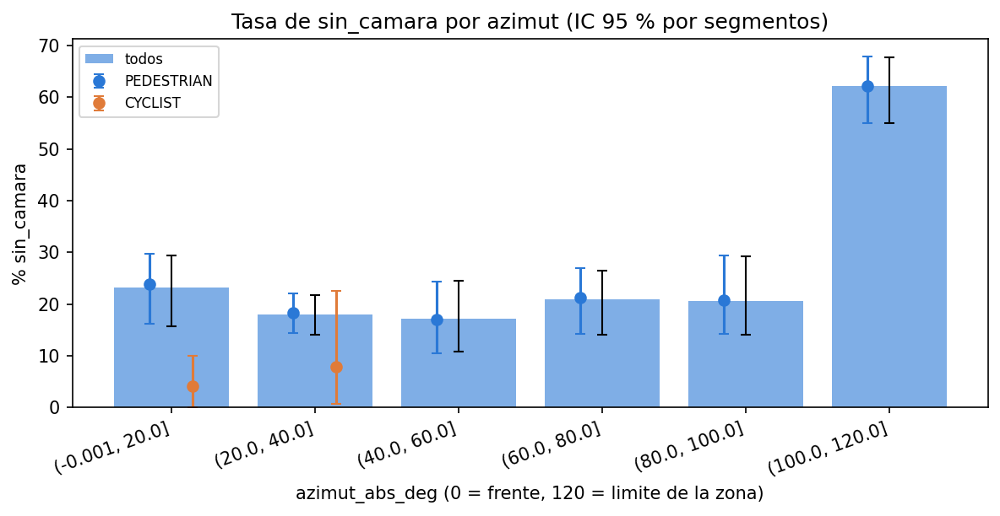

*Figura: Tasa de sin_camara por azimut. Archivo: `images/08_tasa_por_azimut.png`.*

**Test sellado.** Los 8 segmentos de test no se abrieron hasta el notebook 10. Solo se contaron filas y positivos por segmento para el plan (archivo `07_conteos_test.csv`):

| Segmento | Ubicación | Momento del día | Filas (120°) | Positivos (120°) | Filas (principal) | Positivos (principal) | Filas en la franja | Positivos en la franja |
|---|---|---|---|---|---|---|---|---|
| 102124064984 | location_sf | Dawn/Dusk | 882 | 65 | 851 | 48 | 31 | 17 |
| 141430544948 | location_other | Day | 1.695 | 280 | 1.654 | 256 | 41 | 24 |
| 167359384489 | location_other | Day | 203 | 3 | 196 | 2 | 7 | 1 |
| 221704303323 | location_sf | Night | 4.932 | 1.062 | 4.653 | 918 | 279 | 144 |
| 257766998801 | location_sf | Day | 6.837 | 2.298 | 6.474 | 2.046 | 363 | 252 |
| 497181704156 | location_phx | Day | 384 | 29 | 369 | 16 | 15 | 13 |
| 645616575015 | location_phx | Day | 2.170 | 631 | 1.710 | 445 | 460 | 186 |
| 703836276130 | location_phx | Day | 194 | 10 | 155 | 3 | 39 | 7 |

### Preparación y calidad de los datos

**Filtros aplicados, en este orden.** (1) Solo los 41 segmentos supervisados. (2) Solo frames etiquetados: en cada segmento se descartan los frames sin ningún positivo de `tiene_camara`, porque sus objetos quedarían en 0 por falta de etiqueta y no porque la cámara no los viera; las filas pasan de 489.613 a 457.070 (93,4 % conservadas) y la tasa de `tiene_camara` de 13,4 % a 14,4 % (`reporte_filtro_frames.csv`, notebook 06). (3) Solo peatones y ciclistas, porque `sin_camara` solo es una pregunta para ellos: en train, los vehículos y las señales nunca son positivos (sección 5). (4) La población principal, |azimut| <= 100° (sección 3).

**Nulos, duplicados y valores atípicos.** El notebook 06 revisó los 489.613 registros de los segmentos supervisados antes del filtro de frames y no encontró nulos ni infinitos en las variables de entrada; las filas duplicadas por llave (segmento, frame, objeto) son 0, los tamaños menores o iguales a cero 0 y las cajas con cero puntos LiDAR 42.354 (esas cajas son reales: objetos que el LiDAR casi no vio). Con la población principal de train (64.509 filas, calculado al generar este informe) los nulos son 0 en las 16 variables, los duplicados por llave 0 y 6,2 % de las cajas tienen cero puntos. No eliminamos atípicos: son objetos reales (cajas lejanas con pocos puntos, cajas grandes); los árboles no se afectan por la escala y la regresión logística usa `log1p` y estandarización (columna de tratamiento).

**Variables.** Las 16 variables del modelo (conjunto `TODAS_B`) y su tratamiento. Las variables nuevas que se probaron en el 08 (temporales y de oclusión: `n_ocl`, `frac_cub`, `dist_ocl`, puntos en frames anteriores) no mejoraron el resultado con el criterio fijado antes y no entraron en los modelos (sección 6). Logaritmos y escalado: la regresión logística aplica `log1p` y luego estandariza 4 variables (`num_lidar_points`, `num_top_lidar_points`, `densidad_puntos`, `volumen_caja`) y solo estandariza las otras 12; los árboles (HGB y Random Forest) usan las variables sin transformar; el aprendizaje no supervisado usa los logaritmos de puntos, densidad y volumen (sección 7).

| Variable | Definición | Nulos | % fuera de 1,5 IQR (train) | Tratamiento en la regresión logística |
|---|---|---|---|---|
| `box_center_x` | Coordenada x del centro de la caja 3D (m), en el marco del vehículo | 0 | 0,0 % | estandarización |
| `box_center_y` | Coordenada y del centro de la caja 3D (m) | 0 | 2,1 % | estandarización |
| `box_center_z` | Coordenada z del centro de la caja 3D (m) | 0 | 5,6 % | estandarización |
| `azimut_abs_deg` | Valor absoluto del ángulo del centro de la caja respecto del eje x, en grados (derivada de x e y) | 0 | 0,4 % | estandarización |
| `distancia_m` | Distancia euclidiana al sensor: raíz de x al cuadrado más y al cuadrado | 0 | 0,0 % | estandarización |
| `box_length` | Largo de la caja (m) | 0 | 2,8 % | estandarización |
| `box_width` | Ancho de la caja (m) | 0 | 2,5 % | estandarización |
| `box_height` | Alto de la caja (m) | 0 | 9,4 % | estandarización |
| `volumen_caja` | Largo por ancho por alto | 0 | 1,8 % | log1p y estandarización |
| `num_lidar_points` | Puntos LiDAR dentro de la caja | 0 | 10,9 % | log1p y estandarización |
| `num_top_lidar_points` | Puntos dentro de la caja captados por el LiDAR superior | 0 | 10,7 % | log1p y estandarización |
| `densidad_puntos` | Puntos LiDAR divididos por el volumen de la caja | 0 | 11,9 % | log1p y estandarización |
| `speed_mps` | Norma de la velocidad horizontal (x, y) de la etiqueta (m/s) | 0 | 1,4 % | estandarización |
| `heading_sin` | Seno del rumbo de la caja | 0 | 0,0 % | estandarización |
| `heading_cos` | Coseno del rumbo de la caja | 0 | 0,0 % | estandarización |
| `es_ciclista` | 1 si la clase es ciclista, 0 si es peatón | 0 | no aplica (binaria) | estandarización |

**Escalado y fuga.** El escalado y la imputación se ajustan solo con los datos de entrenamiento de cada fold (son parte del `Pipeline`), nunca con el fold de validación ni con el test. El notebook 06 dejó escrito el tratamiento previsto para el 09:

> **Tratamiento de nulos y escalas:** se difiere al pipeline de modelamiento (notebook 09)
> para ajustarlo **solo con train** y evitar fuga: imputación por mediana, `log1p` en las
> variables asimétricas y estandarización para la regresión logística; los árboles usan las
> variables sin transformar. `object_type` se codifica con *one-hot* (4 categorías).

Para evitar la fuga, ninguna variable proviene del par 2D ni de la tabla de asociación cámara-LiDAR; los identificadores (`key.laser_object_id`, `key.frame_timestamp_micros`) no son variables del modelo y los segmentos nunca se reparten entre train y test. El notebook 08 lo comprueba con un `assert`: Control anti-fuga OK: las variables nuevas usan solo puntos LiDAR del mismo track (frames <= t) y geometria de cajas del mismo frame.

## 4. Metodología (CRISP-DM)

Seguimos las seis fases de CRISP-DM. Cada fila dice qué se hizo, dónde está y qué archivo lo respalda.

| Fase | Qué se hizo | Sección y notebook | Evidencia (archivo) |
|---|---|---|---|
| 1. Entendimiento del negocio | Problema (auditar cajas 3D sin par 2D), objetivos, KPIs con metas fijadas antes, elección del target entre cinco candidatas | Secciones 2 y 5; notebook 07 | `data/08_reporting/decision_target_ep2.csv`; `docs/decision_target_ep2.md` |
| 2. Entendimiento de los datos | Selección de segmentos, EDA, tasa de `sin_camara` por puntos, azimut, distancia y clase; geometría de cámaras; franja 100-120° | Secciones 3 y 6; notebooks 00, 02, 06 y 08 | `docs/seleccion_segmentos/segmentos_ep2.csv`; `data/08_reporting/08_tasa_por_puntos.csv`; `data/08_reporting/08_tasa_por_azimut.csv` |
| 3. Preparación de los datos | Ingesta con Kedro, filtro de frames etiquetados, población principal, variables derivadas, split por segmento con 5 folds | Secciones 3 y 6; ingesta (Kedro) y notebooks 06 y 08 | `data/05_model_input/split_segmentos.csv`; `data/05_model_input/features_B.parquet`; `data/05_model_input/config_features_B.json` |
| 4. Modelado | Baselines simples, regresión logística, HGB y Random Forest con búsqueda anidada por segmento; aprendizaje no supervisado | Secciones 7 y 8; notebooks 08 y 09 | `data/08_reporting/09_comparacion_modelos.csv`; `data/06_models/hiperparametros_B.json`; `data/08_reporting/08_clusters_seleccion_k.csv` |
| 5. Evaluación | Criterios fijados antes, plan de evaluación congelado con sha256, test sellado, influencia, equidad y sensibilidad | Secciones 4 y 9; notebooks 09b y 10 | `data/06_models/plan_evaluacion_test.json`; `data/08_reporting/10_resultado_principal.csv`; `data/08_reporting/10_hashes_ejecucion1.json` |
| 6. Despliegue | Recomendación de uso en dos niveles con una persona en el circuito, monitoreo y reproducibilidad (scripts, pruebas, paquete de entrega) | Secciones 10 a 13 | `docs/evaluacion_final_B.md`; `scripts/generar_informe_tecnico.py`; `docs/informe_tecnico_EP2.md` |

**Criterios fijados antes de mirar resultados.** Cada notebook fija sus criterios en una celda antes de calcular y no los cambia al ver los números. Los de la evaluación final, tomados del plan congelado:

- "Vale la pena": la Fracción para 80 % del modelo baja al menos 5 % puntos frente al baseline, con IC 95 % pareado que excluya 0, y el AUC sube al menos 0,030.
- Elección entre modelos: ΔAUC >= 0,010 y ambos IC excluyen 0.
- Estabilidad: AUC mínimo por fold >= 0,750 y mediana del AUC por segmento >= 0,800.
- Operación: recall objetivo 0,800, presupuesto de revisión 20 % de las cajas; el punto A se considera sostenido en test si el recall puntual es >= 0,750.
- Calibración aceptable: ECE <= 0,050.

**Validación por segmento y prevención de fuga.** `StratifiedGroupKFold` por segmento; la búsqueda de hiperparámetros es anidada (`GroupKFold(3)` interno por segmento, criterio PR-AUC) dentro de cada fold externo; los umbrales de operación se fijan solo con predicciones internas de entrenamiento; el preprocesamiento se ajusta dentro de cada fold. Los intervalos son bootstrap por segmentos (remuestreo de segmentos completos, diferencias pareadas), porque las filas de un mismo segmento no son independientes. Con 8 segmentos de test los intervalos son anchos y así se reportan.

**Por qué comparar contra baselines simples.** Un modelo complejo solo se justifica si supera a una regla que se explica en una línea. Es como justificar un instrumento nuevo: hay que mostrar que mide mejor que la regla de medir a ojo. Los baselines son: menos puntos LiDAR, menos puntos de la parte alta (`Regla: menos puntos top`), la regla geométrica (azimut > 105° primero, luego menos puntos) y un modelo mínimo de 3 variables.

**Plan de evaluación del test congelado.** Antes de abrir el test se congelaron modelos, umbrales, calibrador y criterios con sha256 (`data/06_models/plan_evaluacion_test.json`, plan en `docs/plan_evaluacion_test.md`). Hubo una versión v1 y una v2 (v1 conservada); la v2 se congeló el 2026-10-18T13:42:13-03:00. Cambios de la v2 respecto de la v1:

1. **Modelos de la sensibilidad a 120°.** En v1 la sensibilidad usaba los modelos entrenados en la población principal. Ahora hay modelos congelados entrenados sobre toda la población de 120° de train (`*_B120.joblib`), con los mismos hiperparámetros finales del 09 (sin nueva búsqueda) y umbrales fijados con predicciones internas fuera de fold de esa población. Motivo: que la sensibilidad compare modelos entrenados en la población que evalúa.
2. **Comparación principal pre-declarada.** Se declara una sola comparación principal: población principal (|azimut| ≤ 100°), modelo Regresión logística (el mejor modelo aprendido según la prueba de elección del 09, leído de `hiperparametros_B.json`) frente a la Regla: menos puntos top (el mejor baseline simple elegido en train), con el criterio 'vale la pena' del 09. Todo lo demás es secundario. Motivo: evitar elegir la comparación después de ver el test.
3. **El mejor baseline del test sale del criterio principal.** En v1 el mejor baseline simple se elegía por AUC del test. Ahora el criterio principal usa el baseline elegido en train, y 'qué baseline habría sido el mejor en test' es un análisis de sensibilidad separado. Motivo: no usar el test para elegir contra qué se compara.
4. **Punto A sostenido.** El punto A se considera sostenido si el recall puntual en test es ≥ 0,75; se reporta además el % de frames revisados frente al de train. El punto B se reporta sin tolerancia. No se recalibra ni se mueve ningún umbral. Motivo: fijar de antemano qué se entiende por sostenido.
5. **Calibración en test.** Descriptiva: ECE, Brier y curva de confiabilidad del mejor modelo aprendido con el calibrador congelado. Motivo: saber si las probabilidades publicadas conservarían su significado.
6. **Análisis de influencia.** Se repite la comparación principal excluyendo cada uno de los dos segmentos más grandes, ambos, y leave-one-segment-out (8 resultados), con el rango. Motivo: con 8 segmentos y dos que concentran la mayor parte de las filas, el resultado puede depender de uno solo.
7. **Equidad descriptiva.** Por ubicación, momento del día y clase, con número de segmentos y filas, recall al punto A y AUC solo con ≥ 200 filas por clase, sin pruebas de hipótesis. Motivo: describir sin sobreinterpretar grupos de un solo segmento.
8. **Tabla de diferencias con train.** Para cada método: AUC, Fracción para 80 %, recall y % revisado en el punto A, en test frente al OOF de train. Motivo: ver qué cambia entre train y test y por qué.
9. **Congelamiento v2.** El plan v1 se conserva (`plan_evaluacion_test_v1.*`); este es el v2, con nuevos sha256 (incluidos los `*_B120.joblib`) y nuevo sello de fecha y hora.

Archivos congelados (sha256 verificado al inicio del notebook 10): son 14, los 12 de `sha256.archivos` de `plan_evaluacion_test.json` (modelos, calibrador, hiperparámetros y configuración de variables, también los de 120°) más `features_B.parquet` y `plan_evaluacion_test_v1.json`. `plan_evaluacion_test.json` no se incluye porque guarda los sha256 y no se hashea a sí mismo. `scripts/verificar_congelados.py` comprueba los mismos 14.

| Archivo | Sha256 (primeros 16 caracteres) |
|---|---|
| hiperparametros_B.json | dbf1c7d275dea216 |
| config_features_B.json | c81ed082c26b3d86 |
| calibrador_B.joblib | 685e46723e88e80e |
| lr_minimo_B.joblib | d5dabd6c6b074a28 |
| lr_B.joblib | 993c2f2bbace25f0 |
| hgb_B.joblib | ac8328046919c4ad |
| rf_B.joblib | b990648ec16b3b5d |
| lr_B120.joblib | f4c80b104d4a157e |
| hgb_B120.joblib | 37ea6400a7b32816 |
| rf_B120.joblib | cd9a0fc66f8975a3 |
| lr_minimo_B120.joblib | 545bfac46ae29424 |
| hiperparametros_B120.json | 421ed63cf989c8d2 |
| features_B.parquet | 4cb6af91da2bc6b9 |
| plan_evaluacion_test_v1.json | e4188b80a33fad59 |

## 5. Elección del target (notebook 07)

Antes de modelar comparamos cinco candidatas con criterios fijados antes de calcular (`decision_target_ep2.csv`):

- A: `tiene_camara` en todos los objetos.
- B: `sin_camara` en peatones y ciclistas dentro de la zona de cámaras.
- C: desplazamiento a 2 segundos (regresión).
- D: peatón frente a ciclista.
- E: conflicto con el corredor del auto a 2 segundos.

**Decisión: B.** Resumen generado por el notebook 07. Las cifras de B (AUC, prevalencia, fracciones de revisión, diferencia modelo menos regla) son de una versión previa del análisis con la población de 120°, y se rotularon así; la tabla siguiente las compara con las vigentes.

> **Decisión.** Target elegido para EP2: B.
>
> **Razones**
>
> 1. `tiene_camara` en todos los objetos queda dominado por la clase: vehículos y señales tienen 0 positivos en 265.377 filas [cifra del notebook 07, sin archivo de salida], y una regla de una línea da AUC 0,975 (el modelo, 0,992).
> 2. `sin_camara` en peatones y ciclistas dentro de la zona de cámaras es la clase rara (23,2 %) y se predice con AUC 0,854 (IC 95 % 0,810–0,897), con AUC mínimo por fold 0,824 y brechas Day/Night de 0,000 [cifras de una versión previa del análisis (población de 120°); ver la nota 'Actualización posterior al 08 y 09' del 07].
> 3. El desplazamiento a 2 s (C) no mejora la velocidad constante: error 0,28 m contra 0,29 m del modelo (-2,4 %); peatón vs ciclista (D) y conflicto (E) también se descartan (D: 2.105 filas de ciclistas en 12 segmentos y bajo valor de negocio; E: 68 casos de conflicto en 5 objetos).
> 4. Valor práctico (versión previa, población de 120°): para encontrar el 80 % de las cajas 3D etiquetadas sin par 2D hay que revisar el 39,1 % de los frames con el modelo, el 50,5 % con la regla simple [cifras de una versión previa del análisis (población de 120°); ver la nota 'Actualización posterior al 08 y 09' del 07] de menos puntos LiDAR primero y el 80,0 % al azar (modelo menos regla: -11.4 puntos, IC 95 % -19.0 a -6.1 [cifras de una versión previa del análisis (población de 120°); ver la nota 'Actualización posterior al 08 y 09' del 07]). En el tope de la lista (Captura@20 %) la ventaja sobre la regla es pequeña (+3.5 puntos): el modelo aporta más en alta cobertura. **Actualización:** la población principal pasa a |azimut| ≤ 100° y, frente a la regla geométrica, la diferencia del HGB en la población de 120° es +4.8 puntos en Fracción para 80 % (IC -1.3 a +9.1); la ventaja de la versión previa no se sostiene. Recomendación del 09: Regla: menos puntos top.
>
> **Limitaciones**
>
> - Los puntos LiDAR sostienen el modelo (sin ellos AUC 0,654): modela cobertura de etiquetado y calidad de observación, no visibilidad física de la cámara, y no sirve como alerta dentro del auto.
> - Pocos ciclistas, muestra con etiquetado denso, folds estratificados por `tiene_camara`, y un test de 8 segmentos con etiquetado muy desigual (`sin_camara` de 1,5 % a 33,6 % por segmento).
> - El movimiento del auto para C se estimó con señales de tránsito porque no había vehicle_pose.

**Cifras del 07 que la nota "Actualización posterior al 08 y 09" dejó desactualizadas, y su valor vigente** (cada valor vigente sale de los archivos indicados):

| Cifra del 07 | Valor en el 07 (versión previa, 120°) | Valor vigente | Fuente del valor vigente |
|---|---|---|---|
| Prevalencia de sin_camara | 0,232 | 0,207 (población principal, train) | 09_resumen_cifras.json |
| AUC con todas las variables | 0,854 | Regresión logística 0,825; Regla: menos puntos top 0,862 | 09_comparacion_modelos.csv |
| AUC mínimo por fold | 0,824 | Regresión logística 0,811 | 09_auc_por_fold.csv |
| Fracción para 80 % con el modelo | 39,1 % (HGB) | Regresión logística 43,7 %; Regla: menos puntos top 37,8 % (población principal) | 09_comparacion_modelos.csv |
| Fracción para 80 % con la regla de puntos | 50,5 % | Regla: menos puntos top 37,8 % (principal) | 09_comparacion_modelos.csv |
| Diferencia modelo menos regla (Fracción para 80 %) | -11,4 puntos (HGB menos regla de puntos, IC 95 % -19,0 a -6,1) | HGB menos regla de puntos en 120°: -9,0 puntos (IC -20,0 a -2,0); HGB menos regla geométrica en 120°: +4,8 puntos (IC -1,3 a +9,1) | 09_resumen_cifras.json |
| Conteos del test (filas / positivos) | 17.297 / 4.378 | 16.062 / 3.734 (población principal) | 07_conteos_test.csv |

Tabla de descarte (generada por el notebook 07; las cifras de A, C, D y E no dependen del borde de azimut):

**Candidatas descartadas**

| Candidata | Motivo | Evidencia |
|---|---|---|
| A: tiene_camara en todos los objetos | dominado por clase y zona de cámaras | regla R2 AUC 0,975; modelo 0,992 (+0,018, techo 0,025); PR-AUC +0,163; 0 positivos en 265.377 filas [cifra del notebook 07, sin archivo de salida] de vehículos y señales |
| C: desplazamiento a 2 s | la velocidad constante ya lo resuelve; el modelo no la mejora | error 0,28 m (velocidad constante) vs 0,29 m (modelo); mejora -2,4 %, IC 95 % inferior -11,6 %; gana en 2 de 5 folds |
| D: peatón vs ciclista | pocos ciclistas y bajo valor de negocio | 2,09 % ciclistas en 12 segmentos [cifra del notebook 07, sin archivo de salida]; folds sin ciclistas: 1 de 5; AUC 0,988 vs 0,703 del baseline simple |
| E: conflicto con el corredor a 2 s | eventos insuficientes | 68 casos, 5 objetos distintos, 2 segmentos, 2 de 5 folds |

Tabla de criterios (cada fila es un criterio fijado antes; los valores de B son de la versión previa, población de 120°). Leyenda de las columnas: `umbral` es el valor fijado antes; `valor` es lo observado; `cumple` dice si el valor cumple el umbral; `decide` dice si el criterio cuenta para el veredicto del target (`False` significa que solo es informativo y no decide):

| Target | Criterio | Umbral | Valor | Cumple | Decide |
|---|---|---|---|---|---|
| A | AUC modelo - mejor regla | >= 0,05 | +0,018 | False | True |
| A | PR-AUC modelo - mejor regla | >= 0,05 | +0,163 | True | True |
| A | folds donde el modelo gana | >= 4 | 5 | True | True |
| B | AUC (todas las variables) | >= 0,7 | 0,854 | True | True |
| B | AUC minimo por fold | >= 0,6 | 0,824 | True | True |
| B | PR-AUC - prevalencia | >= 0,1 | +0,516 | True | True |
| B | brecha AUC Day vs Night | <= 0,1 | 0,000 | True | True |
| B | brecha AUC entre ubicaciones | <= 0,1 | 0,061 | True | True |
| B | prevalencia de sin_camara | 0,05-0,5 | 0,232 | True | True |
| B | aporte no geometrico (info) | >= 0,02 | +0,219 | True | False |
| C | mejora vs mejor vel. constante (con speed) | >= 10% | -2,4% | False | True |
| C | IC95% inferior de esa mejora | > 0,0 | -11,6% | False | True |
| C | mejora sin speed_mps | >= 5% | -8,3% | False | True |
| C | IC95% inferior sin speed_mps | > 0,0 | -18,2% | False | True |
| C | folds donde el modelo gana | >= 4 | 2 | False | True |
| C | desplazamiento mediano a 2 s (m) | >= 0,5 | 1,74 | True | True |
| C | cobertura de filas utilizables | >= 60% | 71,9% | True | True |
| B | brecha AUC Dawn/Dusk vs Day (informativa) | sin umbral previo | 0,075 | True | False |
| apoyo | silhouette KMeans | >= 0,25 | 0,394 | True | False |
| apoyo | estabilidad por segmento (ARI) | >= 0,8 | 0,798 | False | False |
| apoyo | cociente de error entre clusters | >= 1,5 | 4,18 | True | False |

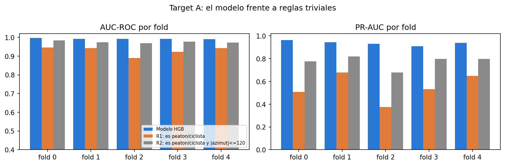

*Figura: Candidata A: modelo frente a reglas. Archivo: `images/07_A_modelo_vs_reglas.png`.*

La analogía: A es como medir si una pelota es una pelota; el modelo acierta porque los vehículos nunca tienen el problema, no porque entienda las cámaras. B es la pregunta que sí tiene incertidumbre.

Nota de actualización que el propio 07 conserva (generada por el notebook; sus cifras antiguas están rotuladas como versión previa):

> **La población principal pasa de 120° a |azimut| ≤ 100° por el hallazgo de la franja** (notebook 08, A.6 y A.7: la tasa de `sin_camara` sube a 62,2 % en 100–120°). El target (`sin_camara`), el split y el veredicto no cambian.
>
> **Cifras de este notebook que eran para la población de 120° y quedan como versión previa:**
>
> - Sección 5 (B): AUC 0,854, PR-AUC 0,747, AUC mínimo por fold 0,824, brecha Day/Night 0,000
> - Sección 7: los criterios de B de la tabla de decisión se evaluaron en la población de 120°
> - Sección 8.4 y 9: Fracción para 80 % de 39,1 % (modelo) y 50,5 % (regla de puntos), diferencia de -11.4 puntos
> - Sección 11.1: los conteos del test de 17.297 filas de B y 4.378 positivos son de la población de 120° (para la principal, ver el párrafo de conteos de esa sección)
>
> Las secciones 4 (A), 6 (C, D, E) y 10 no dependen del límite de azimut de B (usan todos los objetos o todos los peatones y ciclistas) y no cambian.
>
> **Actualización posterior al 08 y 09 (las cifras de arriba son de la versión previa, población de 120°).** La población principal pasó de 120° a |azimut| ≤ 100° porque en 100–120° la ausencia de par 2D es en buena parte geométrica (08). En la población principal (64.509 filas) el mejor baseline simple es Regla: menos puntos top (AUC 0,862, Fracción para 80 % 37,8 %) y la recomendación del 09 es **Regla: menos puntos top**. En la población de 120°, con los modelos reentrenados en el 09, el HGB menos la regla de puntos da -9.0 puntos en Fracción para 80 % (IC -20.0 a -2.0) y menos la regla geométrica +4.8 puntos (IC -1.3 a +9.1): la ventaja de -11.4 puntos frente a la regla de puntos de la versión previa **no se sostiene** al compararla con un baseline geométrico.

## 6. Análisis de datos (notebook 08)

**Qué determina `sin_camara`.** La variable dominante son los puntos LiDAR: cuanto menos puntos tiene la caja, más probable es que no tenga par. La analogía: una persona que casi no aparece en la foto no recibe su recuadro. El efecto es gradual (tasa por tramo de puntos en la población de 120°, 68.555 filas de train):

| Puntos LiDAR | Filas | Tasa | IC inferior | IC superior |
|---|---|---|---|---|
| 0-5 | 9.135 | 0,805 | 0,659 | 0,880 |
| 6-10 | 4.540 | 0,402 | 0,286 | 0,504 |
| 11-20 | 9.078 | 0,201 | 0,139 | 0,283 |
| 21-50 | 17.199 | 0,132 | 0,086 | 0,180 |
| 51-100 | 11.557 | 0,087 | 0,054 | 0,116 |
| >100 | 17.046 | 0,094 | 0,056 | 0,134 |

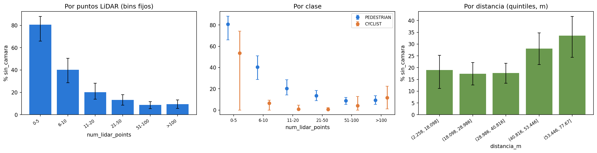

*Figura: Tasa de sin_camara por puntos, clase y distancia. Archivo: `images/08_tasa_por_puntos_clase_distancia.png`.*

Resumen generado por el notebook 08. **Las cifras de este resumen se calcularon con la población de 120° completa** (por ejemplo, el AUC del HGB de 0,854 coincide con la fila "B completa" de `08_comparacion_sin_franja.csv`); en la población principal las cifras vigentes son las de la sección 8.

> **Qué produce `sin_camara`.** La tasa va de 80,5 % con 0-5 puntos a 9,4 % con >100. El cambio es gradual: el mejor corte único (7 puntos) logra AUC 0,665 frente a 0,797 de la regla continua y su ubicación varía entre folds. Dentro de un mismo objeto, el 80,0 % de los objetos mixtos tiene más puntos en los frames con par 2D (Wilcoxon p = 1.9e-29), aunque la distancia también cambia.
>
> **Puntos clave**
>
> 1. **Robustez.** La mediana del AUC por segmento del HGB es 0,864 (IQR 0,818–0,913, 16 segmentos evaluables) frente a 0,854 agrupado; la regla simple tiene 0,802 por segmento y 0,797 agrupado.
> 2. **Variables nuevas.** Ningún conjunto cumple el criterio fijado antes (ΔAUC ≥ 0,01 y fracción para 80 % −2 puntos con IC que excluya 0): la regla "pocos puntos" explica casi todo y el modelo agrega solo la parte ya medida en el 07. Mejor AUC: TODAS_B + ambos (0,861).
> 3. **No supervisado.** k = 2, silhouette 0,387, estabilidad ARI 0,953 (mínimo 0,301), rango de la tasa entre clusters 12,4 puntos y diferencia con signo de 12,4 puntos (IC 7,6 a 18,2): estructura útil según el criterio; las probabilidades del modelo ya siguen esas tasas, así que describe pero no agrega información predictiva.

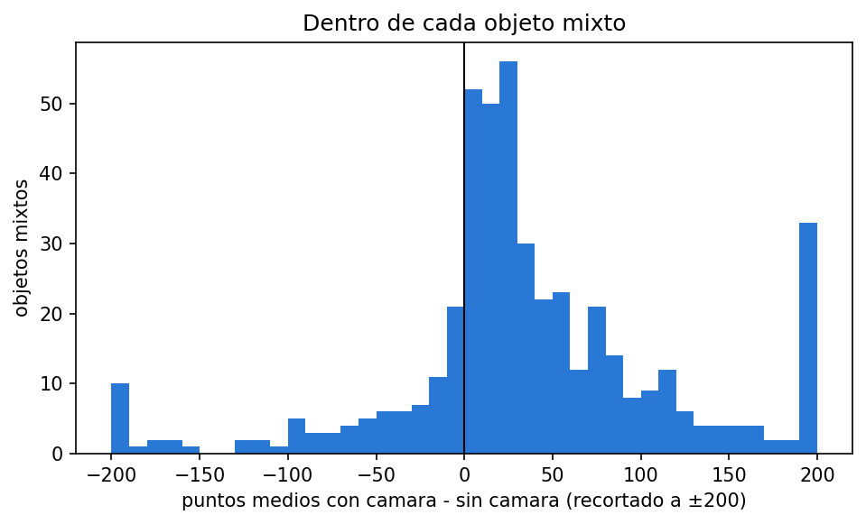

*Figura: Comparación pareada dentro de objetos mixtos (más puntos en los frames con par). Archivo: `images/08_pareado_objetos_mixtos.png`.*

**Importancia por permutación (caída de AUC del HGB en el notebook 08, población de 120°; no es comparable con la del notebook 09, que usa la población principal).**

| Variable | Caída del AUC |
|---|---|
| num_top_lidar_points | 0,122 |
| azimut_abs_deg | 0,059 |
| densidad_puntos | 0,007 |
| distancia_m | 0,007 |
| box_height | 0,006 |
| pts_min10 | 0,005 |
| pts_min5 | 0,004 |
| num_lidar_points | 0,003 |

**Robustez por segmento.** AUC por segmento en train (08), solo segmentos evaluables (al menos 200 cajas de cada clase):

| Método | Segmentos evaluables | Mediana | Q1 | Q3 |
|---|---|---|---|---|
| HGB | 16 | 0,864 | 0,818 | 0,913 |
| Regresión logística | 16 | 0,873 | 0,802 | 0,920 |
| Regla: menos puntos LiDAR primero | 16 | 0,802 | 0,743 | 0,866 |

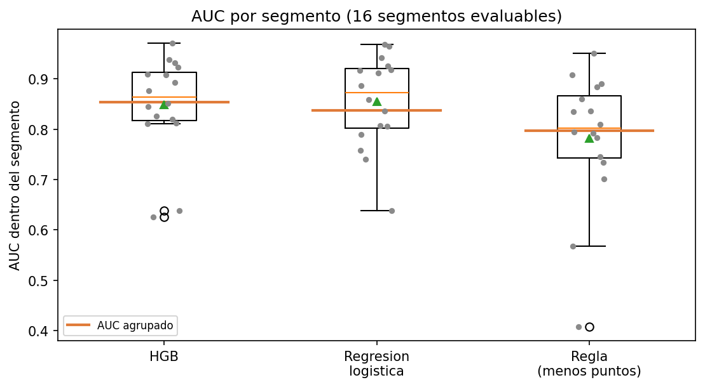

*Figura: AUC por segmento. Archivo: `images/08_auc_por_segmento.png`.*

**Variables nuevas (temporales y de oclusión).** Se evaluaron con un criterio fijado antes (descrito en el resumen del 08 citado arriba) y con la población de 120° completa. La columna `ayuda` dice si el conjunto lo cumplió:

| Conjunto | AUC | Fracción para 80 % | Dif. de AUC | Dif. de Fracción para 80 % | Ayuda |
|---|---|---|---|---|---|
| TODAS_B | 0,854 | 0,391 |  |  | False |
| TODAS_B + temporales | 0,852 | 0,400 | -0,002 | 0,009 | False |
| TODAS_B + oclusion | 0,853 | 0,388 | -0,001 | -0,004 | False |
| TODAS_B + ambos | 0,861 | 0,373 | 0,007 | -0,018 | False |

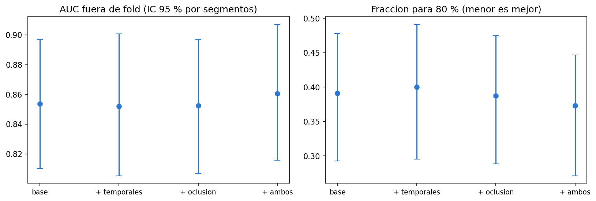

*Figura: Conjuntos de variables. Archivo: `images/08_conjuntos_variables.png`.*

**Geometría de cámaras.** `camera_calibration` no está en los datos locales; el 08 usa la tabla de asociación (`key.camera_name`) para describir el azimut de las cajas asociadas por cámara. Eso no es calibración: no da yaw ni campo de visión. La Tabla 3 de Sun et al. (2020) da un campo de visión horizontal de ±25,2° para las cinco cámaras. No verificamos el yaw de montaje de cada una. Los rangos empíricos del 08 (tabla siguiente) son consistentes con cámaras laterales centradas cerca de ±90°, cuya cobertura llegaría hasta unos 115°, y con que la tasa de `sin_camara` pase de 37,0 % en 105-110° a 76,2 % en 110-115° y 100,0 % en 115-120° (`08_tasa_azimut_5grados.csv`). Es una hipótesis geométrica que debe validarse con `camera_calibration`; no cambia la población principal, cuyo corte de 100° es conservador.

| Cámara | Asociaciones | Azimut p1 | p5 | Mediana | p95 | p99 | Min | Max |
|---|---|---|---|---|---|---|---|---|
| 1 (frontal) | 25.020 | -23,329 | -20,982 | -6,540 | 20,062 | 23,223 | -25,221 | 26,268 |
| 2 (frontal izq.) | 11.926 | 18,863 | 20,365 | 36,122 | 63,096 | 66,819 | 15,965 | 69,543 |
| 3 (frontal der.) | 10.929 | -63,576 | -60,510 | -32,757 | -19,496 | -17,130 | -69,009 | -10,363 |
| 4 (lateral izq.) | 6.359 | 60,793 | 64,393 | 85,157 | 109,196 | 111,648 | 45,114 | 113,692 |
| 5 (lateral der.) | 3.627 | -109,506 | -105,250 | -77,291 | -57,558 | -52,386 | -113,182 | -43,270 |

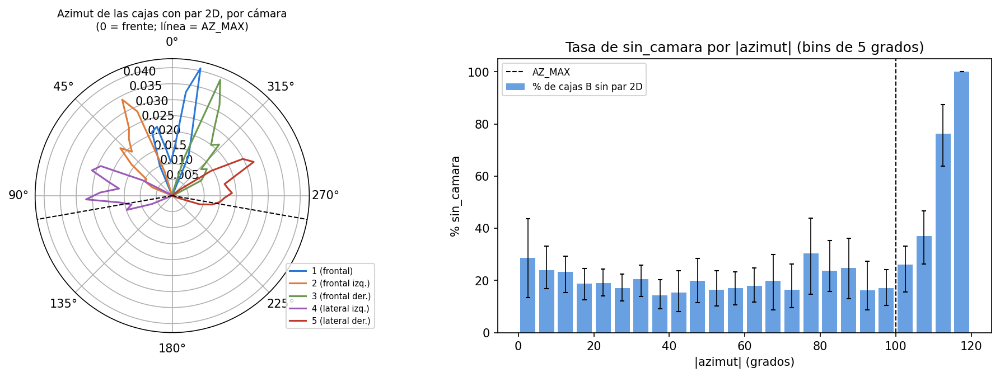

*Figura: Azimut de las cajas asociadas por cámara. Archivo: `images/08_geometria_camaras.png`.*

## 7. Aprendizaje no supervisado (notebook 08, sección D, y exploración con k = 3 y 4)

**Para qué.** El no supervisado no entrena nada contra `sin_camara`: pregunta si las cajas se agrupan solas en tipos de observación y si esos tipos se parecen a los grupos con más o menos pares. Es como ordenar las fotos por parecido sin mirar la etiqueta, y recién después ver cuántas tienen anexo.

**Técnicas y métricas.** KMeans, mezcla gaussiana (GMM) y agrupamiento jerárquico (Ward) sobre variables de distancia, azimut, puntos (en logaritmo), densidad, volumen y oclusión; para elegir k: silhouette, Davies-Bouldin, Calinski-Harabasz y BIC del GMM.

| k | Silhouette | Davies-Bouldin | Calinski-Harabasz | BIC GMM | Tamaño del cluster más chico |
|---|---|---|---|---|---|
| 2 | 0,387 | 1,045 | 35.662,010 | 26.856,993 | 0,233 |
| 3 | 0,298 | 1,264 | 35.156,378 | -405.480,284 | 0,232 |
| 4 | 0,251 | 1,422 | 29.184,669 | -453.682,143 | 0,199 |
| 5 | 0,227 | 1,480 | 25.839,183 | -476.166,910 | 0,109 |
| 6 | 0,230 | 1,415 | 24.031,805 | -632.226,053 | 0,105 |
| 7 | 0,229 | 1,385 | 23.098,912 | -610.628,975 | 0,098 |
| 8 | 0,218 | 1,418 | 21.563,213 | -645.946,285 | 0,092 |

El k elegido por máximo silhouette de KMeans es 2. Concordancia entre técnicas (ARI): KMeans vs GMM 0,997, KMeans vs jerarquico 1,000, GMM vs jerarquico 0,997. Estabilidad por segmento (30 remuestreos): ARI medio 0,953 y mínimo 0,301. Diferencia con signo entre los dos clusters en la tasa de `sin_camara`: 12,4 puntos (IC 95 % por segmentos 7,6 a 18,2; excluye 0). Estas cifras vienen de `data/08_reporting/08_no_supervisado_resumen.json`, extraído una vez del notebook 08 con `scripts/extraer_no_supervisado_08.py`.

El BIC del GMM no se usó para elegir k: pasa de +26.857 (k = 2) a -405.480 (k = 3) y sigue bajando hasta -645.946 (k = 8), lo que no es una curva interpretable. Un diagnóstico post hoc, no pre-declarado (`scripts/diagnostico_post_hoc_08.py`), reprodujo el ajuste y encontró la causa más probable: en k = 3 la varianza mínima de un componente es 1,0e-06, igual al piso de regularización de scikit-learn, es decir, covarianzas degeneradas en las variables discretas (`n_ocl`, `frac_cub`, `dist_ocl_f`), que disparan la verosimilitud. Sin esas variables el BIC es +208.719 (k = 2), +145.656 (k = 3) y +76.395 (k = 4). No lo usamos para elegir k en ningún caso.

**Perfiles con k = 2 (el elegido) y su cruce con `sin_camara`.** La tasa de cada cluster tiene IC 95 % por segmentos:

| Cluster | Filas | Tasa | IC inferior | IC superior | Probabilidad media del modelo | % ciclistas | Distancia (m) | Puntos LiDAR | Perfil |
|---|---|---|---|---|---|---|---|---|---|
| 0 | 52.611 | 0,261 | 0,218 | 0,306 | 0,244 | 1,032 | 36,856 | 31 | a distancia media, de densidad media y ocluidos |
| 1 | 15.944 | 0,136 | 0,096 | 0,171 | 0,145 | 6,103 | 27,841 | 77 | a distancia media, densos y sin oclusores |

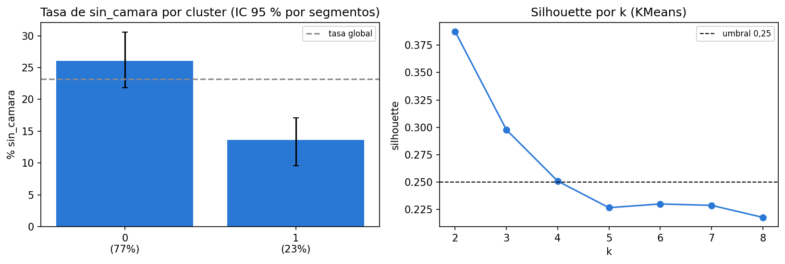

*Figura: Tasa de sin_camara por cluster. Archivo: `images/08_clusters_tasa.png`.*

**Exploración con k = 3 y 4.** Con más clusters aparece uno de objetos lejanos, con pocos puntos y oclusores, donde la tasa de `sin_camara` es la más alta (en k = 4):

| k | Cluster | Filas | Tasa | IC inferior | IC superior | Distancia (m) | Puntos LiDAR | Perfil |
|---|---|---|---|---|---|---|---|---|
| k3 | 0 | 27.726 | 0,392 | 0,321 | 0,476 | 50,637 | 13 | lejanos, poco densos y ocluidos |
| k3 | 1 | 24.908 | 0,114 | 0,078 | 0,144 | 23,155 | 83 | cercanos, densos y ocluidos |
| k3 | 2 | 15.921 | 0,136 | 0,096 | 0,171 | 27,796 | 78 | a distancia media, densos y sin oclusores |
| k4 | 0 | 14.813 | 0,142 | 0,096 | 0,181 | 17,541 | 141 | cercanos, densos y ocluidos |
| k4 | 1 | 15.904 | 0,137 | 0,096 | 0,171 | 27,763 | 78 | a distancia media, densos y sin oclusores |
| k4 | 2 | 24.254 | 0,127 | 0,089 | 0,175 | 41,188 | 31 | a distancia media, de densidad media y ocluidos |
| k4 | 3 | 13.584 | 0,627 | 0,547 | 0,690 | 52,996 | 4 | lejanos, poco densos y ocluidos |

**Cruce con la franja 100-120°** (los clusters se calcularon con la población completa de 120°):

| k | Cluster | Perfil | Filas | % del cluster en 100-120 | % de la franja que es del cluster | Tasa con franja (%) | Tasa sin franja (%) | IC sin franja |
|---|---|---|---|---|---|---|---|---|
| k = 2 | 0 | a distancia media, de densidad media y ocluidos | 52.611 | 4,982 | 64,780 | 26,061 | 23,939 | 19,5 a 28,4 |
| k = 2 | 1 | a distancia media, densos y sin oclusores | 15.944 | 8,938 | 35,220 | 13,629 | 9,649 | 5,9 a 12,7 |
| k = 3 | 0 | lejanos, poco densos y ocluidos | 27.726 | 1,511 | 10,356 | 39,216 | 38,485 | 31,1 a 46,7 |
| k = 3 | 1 | cercanos, densos y ocluidos | 24.908 | 8,841 | 54,424 | 11,394 | 6,421 | 4,6 a 8,3 |
| k = 3 | 2 | a distancia media, densos y sin oclusores | 15.921 | 8,950 | 35,220 | 13,649 | 9,665 | 5,9 a 12,7 |
| k = 4 | 0 | cercanos, densos y ocluidos | 14.813 | 14,805 | 54,202 | 14,237 | 5,800 | 3,0 a 8,6 |
| k = 4 | 1 | a distancia media, densos y sin oclusores | 15.904 | 8,960 | 35,220 | 13,663 | 9,676 | 5,9 a 12,8 |
| k = 4 | 2 | a distancia media, de densidad media y ocluidos | 24.254 | 0,140 | 0,840 | 12,715 | 12,655 | 8,8 a 17,4 |
| k = 4 | 3 | lejanos, poco densos y ocluidos | 13.584 | 2,900 | 9,738 | 62,706 | 61,941 | 53,6 a 68,2 |

**Detección de atípicos.** IsolationForest marca 686 cajas atípicas (1 %) en 28 segmentos, con tasa de `sin_camara` 80,3 % frente a 22,6 % en el resto.

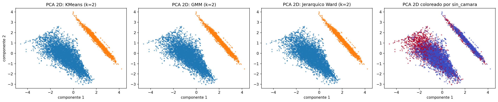

*Figura: Clusters sobre PCA. Archivo: `images/08_clusters_pca.png`.*

### Segmentos de lluvia (post hoc, no pre-declarado)

Los 5 segmentos de lluvia no se usaron en EP2 (sección 3). Como análisis descriptivo, asignamos sus 109 peatones y ciclistas con |azimut| <= 120° (0 ciclistas) a los clusters de KMeans con k = 2 y k = 4, reajustados con la misma semilla en train (reproducen los tamaños de `08_clusters_perfil.csv` y `08_clusters_k3_k4.csv`: sí) y con el mismo escalador. No usa el target, no toca `features_B.parquet`, y, como 4 de los 5 segmentos de lluvia no tienen frames etiquetados (asociación vacía) y 1 tiene 81 frames etiquetados, pero con etiquetado ralo (117 filas de asociación), se usan todos los frames de los 5 segmentos. Con tan pocas cajas es solo una descripción de composición:

| k | Cluster | Filas de train | % train | Filas de lluvia | % lluvia |
|---|---|---|---|---|---|
| 2 | 0 | 52.611 | 0,767 | 41 | 0,376 |
| 2 | 1 | 15.944 | 0,233 | 68 | 0,624 |
| 4 | 0 | 14.813 | 0,216 | 6 | 0,055 |
| 4 | 1 | 15.904 | 0,232 | 68 | 0,624 |
| 4 | 2 | 24.254 | 0,354 | 10 | 0,092 |
| 4 | 3 | 13.584 | 0,198 | 25 | 0,229 |

Con k = 2, el 62,4 % de las cajas de lluvia cae en el cluster «a distancia media, densos y sin oclusores», frente al 23,3 % en train; con k = 4, el 22,9 % cae en el cluster «lejanos, poco densos y ocluidos» (train: 19,8 %). La comparación no es pareja: los segmentos de lluvia usan todos sus frames y train usa solo los etiquetados. La composición es distinta, pero con 109 cajas, sin ciclistas y sin etiquetas no sacamos conclusiones sobre `sin_camara` en lluvia.

### Lectura de negocio

1. Los clusters se pueden leer como tramos de la cola de revisión: grupos de cajas que se parecen en distancia, densidad y oclusión y que la persona que revisa vería como "tipos de caso".
2. El cluster «lejanos, poco densos y ocluidos» (k = 4) reúne 19,8 % de las cajas y tiene una tasa de `sin_camara` de 62,7 % (IC 54,7 % a 69,0 %): ahí cerca de 6 de cada 10 cajas no tienen par.
3. Los otros tres clusters están entre 12,7 % y 14,2 %: son la parte de la cola donde revisar rinde menos.
4. Los clusters no mejoran la predicción: la probabilidad media del modelo en ese cluster (0,617) ya sigue su tasa (0,627), así que no aportan información que el modelo no tenga.
5. Sí ayudan a explicar y a comunicar: permiten decirle a quien revisa "estas cajas son lejanas, con pocos puntos y detrás de otras, por eso suelen no tener par", y a elegir cuándo cortar la revisión.

**Qué se concluye.** Hay una estructura útil según el criterio fijado antes (silhouette, estabilidad por segmento y rango de tasas con IC que excluye 0; ver el resumen del 08): los clusters se parecen a las zonas de pocos y muchos puntos. **Qué no se concluye.** Los clusters no agregan información predictiva: las probabilidades del modelo ya siguen esas tasas (columna `prob_media_modelo`). Describen, no predicen mejor.

## 8. Modelos supervisados (notebook 09)

**Modelos y baselines.** Regresión logística (LR), `HistGradientBoosting` (HGB) y Random Forest (RF), contra cuatro baselines simples. Ajuste de hiperparámetros anidado (por segmento) con búsqueda acotada (la cantidad de configuraciones por modelo está en las limitaciones del resumen del 09, citado más abajo). Semilla 42. Configuraciones finales (entrenadas con todo el train):

| Modelo | Configuración final | PR-AUC interno |
|---|---|---|
| LR | {"C": 0,001, "class_weight": null} | 0,706 |
| HGB | {"class_weight": null, "l2_regularization": 9,6098, "learning_rate": 0,0305, "max_depth": null, "max_leaf_nodes": 4, "min_samples_leaf": 100, "mono": false, "max_iter": 90} | 0,723 |
| RF | {"min_samples_leaf": 200, "max_features": "sqrt", "max_depth": 6} | 0,722 |

### Por qué estos algoritmos y esta configuración

1. **Regresión logística:** es la referencia lineal e interpretable (coeficientes y odds ratios en la tabla de abajo) y es el modelo que el 09 eligió para la comparación principal con la regla.
2. **HGB:** captura interacciones y relaciones no lineales sin transformar las variables; **Random Forest:** es robusto y poco sensible a los hiperparámetros, y sirve de contraste a un modelo de árboles de otro tipo.
3. **Hiperparámetros buscados** (búsqueda anidada por segmento, criterio PR-AUC): en la LR, la regularización `C` y el `class_weight` (16 configuraciones); en el HGB, hojas, mínimo de muestras por hoja, regularización L2, tasa de aprendizaje, iteraciones y monotonía (12 configuraciones); en el RF, profundidad, mínimo de muestras por hoja y variables por división (6 configuraciones). Con solo 33 segmentos de train, controlan el sobreajuste.
4. **`class_weight`** se evaluó (`09_class_weight.csv`, mejor PR-AUC interno promedio de los folds): HGB: sin peso 0,719 frente a balanced 0,719 (empate a 3 decimales; gana balanced por 0,0008); LR: sin peso 0,713 frente a balanced 0,711 (gana sin peso). **Por qué el HGB quedó sin peso aunque la tabla dé como ganador a balanced:** esa tabla promedia la mejor configuración de cada fold y la diferencia es de 0,0008, que no separa una opción de la otra. En la selección anidada por fold (`09_hiperparametros_por_fold.csv`) el HGB eligió balanced en 3 de 5 folds y sin peso en 2 (LR: balanced en 2 y sin peso en 3); el ajuste final repite la búsqueda con todo el train y su mejor configuración de 12 quedó sin peso (PR-AUC interno 0,723). En los modelos finales, el peso de clases quedó en: LR sin peso y HGB sin peso.
5. **No usamos SMOTE:** `imbalanced-learn` no está instalado en el entorno del proyecto (comprobado al generar este informe) y la prevalencia de `sin_camara` es 20,7 %, que no es un desbalance extremo; con ese nivel, el peso de clases y las métricas de ranking (AUC, PR-AUC, fracción para 80 %) bastan para comparar.

**Resultados en train, fuera de fold, población principal** (IC 95 % por bootstrap de segmentos):

| Modelo | AUC | PR-AUC | Captura@20 % | Fracción para 80 % |
|---|---|---|---|---|
| Prevalencia (trivial) | 0,500 (0,500 a 0,500) | 0,207 (0,167 a 0,245) | 0,199 (0,194 a 0,202) | 0,802 (0,795 a 0,807) |
| Regla: menos puntos LiDAR | 0,858 (0,810 a 0,901) | 0,698 (0,580 a 0,778) | 0,646 (0,575 a 0,738) | 0,385 (0,275 a 0,471) |
| Regla: menos puntos top | 0,862 (0,814 a 0,906) | 0,704 (0,597 a 0,785) | 0,649 (0,580 a 0,741) | 0,378 (0,266 a 0,467) |
| Regla geométrica (azimut > 105 primero) | 0,858 (0,810 a 0,901) | 0,698 (0,580 a 0,778) | 0,646 (0,575 a 0,738) | 0,385 (0,275 a 0,471) |
| Modelo mínimo (LR 3 variables) | 0,855 (0,800 a 0,906) | 0,702 (0,573 a 0,798) | 0,636 (0,555 a 0,741) | 0,384 (0,266 a 0,478) |
| Regresión logística | 0,825 (0,774 a 0,883) | 0,657 (0,553 a 0,755) | 0,581 (0,500 a 0,708) | 0,437 (0,309 a 0,523) |
| HGB | 0,805 (0,753 a 0,871) | 0,655 (0,562 a 0,746) | 0,589 (0,498 a 0,709) | 0,529 (0,326 a 0,623) |
| Random Forest | 0,836 (0,779 a 0,893) | 0,690 (0,556 a 0,791) | 0,620 (0,532 a 0,719) | 0,430 (0,283 a 0,533) |

**Por qué dos filas son idénticas.** «Regla geométrica» y «Regla: menos puntos LiDAR» dan las mismas métricas porque el puntaje de la geométrica es `1e6*(azimut_abs_deg > 105) - num_lidar_points`: pone primero las cajas con azimut mayor que 105°, y la población principal solo tiene cajas hasta 100° (máximo en train), así que su orden queda igual al de menos puntos LiDAR. Las dos reglas solo se distinguen en la población de 120° (sensibilidad), donde la geométrica es el mejor baseline simple.

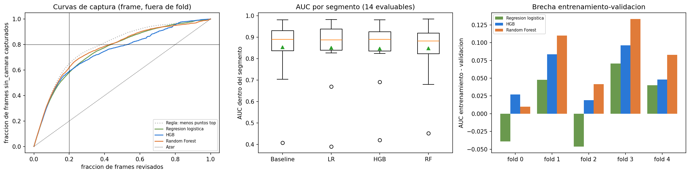

*Figura: Comparación de modelos y baselines. Archivo: `images/09_comparacion_modelos.png`.*

Resumen generado por el notebook 09:

> **Resultado.** **Recomendación final: Regla: menos puntos top.** Ningún modelo es robusto frente al mejor baseline simple: el mejor modelo (Regresión logística) no vale la pena en la población principal y no vale la pena en la de 120°. Se recomienda el baseline simple **Regla: menos puntos top** por simplicidad y explicabilidad; los modelos quedan como comparación. En la población principal el mejor modelo (Regresión logística) tiene AUC 0,825, PR-AUC 0,657, Captura@20 % 58,1 % y Fracción para 80 % 43,7 %; el baseline (Regla: menos puntos top), AUC 0,862 y Fracción para 80 % 37,8 %. Diferencia modelo menos baseline: AUC -0.036 (IC -0.056 a -0.007) y Fracción para 80 % +5.8 puntos (IC -0.8 a +10.6).
>
> **Puntos clave**
>
> 1. Estabilidad del mejor modelo (Regresión logística): AUC mínimo por fold 0,811 y mediana del AUC por segmento 0,888 → cumple los umbrales fijados.
> 2. Punto A (recall 0,80 fijado con train, mejor modelo Regresión logística): recall 0,810 (IC 0,761 a 0,874), precisión 0,431, 38,9 % de los frames a revisar; el baseline (Regla: menos puntos top) con el mismo método revisa el 37,9 % para un recall de 0,806.
> 3. Calibración: ECE crudo 0,044; mejor versión Platt con ECE 0,013 (cumple el umbral de 0,05).
> 4. Sensibilidad (población de 120°, 68.555 filas): mejor baseline simple Regla geométrica (azimut > 105 primero); modelos que valen la pena frente a él: ninguno; robustos: ninguno.
> 5. Diagnóstico (C.2): la brecha agrupada de AUC entre modelo y regla de puntos es mucho mayor que la brecha por fold y por segmento; por fold y por segmento los IC incluyen 0 para Regresión logística, HGB, Random Forest, así que **el modelo no se distingue de la regla de puntos**. Frente al mejor baseline simple (Regla: menos puntos top): Regresión logística: el modelo no se distingue de la regla; HGB: la evidencia es mixta (un IC incluye 0 y el otro no); Random Forest: el modelo no se distingue de la regla. El veredicto de los criterios fijados antes (frente al mejor baseline simple: Regresión logística: no vale la pena, HGB: no vale la pena, Random Forest: no vale la pena) no cambia: lo que cambia es su alcance, porque «no vale la pena» no equivale a «es peor».
>
> **Limitaciones**
>
> - La etiqueta mide cobertura de etiquetado, no visibilidad física de la cámara.
> - La población principal (|azimut| ≤ 100°) excluye 4.046 filas (5,9 %) cuya ausencia de par 2D es en buena parte geométrica; el borde de 100° es empírico y no se pudo confirmar con la calibración de las cámaras (`camera_calibration` no está disponible localmente).
> - Pocos ciclistas (1.483 filas en la población principal): las métricas por clase son frágiles.
> - La búsqueda de hiperparámetros es acotada: Regresión logística: 16, 16, 16, 16, 16 configuraciones reales por fold (ajuste final: 16); HGB: 12, 12, 12, 12, 12 configuraciones reales por fold (ajuste final: 12); Random Forest: 6, 6, 6, 6, 6 configuraciones reales por fold (ajuste final: 6). Es una búsqueda aleatoria sobre un espacio limitado (con grilla para la regresión logística), no exhaustiva.

**Diagnóstico de la métrica agrupada frente a por fold y por segmento.** El AUC agrupado mezcla las predicciones de cinco modelos distintos (uno por fold), lo que puede castigar a los modelos más que a las reglas, que no cambian entre folds. Por eso comparamos también por fold y por segmento (archivo completo: `data/08_reporting/09_diagnostico_agrupado.csv`):

Frente a la `Regla: menos puntos top`, por fold (AUC y Fracción para 80 %):

| Modelo | Métrica | Rango por fold | Folds donde el modelo supera | IC95% (segmentos) |
|---|---|---|---|---|
| Modelo mínimo (LR 3 variables) | AUC | -0,011 a +0,006 | 3 de 5 | -0,003 a +0,006 |
| Modelo mínimo (LR 3 variables) | Fraccion para 80% | -0,019 a -0,001 | 5 de 5 | -0,020 a +0,009 |
| Regresión logística | AUC | -0,010 a +0,005 | 1 de 5 | -0,010 a +0,033 |
| Regresión logística | Fraccion para 80% | -0,061 a -0,001 | 5 de 5 | -0,081 a +0,013 |
| HGB | AUC | -0,011 a -0,000 | 0 de 5 | -0,012 a +0,021 |
| HGB | Fraccion para 80% | -0,053 a +0,087 | 2 de 5 | -0,049 a +0,034 |
| Random Forest | AUC | -0,025 a +0,009 | 1 de 5 | -0,012 a +0,013 |
| Random Forest | Fraccion para 80% | -0,049 a +0,040 | 2 de 5 | -0,042 a +0,025 |

Frente a la `Regla: menos puntos top`, por segmento (diferencia de AUC por segmento, modelo menos regla):

| Modelo | Segmentos | Mediana dif AUC | IQR | Proporción donde el modelo supera | IC95% mediana |
|---|---|---|---|---|---|
| Modelo mínimo (LR 3 variables) | 14 | 0,001 | -0,003 a +0,006 | 0,643 | -0,003 a +0,006 |
| Regresión logística | 14 | -0,001 | -0,008 a +0,002 | 0,429 | -0,008 a +0,002 |
| HGB | 14 | -0,009 | -0,013 a -0,001 | 0,214 | -0,013 a -0,001 |
| Random Forest | 14 | -0,010 | -0,020 a +0,004 | 0,429 | -0,021 a +0,005 |

**Calibración (modelo recomendado, fuera de fold).**

| Versión | ECE | Brier | AUC | Probabilidad media | Prevalencia |
|---|---|---|---|---|---|
| Crudo | 0,044 | 0,115 | 0,825 | 0,247 | 0,207 |
| Platt | 0,013 | 0,104 | 0,850 | 0,210 | 0,207 |
| Isotónica | 0,030 | 0,105 | 0,841 | 0,211 | 0,207 |

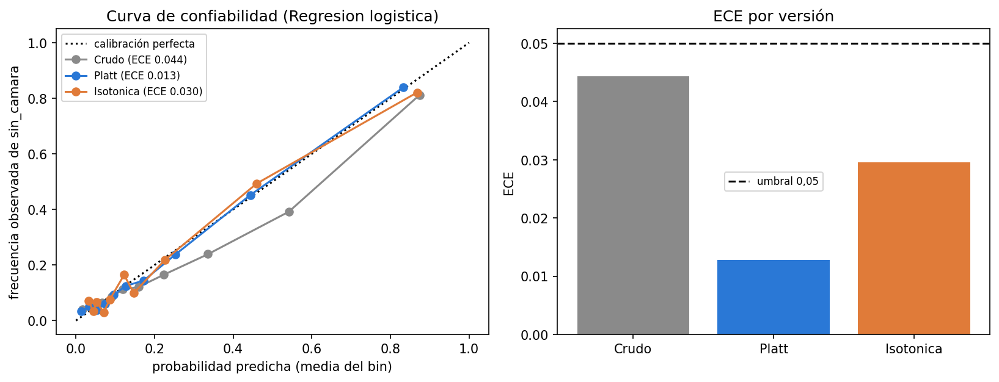

*Figura: Curva de confiabilidad. Archivo: `images/09_calibracion.png`.*

**Interpretación.** Coeficientes de la regresión logística (por desviación estándar) y permutación del HGB:

| Variable | Coeficiente | Odds ratio (+1 DE) | OR inferior | OR superior | Significativa |
|---|---|---|---|---|---|
| num_top_lidar_points | -0,773 | 0,462 | 0,395 | 0,530 | True |
| num_lidar_points | -0,644 | 0,525 | 0,464 | 0,589 | True |
| densidad_puntos | -0,473 | 0,623 | 0,527 | 0,713 | True |
| distancia_m | -0,250 | 0,779 | 0,707 | 0,930 | True |
| box_length | -0,155 | 0,856 | 0,691 | 1,136 | False |
| box_center_z | 0,139 | 1,150 | 0,921 | 1,479 | False |
| box_center_x | -0,115 | 0,892 | 0,780 | 1,000 | False |
| heading_cos | 0,090 | 1,094 | 0,933 | 1,322 | False |

Importancia por permutación del HGB en el notebook 09 (caída de AUC, población principal):

| Variable | HGB |
|---|---|
| num_top_lidar_points | 0,309 |
| speed_mps | 0,004 |
| distancia_m | 0,002 |
| volumen_caja | 0,002 |
| densidad_puntos | 0,001 |
| box_height | 0,001 |

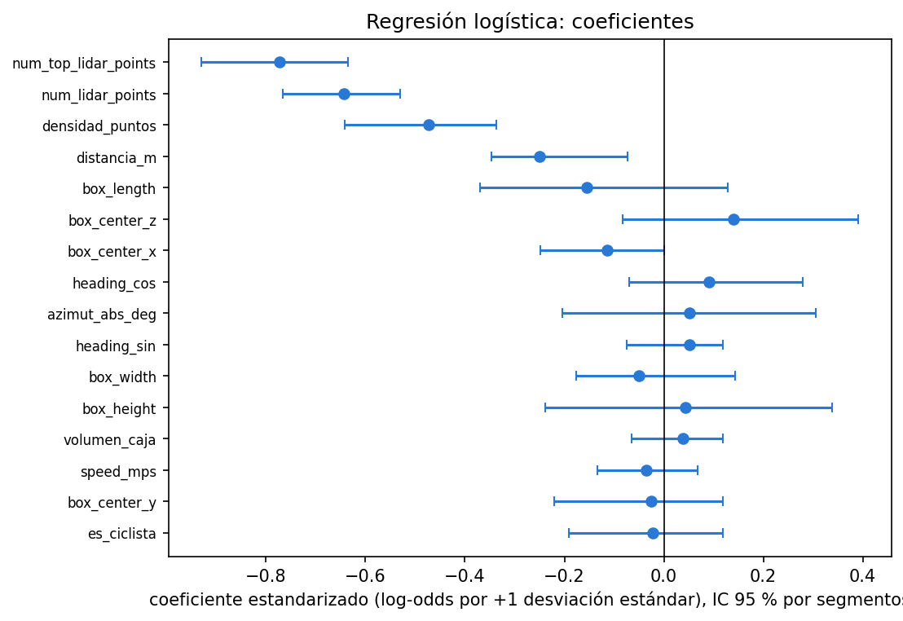

*Figura: Coeficientes de la regresión logística. Archivo: `images/09_coeficientes_lr.png`.*

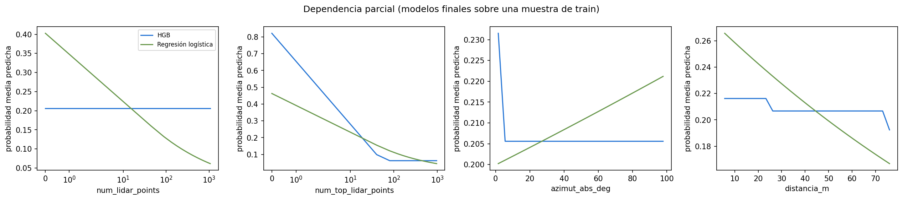

*Figura: Dependencia parcial. Archivo: `images/09_dependencia_parcial.png`.*

**Análisis de errores.** Perfil de aciertos y errores del punto A:

| Tipo | Filas | % de ciclistas | Distancia mediana (m) | Azimut mediano (°) | Puntos LiDAR (mediana) | Puntos top (mediana) | % en la franja 100-120° | Segmentos |
|---|---|---|---|---|---|---|---|---|
| TN | 36.872 | 3,140 | 28,360 | 27,380 | 77 | 76 | 0,000 | 33 |
| acierto (TP) | 10.830 | 0,440 | 48,830 | 20,770 | 3 | 3 | 0,000 | 30 |
| falso negativo (FN) | 2.538 | 2,520 | 36,980 | 17,520 | 43 | 43 | 0,000 | 23 |
| falso positivo (FP) | 14.269 | 1,510 | 48,270 | 17,050 | 15 | 15 | 0,000 | 33 |

**Puntos de operación en train (A: recall objetivo 0,80; B: revisar 20 %):**

| Método | Punto | Recall | Precisión | % de cajas revisadas |
|---|---|---|---|---|
| Regla: menos puntos top | A: recall objetivo 0,80 | 0,806 (0,760 a 0,869) | 0,441 (0,346 a 0,519) | 0,379 (0,340 a 0,422) |
| Regla: menos puntos top | B: revisar 20 % | 0,665 (0,602 a 0,745) | 0,656 (0,510 a 0,744) | 0,210 (0,182 a 0,244) |
| Regresión logística | A: recall objetivo 0,80 | 0,810 (0,761 a 0,874) | 0,431 (0,339 a 0,516) | 0,389 (0,352 a 0,438) |
| Regresión logística | B: revisar 20 % | 0,644 (0,569 a 0,741) | 0,654 (0,511 a 0,749) | 0,204 (0,177 a 0,234) |
| HGB | A: recall objetivo 0,80 | 0,800 | 0,423 | 0,392 |
| HGB | B: revisar 20 % | 0,645 | 0,657 | 0,204 |
| Random Forest | A: recall objetivo 0,80 | 0,793 | 0,424 | 0,387 |
| Random Forest | B: revisar 20 % | 0,650 | 0,643 | 0,209 |

**Equidad en train (fuera de fold), punto A:**

| Variable | Grupo | Segmentos | Filas | sin_camara | AUC | Recall (A) | Precisión (A) | % de cajas revisadas (A) |
|---|---|---|---|---|---|---|---|---|
| time_of_day | Dawn/Dusk | 10 | 14.766 | 3.013 | 0,787 | 0,714 | 0,402 | 0,362 |
| time_of_day | Day | 12 | 31.028 | 5.456 | 0,866 | 0,862 | 0,358 | 0,424 |
| time_of_day | Night | 11 | 18.715 | 4.899 | 0,871 | 0,811 | 0,603 | 0,352 |
| location | location_other | 5 | 4.239 | 540 | 0,920 | 0,906 | 0,416 | 0,277 |
| location | location_phx | 15 | 10.566 | 1.668 | 0,859 | 0,914 | 0,312 | 0,462 |
| location | location_sf | 13 | 49.704 | 11.160 | 0,818 | 0,790 | 0,463 | 0,383 |
| object_type | CYCLIST | 12 | 1.483 | 112 |  | 0,429 | 0,183 | 0,177 |
| object_type | PEDESTRIAN | 32 | 63.026 | 13.256 | 0,828 | 0,813 | 0,434 | 0,394 |

Brechas de equidad en train con IC 95 % por segmentos (09): Dawn/Dusk menos Day: AUC -0,080 (IC -0,196 a +0,083; incluye 0) y recall al punto A -0,148 (IC -0,255 a +0,061; incluye 0); Night menos Day: AUC +0,005 (IC -0,082 a +0,134; incluye 0) y recall al punto A -0,051 (IC -0,151 a +0,100; incluye 0). Los intervalos son anchos y ninguno permite afirmar una brecha. Las cifras vienen de `09_equidad_brechas.json`, extraído una vez del notebook 09 con `scripts/extraer_equidad_09.py`.

## 9. Evaluación final en el test (notebook 10)

**Lo oficial es lo pre-declarado.** El notebook 10 aplicó el plan congelado v2 sin cambiar modelos, umbrales, criterios ni métricas, y se ejecutó sobre el test 6 veces (la primera fue la evaluación pre-declarada; las siguientes corrigieron textos o agregaron los apéndices L, M y L.7, ver K.1 en la sección 11); los 15 CSV de resultados de la primera ejecución son idénticos por sha256 en todas (celda de verificación del notebook). Las secciones 9.1 a 9.7 son el resultado oficial. Los apéndices 9.8 (L) y 9.9 (M) son **diagnósticos post hoc, no pre-declarados**, y no cambian la recomendación formal.

### 9.1 Resultado principal (pre-declarado)

Modelo elegido en train (Regresión logística) frente a la Regla: menos puntos top, población principal (16.062 filas, 8 segmentos de test, 3.734 positivos):

| Método | AUC | PR-AUC | Captura@20 % | Fracción para 80 % |
|---|---|---|---|---|
| Regresión logística | 0,698 (0,503 a 0,961) | 0,565 (0,451 a 0,826) | 0,517 (0,364 a 0,887) | 0,774 (0,154 a 0,884) |
| Regla: menos puntos top | 0,684 (0,482 a 0,958) | 0,558 (0,430 a 0,795) | 0,503 (0,346 a 0,875) | 0,790 (0,148 a 0,883) |

**Caso del plan: `ningun_modelo_supera_al_mejor_baseline`.** Se reporta que ningun modelo cumple 'vale la pena' frente al mejor baseline simple y que el baseline es suficiente por simplicidad y explicabilidad. Si el IC por segmentos incluye 0 se escribe 'no se distingue del baseline', no 'es peor'. En test (población principal, 16.062 filas, 8 segmentos), Regresión logística frente a Regla: menos puntos top: AUC 0,698 contra 0,684 (diferencia +0,014, IC 95 % -0,014 a +0,029) y Fracción para 80 % 77,4 % contra 79,0 % (diferencia -1,7 puntos, IC -4,2 a +4,1). El criterio 'vale la pena' (Fracción para 80 % baja ≥ 5 puntos con IC que excluye 0 y AUC sube ≥ 0,03) **no se cumple**. Los IC de ambas diferencias incluyen 0: **el modelo no se distingue del baseline**.

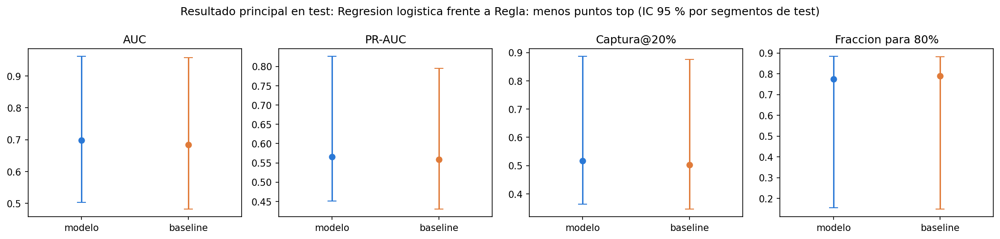

*Figura: Resultado principal en test. Archivo: `images/10_resultado_principal.png`.*

### 9.2 Todos los métodos (secundario) y sensibilidad al baseline de test

| Método | AUC | PR-AUC | Captura@20 % | Fracción para 80 % |
|---|---|---|---|---|
| Regla: menos puntos LiDAR | 0,683 (0,481 a 0,957) | 0,557 (0,429 a 0,793) | 0,502 (0,346 a 0,875) | 0,801 (0,153 a 0,884) |
| Regla: menos puntos top | 0,684 (0,482 a 0,958) | 0,558 (0,430 a 0,795) | 0,503 (0,346 a 0,875) | 0,790 (0,148 a 0,883) |
| Regla geométrica (azimut > 105 primero) | 0,683 (0,481 a 0,957) | 0,557 (0,429 a 0,793) | 0,502 (0,346 a 0,875) | 0,801 (0,153 a 0,884) |
| Modelo mínimo (LR 3 variables) | 0,685 (0,487 a 0,957) | 0,556 (0,441 a 0,789) | 0,497 (0,347 a 0,867) | 0,786 (0,156 a 0,886) |
| Regresión logística | 0,698 (0,503 a 0,961) | 0,565 (0,451 a 0,826) | 0,517 (0,364 a 0,887) | 0,774 (0,154 a 0,884) |
| HGB | 0,679 (0,514 a 0,953) | 0,578 (0,459 a 0,807) | 0,510 (0,348 a 0,865) | 0,821 (0,153 a 0,864) |
| Random Forest | 0,686 (0,512 a 0,955) | 0,586 (0,463 a 0,814) | 0,515 (0,346 a 0,841) | 0,760 (0,158 a 0,909) |

Qué baseline habría sido el mejor en test (análisis aparte, no entra en el criterio principal):

| Modelo | Mejor baseline en test | Dif. de AUC | Dif. de Fracción para 80 % (puntos) | Vale la pena |
|---|---|---|---|---|
| Regresión logística | Modelo mínimo (LR 3 variables) | +0,012 (-0,005 a +0,023) | -1,2 (-3,3 a +2,4) | no |
| HGB | Modelo mínimo (LR 3 variables) | -0,007 (-0,016 a +0,025) | +3,5 (-6,5 a +7,4) | no |
| Random Forest | Modelo mínimo (LR 3 variables) | +0,001 (-0,017 a +0,026) | -2,6 (-9,5 a +4,4) | no |

### 9.3 Puntos de operación con los umbrales congelados

| Método | Punto | Umbral | Recall | Precisión | % de cajas revisadas | % revisado en train (OOF) |
|---|---|---|---|---|---|---|
| Regla: menos puntos LiDAR | A (recall objetivo 0,80) | -25 | 0,593 (0,387 a 0,931) | 0,405 (0,297 a 0,555) | 0,340 (0,246 a 0,410) | 0,385 |
| Regla: menos puntos LiDAR | B (20 % de revision) | -10 | 0,468 (0,329 a 0,781) | 0,658 (0,559 a 0,791) | 0,166 (0,127 a 0,206) | 0,209 |
| Regla: menos puntos top | A (recall objetivo 0,80) | -24 | 0,590 (0,383 a 0,924) | 0,414 (0,303 a 0,567) | 0,331 (0,238 a 0,397) | 0,379 |
| Regla: menos puntos top | B (20 % de revision) | -10 | 0,469 (0,331 a 0,783) | 0,658 (0,559 a 0,790) | 0,166 (0,128 a 0,205) | 0,210 |
| Regla geométrica (azimut > 105 primero) | A (recall objetivo 0,80) | -25 | 0,593 (0,387 a 0,931) | 0,405 (0,297 a 0,555) | 0,340 (0,246 a 0,410) | 0,385 |
| Regla geométrica (azimut > 105 primero) | B (20 % de revision) | -10 | 0,468 (0,329 a 0,781) | 0,658 (0,559 a 0,791) | 0,166 (0,127 a 0,206) | 0,209 |
| Modelo mínimo (LR 3 variables) | A (recall objetivo 0,80) | 0,161 | 0,585 (0,383 a 0,924) | 0,435 (0,327 a 0,587) | 0,313 (0,225 a 0,401) | 0,364 |
| Modelo mínimo (LR 3 variables) | B (20 % de revision) | 0,325 | 0,444 (0,320 a 0,770) | 0,677 (0,603 a 0,804) | 0,153 (0,115 a 0,214) | 0,203 |
| Regresión logística | A (recall objetivo 0,80) | 0,146 | 0,621 (0,413 a 0,958) | 0,406 (0,316 a 0,543) | 0,356 (0,257 a 0,449) | 0,389 |
| Regresión logística | B (20 % de revision) | 0,321 | 0,447 (0,305 a 0,776) | 0,688 (0,588 a 0,829) | 0,151 (0,113 a 0,224) | 0,204 |
| HGB | A (recall objetivo 0,80) | 0,129 | 0,633 (0,445 a 0,921) | 0,410 (0,338 a 0,476) | 0,359 (0,288 a 0,414) | 0,392 |
| HGB | B (20 % de revision) | 0,288 | 0,443 (0,303 a 0,734) | 0,693 (0,609 a 0,797) | 0,149 (0,117 a 0,190) | 0,204 |
| Random Forest | A (recall objetivo 0,80) | 0,127 | 0,608 (0,419 a 0,906) | 0,423 (0,343 a 0,506) | 0,334 (0,258 a 0,392) | 0,387 |
| Random Forest | B (20 % de revision) | 0,307 | 0,430 (0,300 a 0,717) | 0,723 (0,658 a 0,812) | 0,138 (0,107 a 0,182) | 0,209 |

El punto A se consideraba sostenido en test si el recall puntual era >= 0,75. Métodos que lo sostienen: 0 de 7.

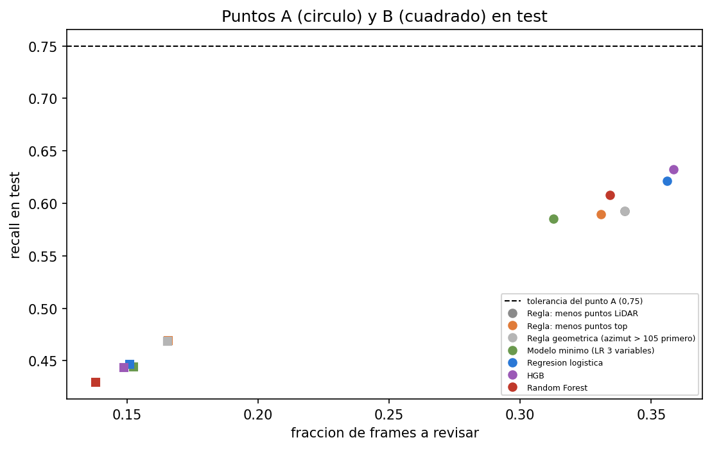

*Figura: Puntos A y B en test. Archivo: `images/10_puntos_de_operacion.png`.*

### 9.4 Calibración (descriptiva, calibrador congelado)

| Versión | ECE | Brier | Probabilidad media | Prevalencia |
|---|---|---|---|---|
| crudo | 0,079 | 0,145 | 0,175 | 0,232 |
| calibrado (Platt) | 0,080 | 0,146 | 0,173 | 0,232 |

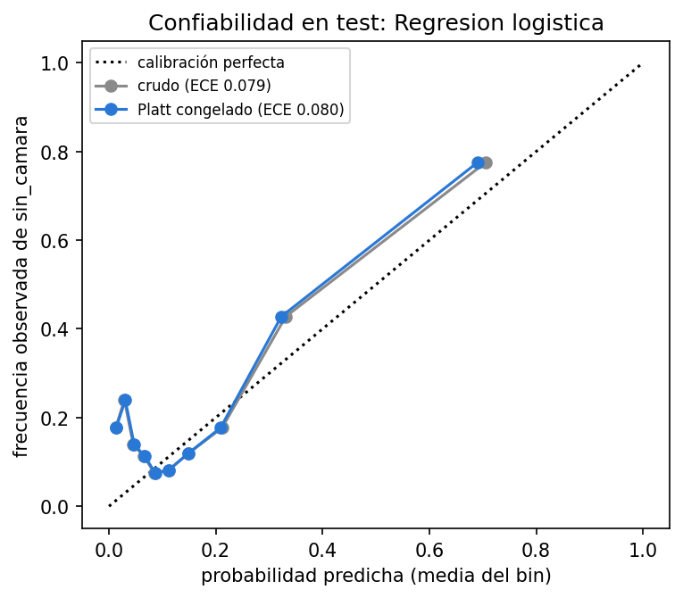

*Figura: Confiabilidad en test. Archivo: `images/10_calibracion.png`.*

### 9.5 Análisis de influencia

Se repitió la comparación principal quitando segmentos (cada uno de los dos más grandes, ambos, y dejando uno afuera a la vez):

| Variante | Segmentos | Filas | Dif. de AUC | IC de la dif. de AUC | Dif. de Fracción para 80 % (puntos) | IC de la dif. de F80 | Vale la pena |
|---|---|---|---|---|---|---|---|
| todos los segmentos | 8 | 16.062 | 0,014 | -0,014 a +0,028 | -1,656 | -4,1 a +4,1 | False |
| sin 257766998801 | 7 | 9.588 | -0,004 | -0,020 a +0,011 | 1,335 | -0,8 a +7,8 | False |
| sin 221704303323 | 7 | 11.409 | 0,019 | -0,019 a +0,034 | -1,376 | -3,1 a +7,7 | False |
| sin los dos mas grandes | 6 | 4.935 | -0,001 | -0,021 a +0,015 | 1,155 | -0,9 a +8,1 | False |
| leave-one-out: sin 102124064984 | 7 | 15.211 | 0,015 | -0,017 a +0,032 | -2,373 | -4,0 a +5,8 | False |
| leave-one-out: sin 141430544948 | 7 | 14.408 | 0,009 | -0,020 a +0,018 | -1,798 | -2,8 a +7,5 | False |
| leave-one-out: sin 167359384489 | 7 | 15.866 | 0,013 | -0,017 a +0,030 | -1,311 | -3,8 a +5,4 | False |
| leave-one-out: sin 221704303323 | 7 | 11.409 | 0,019 | -0,019 a +0,034 | -1,376 | -3,1 a +7,7 | False |
| leave-one-out: sin 257766998801 | 7 | 9.588 | -0,004 | -0,020 a +0,011 | 1,335 | -0,8 a +7,8 | False |
| leave-one-out: sin 497181704156 | 7 | 15.693 | 0,014 | -0,016 a +0,029 | -2,020 | -4,1 a +5,5 | False |
| leave-one-out: sin 645616575015 | 7 | 14.352 | 0,020 | -0,002 a +0,033 | -2,313 | -4,0 a +0,8 | False |
| leave-one-out: sin 703836276130 | 7 | 15.907 | 0,013 | -0,014 a +0,027 | -1,672 | -4,2 a +4,1 | False |

Rango de ΔAUC: -0,004 a +0,020; rango de Δ Fracción para 80 %: -2,4 a +1,3 puntos. Variantes que cambian el veredicto: ninguna.

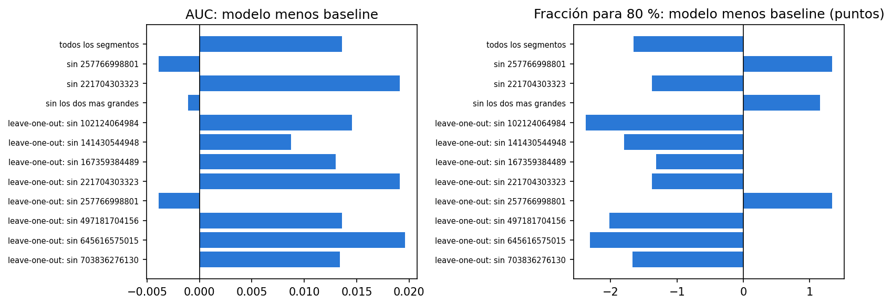

*Figura: Influencia por segmento. Archivo: `images/10_influencia.png`.*

### 9.6 Equidad descriptiva (sin pruebas de hipótesis)

| Método | Variable | Grupo | Segmentos | Filas | sin_camara | AUC | Recall (A) | Precisión (A) | % revisado A |
|---|---|---|---|---|---|---|---|---|---|
| Regresión logística | location | location_other | 2 | 1.850 | 258 | 0,979 | 0,992 | 0,573 | 0,242 |
| Regresión logística | location | location_phx | 3 | 2.234 | 464 | 0,862 | 0,899 | 0,333 | 0,560 |
| Regresión logística | location | location_sf | 3 | 11.978 | 3.012 | 0,650 | 0,547 | 0,409 | 0,336 |
| Regresión logística | time_of_day | Dawn/Dusk | 1 | 851 | 48 |  | 1,000 | 0,623 | 0,090 |
| Regresión logística | time_of_day | Day | 6 | 10.558 | 2.768 | 0,589 | 0,525 | 0,350 | 0,393 |
| Regresión logística | time_of_day | Night | 1 | 4.653 | 918 | 0,933 | 0,893 | 0,550 | 0,320 |
| Regresión logística | object_type | CYCLIST | 2 | 332 | 3 |  | 0,667 | 0,667 | 0,009 |
| Regresión logística | object_type | PEDESTRIAN | 8 | 15.730 | 3.731 | 0,692 | 0,621 | 0,405 | 0,363 |
| Regla: menos puntos top | location | location_other | 2 | 1.850 | 258 | 0,967 | 0,946 | 0,542 | 0,243 |
| Regla: menos puntos top | location | location_phx | 3 | 2.234 | 464 | 0,878 | 0,879 | 0,392 | 0,466 |
| Regla: menos puntos top | location | location_sf | 3 | 11.978 | 3.012 | 0,637 | 0,515 | 0,405 | 0,319 |
| Regla: menos puntos top | time_of_day | Dawn/Dusk | 1 | 851 | 48 |  | 1,000 | 0,762 | 0,074 |
| Regla: menos puntos top | time_of_day | Day | 6 | 10.558 | 2.768 | 0,568 | 0,495 | 0,348 | 0,372 |
| Regla: menos puntos top | time_of_day | Night | 1 | 4.653 | 918 | 0,937 | 0,854 | 0,594 | 0,284 |
| Regla: menos puntos top | object_type | CYCLIST | 2 | 332 | 3 |  | 0,667 | 0,400 | 0,015 |
| Regla: menos puntos top | object_type | PEDESTRIAN | 8 | 15.730 | 3.731 | 0,681 | 0,590 | 0,414 | 0,338 |

Segmentos de test por momento del día (Dawn/Dusk: 1, Day: 6, Night: 1) y por ubicación (location_other: 2, location_phx: 3, location_sf: 3). Con un solo segmento: Dawn/Dusk, Night; las brechas de esos grupos son las de un solo segmento. Sin el segmento 257766998801 (post hoc, no pre-declarado), el recall al punto A de la regla top pasa de 0,495 a 0,903 en Day y de 0,515 a 0,861 en San Francisco; las brechas por momento del día y por ubicación estaban confundidas con ese segmento (de día y de San Francisco).

### 9.7 Sensibilidad a 120° y test frente a train

Con los modelos congelados entrenados en la población de 120°:

| Método | AUC | PR-AUC | Captura@20 % | Fracción para 80 % |
|---|---|---|---|---|
| Regla: menos puntos LiDAR | 0,639 (0,449 a 0,876) | 0,534 (0,420 a 0,736) | 0,458 (0,318 a 0,770) | 0,833 (0,239 a 0,884) |
| Regla: menos puntos top | 0,640 (0,450 a 0,877) | 0,535 (0,420 a 0,738) | 0,459 (0,317 a 0,770) | 0,832 (0,234 a 0,882) |
| Regla geométrica (azimut > 105 primero) | 0,707 (0,530 a 0,951) | 0,541 (0,474 a 0,712) | 0,526 (0,401 a 0,879) | 0,770 (0,161 a 0,874) |
| Modelo mínimo (LR 3 variables) | 0,687 (0,528 a 0,923) | 0,513 (0,442 a 0,697) | 0,433 (0,332 a 0,767) | 0,735 (0,218 a 0,884) |
| Regresión logística | 0,712 (0,563 a 0,929) | 0,525 (0,466 a 0,751) | 0,445 (0,344 a 0,815) | 0,685 (0,188 a 0,877) |
| HGB | 0,726 (0,566 a 0,962) | 0,645 (0,537 a 0,838) | 0,532 (0,401 a 0,866) | 0,719 (0,157 a 0,822) |
| Random Forest | 0,722 (0,578 a 0,956) | 0,646 (0,543 a 0,837) | 0,528 (0,398 a 0,861) | 0,724 (0,164 a 0,842) |

| Modelo | Baseline | Dif. de AUC | Dif. de Fracción para 80 % (puntos) | Vale la pena |
|---|---|---|---|---|
| Regresión logística | Regla geométrica (azimut > 105 primero) | +0,005 (-0,054 a +0,042) | -8,5 (-10,1 a +14,3) | no |
| Regresión logística | Regla: menos puntos top | +0,072 (-0,012 a +0,124) | -14,7 (-20,7 a +2,4) | no |
| HGB | Regla geométrica (azimut > 105 primero) | +0,019 (+0,007 a +0,040) | -5,0 (-8,6 a +1,2) | no |
| HGB | Regla: menos puntos top | +0,085 (+0,062 a +0,117) | -11,3 (-18,3 a -4,2) | si |
| Random Forest | Regla geométrica (azimut > 105 primero) | +0,015 (+0,003 a +0,046) | -4,6 (-12,6 a +3,4) | no |
| Random Forest | Regla: menos puntos top | +0,082 (+0,057 a +0,130) | -10,8 (-20,0 a -2,1) | si |

Robusto (criterio del plan, lectura literal): ningún modelo.

Test frente a train (referencia fuera de fold de train):

| Método | AUC test | AUC train (OOF) | Dif. de AUC | F80 test | F80 train (OOF) | Dif. de F80 | Recall A test | Recall A train | % revisado A test | % revisado A train |
|---|---|---|---|---|---|---|---|---|---|---|
| Regla: menos puntos LiDAR | 0,683 | 0,858 | -0,175 | 0,801 | 0,385 | 0,416 | 0,593 | 0,804 | 0,340 | 0,385 |
| Regla: menos puntos top | 0,684 | 0,862 | -0,177 | 0,790 | 0,378 | 0,412 | 0,590 | 0,806 | 0,331 | 0,379 |
| Regla geométrica (azimut > 105 primero) | 0,683 | 0,858 | -0,175 | 0,801 | 0,385 | 0,416 | 0,593 | 0,804 | 0,340 | 0,385 |
| Modelo mínimo (LR 3 variables) | 0,685 | 0,855 | -0,170 | 0,786 | 0,384 | 0,401 | 0,585 | 0,799 | 0,313 | 0,364 |
| Regresión logística | 0,698 | 0,825 | -0,128 | 0,774 | 0,437 | 0,337 | 0,621 | 0,810 | 0,356 | 0,389 |
| HGB | 0,679 | 0,805 | -0,127 | 0,821 | 0,529 | 0,292 | 0,633 | 0,800 | 0,359 | 0,392 |
| Random Forest | 0,686 | 0,836 | -0,150 | 0,760 | 0,430 | 0,330 | 0,608 | 0,793 | 0,334 | 0,387 |

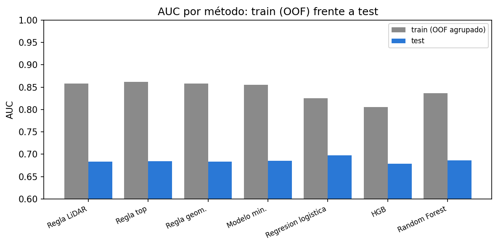

*Figura: AUC de train (OOF) frente a test. Archivo: `images/10_test_vs_train.png`.*

### 9.8 Apéndice L (post hoc, no pre-declarado): el segmento 257766998801

*Diagnóstico post hoc, no pre-declarado. No cambia el plan ni los resultados de 9.1 a 9.7.*

En la sección 9.5 ningún segmento cambia el veredicto, pero un segmento concentra el problema: aporta el 54,8 % de los positivos del test y en él todos los métodos ordenan peor que el azar. AUC por segmento de test (segmentos con al menos 50 positivos):

| Segmento | Filas | Positivos | Tasa | AUC regla top | AUC regresión logística |
|---|---|---|---|---|---|
| 141430544948 | 1.654 | 256 | 0,155 | 0,967 | 0,978 |
| 221704303323 | 4.653 | 918 | 0,197 | 0,937 | 0,933 |
| 257766998801 | 6.474 | 2.046 | 0,316 | 0,443 | 0,459 |
| 645616575015 | 1.710 | 445 | 0,260 | 0,870 | 0,836 |

Cajas sin par bien observadas (con 100 puntos LiDAR o más):

| Grupo | Cajas sin par | Sin par con >= 100 puntos | % de las sin par | Sin par con <= 5 puntos | % de las sin par (<= 5 puntos) | Cajas con >= 100 puntos | Tasa de sin par entre cajas con >= 100 puntos |
|---|---|---|---|---|---|---|---|
| foco | 2.046 | 936 | 0,457 | 439 | 0,215 | 1.708 | 0,548 |
| otros 7 de test | 1.688 | 1 | 0,001 | 800 | 0,474 | 2.760 | 0,000 |
| train | 13.368 | 583 | 0,044 | 6.954 | 0,520 | 15.459 | 0,038 |

Dentro del rango de azimut de cada cámara (rangos empíricos):

| Indicador | 0 | 1 | 2 | 3 | 4 |
|---|---|---|---|---|---|
| camara | 1 (frontal) | 2 (frontal izq.) | 3 (frontal der.) | 4 (lateral izq.) | 5 (lateral der.) |
| rango | -23 a 23 | 19 a 67 | -64 a -17 | 61 a 112 | -110 a -52 |
| % con par en la camara \| foco | 0,842 | 0,936 | 0 | 1 | 0,742 |
| cajas en rango \| foco | 4.264 | 326 | 2.090 | 63 | 623 |
| % sin par en alguna camara de las cajas del rango \| foco | 0,157 | 0,049 | 0,644 | 0 | 0,258 |
| % de las cajas sin par que caen en este rango \| foco | 0,328 | 0,008 | 0,658 | 0 | 0,079 |
| % con par en la camara \| otros 7 de test | 0,784 | 0,853 | 0,668 | 0,913 | 0,824 |
| cajas en rango \| otros 7 de test | 5.351 | 2.194 | 1.642 | 756 | 1.028 |
| % sin par en alguna camara de las cajas del rango \| otros 7 de test | 0,208 | 0,105 | 0,181 | 0,060 | 0,151 |
| % de las cajas sin par que caen en este rango \| otros 7 de test | 0,659 | 0,137 | 0,176 | 0,027 | 0,092 |
| % con par en la camara \| train | 0,761 | 0,768 | 0,785 | 0,756 | 0,606 |
| cajas en rango \| train | 32.225 | 15.212 | 13.642 | 6.864 | 5.220 |
| % sin par en alguna camara de las cajas del rango \| train | 0,228 | 0,206 | 0,140 | 0,208 | 0,190 |
| % de las cajas sin par que caen en este rango \| train | 0,550 | 0,235 | 0,143 | 0,107 | 0,074 |
| razon foco / otros 7 | 1,075 | 1,097 | 0 | 1,096 | 0,900 |

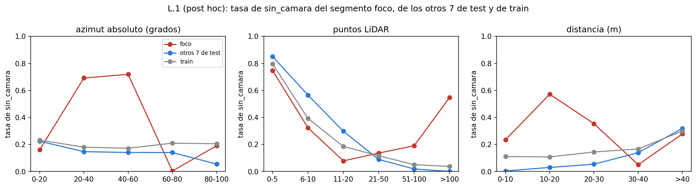

*Figura: Tasa de sin_camara por azimut, puntos y distancia: segmento foco, otros 7 y train. Archivo: `images/10_L_tasas.png`.*

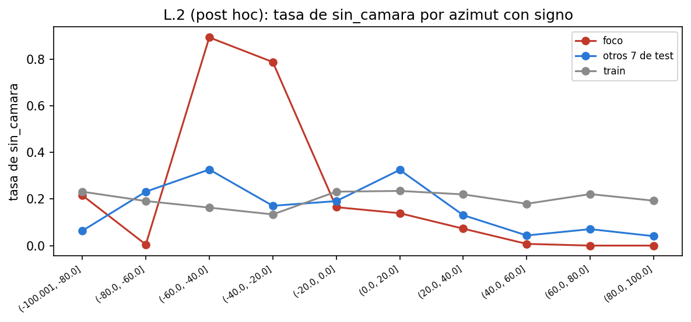

*Figura: Tasa de sin_camara por azimut con signo. Archivo: `images/10_L_azimut_con_signo.png`.*

Sin el segmento (7 segmentos), junto al resultado oficial (no reemplaza el pre-declarado):

| Resultado | Método | Filas | AUC | PR-AUC | Captura@20 % | Fracción para 80 % |
|---|---|---|---|---|---|---|
| oficial (8 segmentos) | Regresión logística | 16.062 | 0,698 (0,503 a 0,961) | 0,565 (0,451 a 0,826) | 0,517 (0,364 a 0,887) | 0,774 (0,154 a 0,884) |
| oficial (8 segmentos) | Regla: menos puntos top | 16.062 | 0,684 (0,482 a 0,958) | 0,558 (0,430 a 0,795) | 0,503 (0,346 a 0,875) | 0,790 (0,148 a 0,883) |
| sin el segmento (7 segmentos) | Regresión logística | 9.588 | 0,927 (0,880 a 0,990) | 0,729 (0,680 a 0,866) | 0,743 (0,625 a 0,998) | 0,234 (0,081 a 0,368) |
| sin el segmento (7 segmentos) | Regla: menos puntos top | 9.588 | 0,931 (0,897 a 0,982) | 0,750 (0,692 a 0,820) | 0,758 (0,670 a 0,973) | 0,221 (0,083 a 0,311) |

| Método | Punto | Recall oficial | Recall sin el segmento | Precisión oficial | Precisión sin el segmento | % a revisar oficial | % a revisar sin el segmento | A sostenido (oficial \| sin el segmento) |
|---|---|---|---|---|---|---|---|---|
| Regla: menos puntos LiDAR | A | 0,593 (0,387 a 0,931) | 0,882 (0,859 a 0,966) | 0,405 (0,297 a 0,555) | 0,503 (0,326 a 0,572) | 0,340 (0,246 a 0,410) | 0,309 (0,211 a 0,432) | no \| si |
| Regla: menos puntos LiDAR | B | 0,468 (0,329 a 0,781) | 0,672 (0,613 a 0,846) | 0,658 (0,559 a 0,791) | 0,741 (0,639 a 0,803) | 0,166 (0,127 a 0,206) | 0,160 (0,090 a 0,226) | - |
| Regla: menos puntos top | A | 0,590 (0,383 a 0,924) | 0,879 (0,858 a 0,967) | 0,414 (0,303 a 0,567) | 0,516 (0,347 a 0,586) | 0,331 (0,238 a 0,397) | 0,300 (0,202 a 0,419) | no \| si |
| Regla: menos puntos top | B | 0,469 (0,331 a 0,783) | 0,675 (0,618 a 0,857) | 0,658 (0,559 a 0,790) | 0,741 (0,639 a 0,803) | 0,166 (0,128 a 0,205) | 0,160 (0,091 a 0,225) | - |
| Regla geométrica (azimut > 105 primero) | A | 0,593 (0,387 a 0,931) | 0,882 (0,859 a 0,966) | 0,405 (0,297 a 0,555) | 0,503 (0,326 a 0,572) | 0,340 (0,246 a 0,410) | 0,309 (0,211 a 0,432) | no \| si |
| Regla geométrica (azimut > 105 primero) | B | 0,468 (0,329 a 0,781) | 0,672 (0,613 a 0,846) | 0,658 (0,559 a 0,791) | 0,741 (0,639 a 0,803) | 0,166 (0,127 a 0,206) | 0,160 (0,090 a 0,226) | - |
| Modelo mínimo (LR 3 variables) | A | 0,585 (0,383 a 0,924) | 0,870 (0,841 a 0,957) | 0,435 (0,327 a 0,587) | 0,518 (0,338 a 0,615) | 0,313 (0,225 a 0,401) | 0,296 (0,182 a 0,437) | no \| si |
| Modelo mínimo (LR 3 variables) | B | 0,444 (0,320 a 0,770) | 0,632 (0,547 a 0,834) | 0,677 (0,603 a 0,804) | 0,724 (0,598 a 0,819) | 0,153 (0,115 a 0,214) | 0,154 (0,087 a 0,243) | - |
| Regresión logística | A | 0,621 (0,413 a 0,958) | 0,913 (0,894 a 0,995) | 0,406 (0,316 a 0,543) | 0,472 (0,318 a 0,561) | 0,356 (0,257 a 0,449) | 0,341 (0,203 a 0,501) | no \| si |
| Regresión logística | B | 0,447 (0,305 a 0,776) | 0,656 (0,586 a 0,836) | 0,688 (0,588 a 0,829) | 0,717 (0,556 a 0,843) | 0,151 (0,113 a 0,224) | 0,161 (0,085 a 0,264) | - |
| HGB | A | 0,633 (0,445 a 0,921) | 0,895 (0,848 a 0,950) | 0,410 (0,338 a 0,476) | 0,443 (0,263 a 0,486) | 0,359 (0,288 a 0,414) | 0,356 (0,254 a 0,438) | no \| si |
| HGB | B | 0,443 (0,303 a 0,734) | 0,648 (0,601 a 0,796) | 0,693 (0,609 a 0,797) | 0,755 (0,667 a 0,811) | 0,149 (0,117 a 0,190) | 0,151 (0,084 a 0,210) | - |
| Random Forest | A | 0,608 (0,419 a 0,906) | 0,873 (0,802 a 0,933) | 0,423 (0,343 a 0,506) | 0,457 (0,277 a 0,529) | 0,334 (0,258 a 0,392) | 0,337 (0,218 a 0,430) | no \| si |
| Random Forest | B | 0,430 (0,300 a 0,717) | 0,620 (0,567 a 0,779) | 0,723 (0,658 a 0,812) | 0,766 (0,677 a 0,826) | 0,138 (0,107 a 0,182) | 0,142 (0,079 a 0,205) | - |

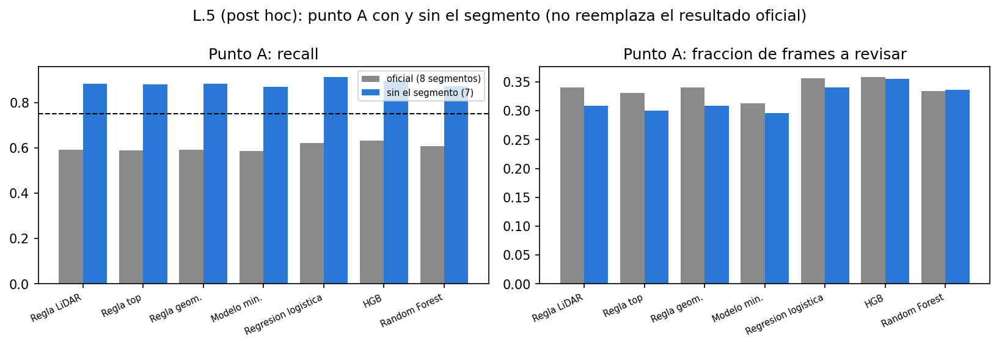

*Figura: Punto A con y sin el segmento. Archivo: `images/10_L_sin_segmento.png`.*

L.7 (post hoc): recall al punto A por momento del día y ubicación, oficial y sin el segmento (`10_L_equidad_sin_segmento.csv`). Sin el segmento 257766998801 (post hoc, no pre-declarado), el recall al punto A de la regla top pasa de 0,495 a 0,903 en Day y de 0,515 a 0,861 en San Francisco; las brechas por momento del día y por ubicación estaban confundidas con ese segmento (de día y de San Francisco).

| Variable | Grupo | Método | Segmentos (oficial) | Positivos (oficial) | Recall A (oficial) | % revisado A (oficial) | Segmentos (sin el segmento) | Positivos (sin el segmento) | Recall A (sin el segmento) | % revisado A (sin el segmento) |
|---|---|---|---|---|---|---|---|---|---|---|
| time_of_day | Dawn/Dusk | Regla: menos puntos top | 1 | 48 | 1,000 | 0,074 | 1 | 48 | 1,000 | 0,074 |
| time_of_day | Dawn/Dusk | Regresión logística | 1 | 48 | 1,000 | 0,090 | 1 | 48 | 1,000 | 0,090 |
| time_of_day | Day | Regla: menos puntos top | 6 | 2.768 | 0,495 | 0,372 | 5 | 722 | 0,903 | 0,365 |
| time_of_day | Day | Regresión logística | 6 | 2.768 | 0,525 | 0,393 | 5 | 722 | 0,932 | 0,416 |
| time_of_day | Night | Regla: menos puntos top | 1 | 918 | 0,854 | 0,284 | 1 | 918 | 0,854 | 0,284 |
| time_of_day | Night | Regresión logística | 1 | 918 | 0,893 | 0,320 | 1 | 918 | 0,893 | 0,320 |
| location | location_other | Regla: menos puntos top | 2 | 258 | 0,946 | 0,243 | 2 | 258 | 0,946 | 0,243 |
| location | location_other | Regresión logística | 2 | 258 | 0,992 | 0,242 | 2 | 258 | 0,992 | 0,242 |
| location | location_phx | Regla: menos puntos top | 3 | 464 | 0,879 | 0,466 | 3 | 464 | 0,879 | 0,466 |
| location | location_phx | Regresión logística | 3 | 464 | 0,899 | 0,560 | 3 | 464 | 0,899 | 0,560 |
| location | location_sf | Regla: menos puntos top | 3 | 3.012 | 0,515 | 0,319 | 2 | 966 | 0,861 | 0,251 |
| location | location_sf | Regresión logística | 3 | 3.012 | 0,547 | 0,336 | 2 | 966 | 0,899 | 0,285 |

Conclusión del apéndice L (generada por el notebook, rotulada como hipótesis):

> **Hipótesis (post hoc, no pre-declarada).** Condición (i): las cajas sin par con al menos 100 puntos son 936 de 2.046 (45,7 %) en el foco frente a 1 de 1.688 (0,1 %) en los otros 7: se cumple. Condición (ii): AUC de la regla por puntos top dentro del segmento 0,443: se cumple. En las cámaras (regla de L.2), la cámara 3 (frontal der.) no tiene ningún par en el segmento (0 de 6.474 cajas del segmento; 2.090 cajas caen dentro de su rango de azimut). La causa puede ser etiquetado 2D faltante o ausencia de datos de esa cámara; con estos archivos no se distinguen. Ambas condiciones se cumplen: una parte importante de las cajas sin par del segmento son objetos bien observados, lo que **sugiere que el problema de este segmento no es la falta de observabilidad LiDAR sino la ausencia de pares en la cámara 3 (frontal der.); si la causa es etiquetado 2D faltante o ausencia de datos de esa cámara no se distingue con estos archivos**. Implicación para el uso de la regla: la regla por puntos sirve mientras la relación entre pocos puntos y ausencia de par 2D se mantenga; **no detecta huecos sistemáticos de etiquetado**, porque esos objetos están bien observados y la regla los ordena como si tuvieran par. Por eso conviene monitorear el recall por segmento. Sin el segmento, el resultado principal sigue sin cumplir 'vale la pena' y 7 de 7 métodos sostienen el punto A (oficial: 0); eso describe cuánto depende el resultado de un solo segmento y no reemplaza el resultado pre-declarado.

### 9.9 Apéndice M (post hoc, no pre-declarado): auditoría por cámara en los 41 segmentos

*Diagnóstico post hoc, no pre-declarado. Los criterios se fijaron antes de calcular el apéndice, pero después de ver el apéndice L, así que no es una confirmación independiente.*

Criterios: rango de azimut de cada cámara = percentil 5 a 95 del azimut de las cajas con par de esa cámara, calculado solo con los 33 segmentos de train; tasa de una cámara en un segmento = fracción de las cajas dentro de su rango con par de esa cámara; "con hueco" si la tasa es menor que el 25 % de la mediana de la cámara entre los 41 segmentos y hay al menos 100 cajas en el rango.

Poblaciones: los rangos y las tasas por cámara usan peatones y ciclistas con |azimut| <= 120° (las cámaras laterales llegan más allá de 100°); los positivos y el AUC usan la población principal, |azimut| <= 100°. Cada encabezado lo indica.

| Cámara | Azimut p5 (<= 120°) | Azimut p95 (<= 120°) | Mediana de la tasa (<= 120°) |
|---|---|---|---|
| 1 (frontal) | -20,982 | 20,062 | 0,880 |
| 2 (frontal izq.) | 20,365 | 63,096 | 0,902 |
| 3 (frontal der.) | -60,510 | -19,496 | 0,917 |
| 4 (lateral izq.) | 64,393 | 109,196 | 0,913 |
| 5 (lateral der.) | -105,250 | -57,558 | 0,914 |

Pares (segmento, cámara) con hueco:

| Segmento | Grupo | Ubicación | Momento | Cámara | Tasa (<= 120°) | Mediana de la cámara (<= 120°) | Umbral (<= 120°) | Cajas en rango (<= 120°) |
|---|---|---|---|---|---|---|---|---|
| 911012534050 | train | location_sf | Day | 5 (lateral der.) | 0,000 | 0,914 | 0,228 | 300 |
| 257766998801 | test | location_sf | Day | 3 (frontal der.) | 0,000 | 0,917 | 0,229 | 1.677 |

Tasa por cámara en los dos segmentos con hueco (el mapa de calor completo está en la figura):

| Segmento | Grupo | Ubicación | Momento | Tasa cámara 1 (<= 120°) | Tasa cámara 2 (<= 120°) | Tasa cámara 3 (<= 120°) | Tasa cámara 4 (<= 120°) | Tasa cámara 5 (<= 120°) | Cajas en rango cámara 1 (<= 120°) | Cajas en rango cámara 2 (<= 120°) | Cajas en rango cámara 3 (<= 120°) | Cajas en rango cámara 4 (<= 120°) | Cajas en rango cámara 5 (<= 120°) |
|---|---|---|---|---|---|---|---|---|---|---|---|---|---|
| 911012534050 | train | location_sf | Day | 0,959 | 0,831 | 0,951 |  | 0,000 | 779 | 255 | 453 | 0 | 300 |
| 257766998801 | test | location_sf | Day | 0,842 | 0,960 | 0,000 | 0,947 | 0,862 | 4.095 | 302 | 1.677 | 75 | 587 |

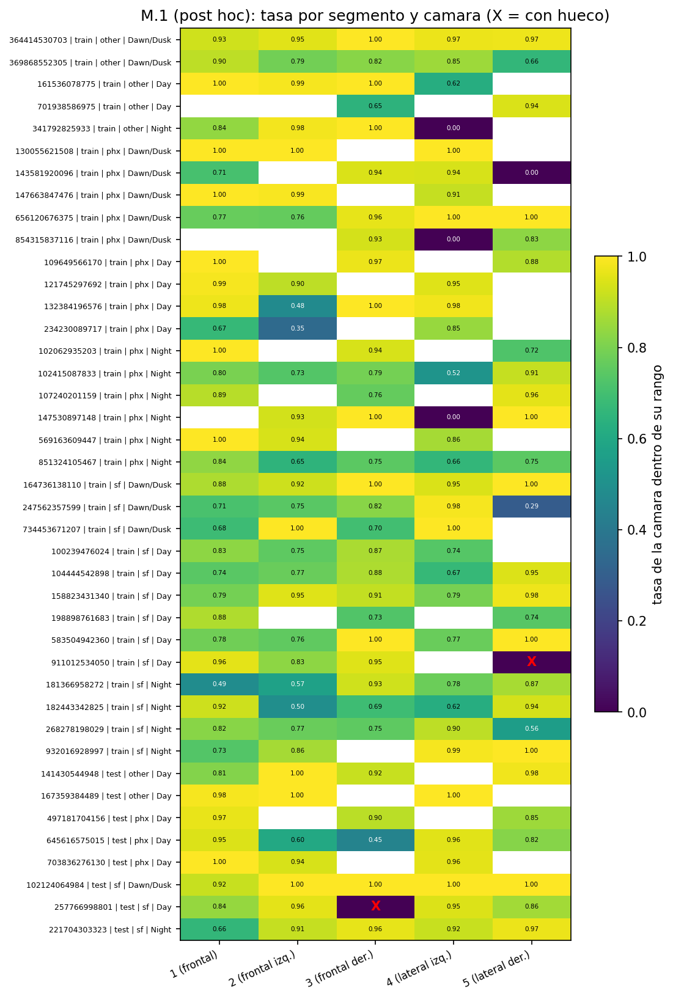

*Figura: Tasa por segmento y cámara (X = con hueco). Archivo: `images/10_M_mapa_calor.png`.*

En train las celdas con hueco reúnen solo el 32,9 % de los positivos con 100 puntos o más (192 de 583); la auditoría por cámara no explica todas las cajas bien observadas sin par.

Positivos de la población principal que caen en celdas con hueco:

| Indicador | 0 | 1 |
|---|---|---|
| grupo | train | test |
| segmentos (<= 100°) | 33 | 8 |
| segmentos con algun hueco (<= 100°) | 1 | 1 |
| cajas (<= 100°) | 64.509 | 16.062 |
| % de las cajas en celdas con hueco (<= 100°) | 0,004 | 0,104 |
| positivos (<= 100°) | 13.368 | 3.734 |
| positivos en celdas con hueco (<= 100°) | 227 | 1.338 |
| % de los positivos (<= 100°) | 0,017 | 0,358 |
| positivos con >= 100 puntos (<= 100°) | 583 | 937 |
| de ellos en celdas con hueco (<= 100°) | 192 | 884 |
| % de los positivos con >= 100 puntos (<= 100°) | 0,329 | 0,943 |
| tasa de sin_camara dentro de celdas con hueco (<= 100°) | 0,847 | 0,798 |
| tasa de sin_camara fuera de celdas con hueco (<= 100°) | 0,205 | 0,167 |

Tabla 2x2 (hueco frente a AUC de la regla top menor que 0,55, con el AUC calculado en la población <= 100°, segmentos con al menos 50 positivos, n = 26). **Se presenta como descriptiva y circular en esta muestra:** los criterios del apéndice M se escribieron después de ver el apéndice L, y los dos segmentos con AUC bajo ya estaban identificados. Que los dos segmentos con hueco coincidan con los dos de AUC bajo no es evidencia a favor de la hipótesis. El test exacto de Fisher (p = 0,0031) se informa solo por completitud y no se usa como evidencia:

| Algún hueco | AUC < 0,55 | AUC >= 0,55 |
|---|---|---|
| con hueco | 2 | 0 |
| sin hueco | 0 | 24 |

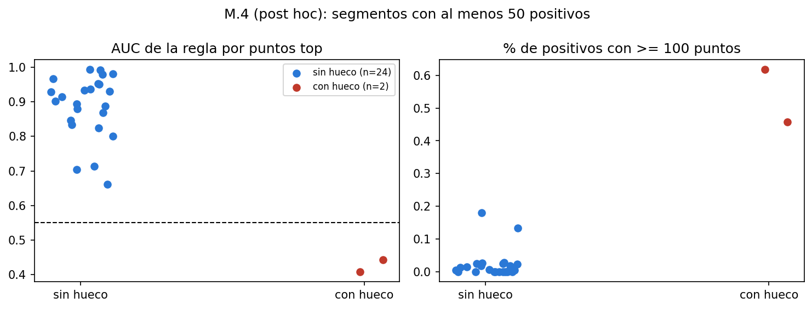

*Figura: Segmentos con y sin hueco: AUC de la regla y % de positivos con 100 puntos o más. Archivo: `images/10_M_auc_hueco.png`.*

Conclusión del apéndice M (generada por el notebook, rotulada como hipótesis; el valor p que menciona es el descriptivo de arriba):

> **Hipótesis (post hoc, no pre-declarada).** Con los criterios fijados antes de calcular, **2 de 41 segmentos (5 %) tienen al menos una cámara con hueco** (1 de 33 de train y 1 de 8 de test), en 2 pares (segmento, cámara). Esas celdas reúnen el 1,7 % de los positivos de train y el 35,8 % de los de test de la población principal; es decir, 9,2 % del total de cajas sin par (1.565 de 17.102) se atribuye a unos pocos huecos de cámara y no a la falta de puntos. El segmento de train 911012534050 tiene hueco en 5 (lateral der.). En la tabla 2x2 exploratoria (p de Fisher = 0,003, n = 26), 2 de 2 segmentos con hueco tienen AUC < 0,55, frente a 0 de 24 sin hueco. **Implicación (hipótesis):** una auditoría por segmento y cámara (tasa de pares de cada cámara dentro de su rango de azimut) detecta lo que la regla por puntos no detecta: los huecos afectan a objetos bien observados, que la regla ordena como si tuvieran par. **Aclaración:** un 'hueco' puede ser de etiquetado o de los datos de esa cámara (por ejemplo, una cámara sin imágenes o sin etiquetas 2D en el segmento); con estos archivos no se puede distinguir. Los rangos de azimut son empíricos (de train), no calibración, y los criterios son los fijados antes de calcular. No cambia la recomendación formal ni el resultado pre-declarado.

**Cómo leer este apéndice.**

- El hueco de una cámara puede ser de etiquetado o de los datos de esa cámara (por ejemplo, una cámara sin imágenes o sin etiquetas 2D en el segmento). Con los archivos disponibles no se distingue.
- Los 2 casos son de San Francisco de día. Con 2 casos en 41 segmentos no hay base para estimar su frecuencia en datos nuevos.
- Los rangos de azimut por cámara son empíricos (percentil 5 a 95 en train) y los criterios se escribieron después de ver el apéndice L.

## 10. Interpretación y recomendaciones

*Esta sección es interpretación de las cifras de las secciones anteriores. Lo único oficial del test es lo pre-declarado (9.1 a 9.7).*

**Uso en dos niveles.** La analogía es la de un control de calidad en una fábrica: primero se revisa la máquina (si una de las cámaras dejó de producir pares en un segmento), y después se revisan las piezas dudosas (qué cajas auditar primero).

1. **Auditoría por segmento y cámara.** Calcular, para cada segmento nuevo, la tasa de pares de cada cámara dentro de su rango de azimut y marcar las cámaras con hueco. En los 41 segmentos auditados encontramos 2 pares con hueco, y las celdas con hueco reúnen el 1,7 % de los positivos de train y el 35,8 % de los de test. Esa auditoría detecta lo que la regla por puntos no detecta: los huecos afectan a objetos bien observados. En train las celdas con hueco reúnen solo el 32,9 % de los positivos con 100 puntos o más (192 de 583); la auditoría por cámara no explica todas las cajas bien observadas sin par. Es una hipótesis post hoc; hay que validarla con `camera_calibration` y con más segmentos.
2. **Priorización de cajas con la regla por puntos top** (humano en el circuito). En los segmentos sin hueco, ordenar las cajas por puntos LiDAR de la parte alta (menos puntos primero) y revisar hasta el corte elegido. Es una regla de una línea, se explica sola y en train no fue peor que ningún modelo.

**Qué fracción de revisión y qué recall esperar.** Con el corte A (fijado con train para un recall de 0,80): en train (fuera de fold) la Regla: menos puntos top dio recall 0,806 (IC 95 % 0,760 a 0,869) revisando 37,9 % (IC 95 % 34,0 % a 42,2 %) de las cajas; en test dio recall 0,590 (IC 95 % 0,383 a 0,924) revisando 33,1 % de las cajas (IC 23,8 % a 39,7 %). Con el corte B (20 % de revisión): recall 0,469 (IC 95 % 0,331 a 0,783) en test. **Matices (no cambian la recomendación formal).** El punto A de Regla: menos puntos top no se sostiene en test: recall 0,590 (IC 0,383 a 0,924) frente a la meta de 0,80 y la tolerancia de 0,75. El recall depende fuertemente de un segmento: en el segmento con más positivos (257766998801, 55 % de los positivos) el recall es 0,351 y sin él pasa de 0,590 a 0,879; entre los 4 segmentos con al menos 50 positivos, 3 alcanzan la tolerancia (recall de 0,351 a 0,945). Por eso se sugiere usarlo para priorizar la revisión humana, junto con un monitoreo del recall por segmento, y no como reemplazo de la revisión. (Detalle y diagnóstico post hoc en la sección L.)

**Riesgos de equidad medidos.** Sin el segmento 257766998801 (post hoc, no pre-declarado), el recall al punto A de la regla top pasa de 0,495 a 0,903 en Day y de 0,515 a 0,861 en San Francisco; las brechas por momento del día y por ubicación estaban confundidas con ese segmento (de día y de San Francisco). Night y Dawn/Dusk tienen un solo segmento de test cada uno.

**Monitoreo.** Vigilar la deriva de la tasa de `sin_camara` y el recall por segmento (no solo el promedio), la tasa de pares por cámara dentro de su rango, y reponer el corte si el recall por segmento baja de 0,75.

**Datos que mejorarían el resultado.** `camera_calibration` (validar el borde de 100° y los rangos por cámara), más segmentos de test, más ciclistas (hoy 332 filas de ciclistas en la población principal del test), y etiquetas por cámara para separar cobertura de etiquetado de visibilidad física.

**Trabajo futuro.** Repetir la evaluación con más segmentos; validar la auditoría por cámara con los datos de calibración; estimar la precisión real con una muestra revisada manualmente; probar si un modelo por segmento y cámara mejora donde la regla no funciona.

**Qué NO se puede afirmar.**

- Que `sin_camara` sea invisibilidad física: es falta de etiqueta 2D de cámara.
- Que el resultado generalice más allá de 8 segmentos de test.
- Nada sólido sobre ciclistas, ni sobre Night y Dawn/Dusk (un segmento de test cada uno).
- Que el hueco de cámara encontrado en el test (3 (frontal der.)) sea de etiquetado y no de los datos de esa cámara.
- Que un modelo supere a la regla por puntos: con el criterio fijado antes, no ocurrió.

## 11. Ética, sesgos y privacidad

*Resumen de lo que desarrolla el notebook 05 (EP1), actualizado con lo medido en EP2.*

**Privacidad.** Usamos solo `lidar_box` y `camera_to_lidar_box_association`: coordenadas 3D y metadatos de cajas etiquetadas y una tabla de pares cámara-LiDAR; no usamos imágenes. Según el README de EP1 y el notebook 05, esas tablas no contienen información directamente identificable de personas, y el 05 establece que no hay identificadores directos (nombres, patentes sin difuminar ni biometría) en las columnas del proyecto; el riesgo que señala es la reidentificación indirecta: `key.laser_object_id` más la marca de tiempo identifican cada detección y, encadenadas, la trayectoria de un objeto. Por minimización, esos identificadores no son variables de ningún modelo (sección 3). El 05 dice que la licencia del Waymo Open Dataset es no comercial y prohíbe redistribuir los datos, y que por eso `data/01_raw/waymo/` está en `.gitignore`; el repositorio guarda solo código, documentos y figuras, y los datos derivados se regeneran con los notebooks (sección 13). Lo que dice el 05 sobre el porqué de la licencia:

> **¿Por qué la licencia de Waymo prohíbe redistribuir los datos?** Porque
> Waymo recolectó datos en vía pública, con personas y vehículos reales
> circulando, bajo condiciones de anonimización (rostros y patentes
> difuminados en cámara) pensadas para su propio proceso de publicación
> controlada, no para que terceros los redistribuyan sin control. Permitir
> redistribución abierta debilitaría esas protecciones y la capacidad de
> Waymo de hacer cumplir el principio de finalidad sobre cómo se usan los
> datos. Por eso `data/01_raw/waymo/` está en `.gitignore` en este proyecto
> (ver README, sección 7 y sección 9): es la forma concreta en que este
> repositorio cumple la licencia sin dejar de ser reproducible, documentando
> en el README cómo volver a descargar los mismos 4 segmentos en vez de
> subirlos al repositorio.

**Sesgos medidos.** (1) *Ubicación:* en train el recall al punto A de la regresión logística es 0,790 en San Francisco, 0,914 en Phoenix y 0,906 en el resto (`09_equidad.csv`); en el test oficial, con la regla top, 0,515 en San Francisco y 0,946 en `location_other`. (2) *Momento del día:* en train, 0,714 en Dawn/Dusk frente a 0,862 de día; la brecha de AUC Dawn/Dusk menos Day es -0,080 (IC -0,196 a +0,083, incluye 0). En el test, Night y Dawn/Dusk tienen un solo segmento cada uno, así que no se puede separar el efecto del momento del día del efecto del segmento. (3) *Ciclistas:* en train son 1.483 filas y 112 positivos, con recall al punto A de 0,429; en el test hay muy pocos positivos y no hay conclusión por clase. (4) *Post hoc, no pre-declarado:* sin el segmento `257766998801`, las brechas por momento del día y ubicación del test cambian mucho (sección 9, L.7), lo que muestra que estaban confundidas con un segmento.

**Riesgo de uso.** Esto no es una alerta de seguridad ni mide qué ve una cámara: `sin_camara` es la ausencia de una etiqueta 2D de cámara, es decir, cobertura de etiquetado. Se usa para ordenar una revisión con una persona en el circuito, nunca para reemplazarla ni para decidir nada dentro de un vehículo. Un puntaje bajo no prueba que la caja tenga par: en el segmento anómalo, la regla ordena como "con par" cajas bien observadas que no lo tienen (sección 9, apéndices L y M).

## 12. Limitaciones y desviaciones del plan

**Desviaciones declaradas en el notebook 10 (sección K.1, copiadas del notebook).**

Todas están documentadas acá; ninguna cambia modelos, umbrales, criterios o métricas.

1. **Dos lecturas de "robusto"** (sección H): el v2 fijó el baseline principal en train pero el criterio "robusto" del plan habla del "mejor baseline simple de cada población"; se reportan ambas lecturas y se indica si difieren.
2. **Cantidad de réplicas del bootstrap:** 1.000 en la comparación principal y en los puntos de operación; 500 en el análisis de influencia (12 cálculos) y en la población de 120° (por costo de cómputo). El plan no fija el número de réplicas.
3. **Bootstrap de los puntos de operación:** el plan pide IC por bootstrap de segmentos; los umbrales no se recalculan en cada réplica (están congelados).
4. **Horas ilustrativas:** el supuesto de 20 s por revisión viene del 09, que lo copia del 07, donde se fijó; no es un dato medido.
5. **Reejecuciones (ejecuciones 2 a 6 de 6 sobre el test).** La ejecución 2 corrigió frases fijas de las secciones D, E, G, I y J que no eran condicionales a las cifras (por ejemplo "se no se sostiene" y "a un recall cercano a 0,80" cuando el observado fue menor) y agregó el apéndice post hoc L; la 3 agregó el apéndice post hoc M; la 4 agregó L.7 y escapó las barras de las tablas de `evaluacion_final_B.md` (tenían filas con distinto número de celdas); la 5 reemplazó en L.6 la razón numérica por los conteos, agregó en L.6 la aclaración sobre la causa del hueco de cámara y agregó la limitación del IC bimodal en K.2; la 6 reformuló en L.6 la conclusión (la hipótesis es la ausencia de pares en la cámara, no un hueco de etiquetado afirmado). Ninguna cambió cifras de las secciones A a K: la celda final de K.3 compara con sha256 los CSV de resultados contra los de la ejecución 1 (`10_hashes_ejecucion1.json`) y se detiene si alguno difiere.

**Limitaciones del notebook 10 (sección K.2, copiadas del notebook).**

- Solo 8 segmentos de test: los IC por segmentos son anchos y no recogen la variación entre ciudades o épocas que no están en el test.
- `sin_camara` mide cobertura de etiquetas 2D, no visibilidad física.
- Night y Dawn/Dusk tienen un único segmento cada uno en el test.
- Pocos ciclistas, así que no hay conclusión por clase.
- El borde de 100° es empírico (no se pudo validar con `camera_calibration`).
- Los modelos únicos del test frente al OOF agrupado de train no son directamente comparables (sección I).
- El IC 95 % por segmentos de la Fracción para 80 % es bimodal y muy ancho: depende de si la réplica del bootstrap incluye o no el segmento con más positivos (ver la celda siguiente); no es una incertidumbre gradual.

**Límite del intervalo de la Fracción para 80 % (generado por el notebook 10).** El IC 95 % por segmentos de la Fracción para 80 % de Regresión logística (15,4 % a 88,4 %) es **bimodal**: en las 657 réplicas del bootstrap que incluyen el segmento 257766998801 la mediana es 83,4 % (rango 52,5 % a 89,0 %) y en las 343 que no lo incluyen es 23,1 % (rango 4,3 % a 46,3 %); los dos grupos no se solapan. La amplitud del intervalo refleja si la réplica incluye o no un segmento, no una incertidumbre gradual; por eso las conclusiones se apoyan en las diferencias pareadas contra la regla y no en el IC de la Fracción para 80 % de un método solo.

**Lecturas tomadas sin consulta (notebook 10).** Son decisiones de interpretación que se escribieron en el notebook:

1. **"Robusto" (sección H).** El plan define robusto como "vale la pena en la población principal y en la de sensibilidad, cada una frente al mejor baseline simple de esa población". Como el v2 sacó el mejor baseline del test del criterio principal, se reportan **dos lecturas**: (a) la literal del plan (mejor baseline simple de cada población en el test) y (b) con los baselines elegidos en train (regla por puntos top en la principal y regla geométrica en la de 120°, la elegida en el 09). Se señala si difieren.
2. **Caso del plan que se aplica a la conclusión principal:** `algun_modelo_supera` si el modelo cumple el criterio "vale la pena" y `ningun_modelo_supera_al_mejor_baseline` si no; si además los IC de ΔAUC y Δ Fracción para 80 % incluyen 0, se escribe "no se distingue", como pide el plan.
3. **"La conclusión cambia" (sección F):** se compara el veredicto "vale la pena" de cada variante (excluyendo segmentos) con el de todos los segmentos, con IC por bootstrap de los segmentos que quedan.
4. **Segmentos evaluables:** los que tienen ≥ 50 positivos en la población principal (según los datos del test, contrastados con la lista del plan).
5. **Horas:** ilustración con 20 s por revisión (supuesto fijado en el 07 y repetido en el 09), calculada como en el 09: el baseline necesitaría la fracción de su propia curva de captura para el mismo recall.
6. **Recomendaciones de negocio (sección J):** son interpretación, rotuladas como tales; la regla que las genera está escrita en la propia celda.

**Criterios y lecturas del apéndice M (post hoc).**

**Criterios fijados antes de calcular nada** (se escriben en el código tal cual):

1. **Rango de azimut de cada cámara** (azimut con signo; peatones y ciclistas en frames etiquetados): percentil 5 a 95 del azimut de las cajas **con par de esa cámara**, calculado **solo con los 33 segmentos de train**.
2. **Tasa de una cámara en un segmento:** fracción de las cajas dentro del rango de esa cámara que tienen par de **esa** cámara.
3. **Una cámara está "con hueco" en un segmento** si su tasa es menor que el 25 % de la mediana de su tasa entre los 41 segmentos y el segmento tiene al menos 100 cajas dentro de su rango.

**Lecturas tomadas (sin consulta):** (a) "cajas" son los peatones y ciclistas de frames etiquetados con |azimut| ≤ 120 (la población de sensibilidad), porque las cámaras laterales llegan más allá de 100°; para el punto 3 y el punto 4 se usa la población principal (|azimut| ≤ 100), que es la del target. (b) La mediana de cada cámara se calcula sobre los segmentos donde esa cámara tiene al menos una caja en su rango. (c) El AUC de la regla por puntos top no es un modelo entrenado, así que en train se calcula directo (sin OOF) con el mismo puntaje `-num_top_lidar_points`. (d) "Positivo" es `sin_camara = 1`, que coincide con no tener par en ninguna cámara (se verificó en L.2).

**Lo que no se verificó.**

- La calibración de cámaras (`camera_calibration`) no está en los datos locales: el borde de 100° y los rangos de azimut por cámara son empíricos.
- No se distinguió si el hueco de una cámara es de etiquetado o de los datos de esa cámara.
- Las horas de revisión usan un supuesto de 20 s por caja, fijado en el notebook 07, que no es un dato medido.
- El etiquetado varía mucho entre segmentos: la tasa de `sin_camara` de la población principal va de 0,0 % a 37,9 % por segmento en train y de 1,0 % a 31,6 % en test, y no se estudió por qué.
- Los folds del split no se estratificaron por el target nuevo (`sin_camara`) sino por `tiene_camara`, el target de EP1: la tasa de `sin_camara` por fold va de 16,8 % a 28,7 % (sección 3).
- El notebook 10 se ejecutó 6 veces sobre el test (constante `EJECUCIONES_TEST` en `scripts/constantes_ep2.py`; el log registra 6 ejecuciones reales, `docs/log_trabajo_ep2.md`).
- Además de esas 6 ejecuciones en el repositorio, hubo 2 ejecuciones de verificación del notebook 10 en copias fuera del repositorio (2026-10-18 y 2026-10-19, fechas del log), con los 15 CSV idénticos por sha256 a los de la ejecución 1; no se cuentan entre las del repositorio y no cambian el conteo oficial.

**Archivos o cifras que no se encontraron al generar este informe:** ninguno.

## 13. Reproducibilidad

**Entorno.** `docs/entorno_ep2.txt` (generado por el notebook 09):

```
Python 3.10.11
pandas 2.3.3
numpy 2.2.6
scikit-learn 1.7.2
scipy 1.15.3
joblib 1.5.3
plataforma Windows-10-10.0.26300-SP0
semilla 42

Tiempos de este notebook (s): {"busqueda_LR_s": 17, "busqueda_HGB_s": 123, "busqueda_RF_s": 109, "bootstrap_comparacion_s": 45, "diagnostico_bootstrap_s": 27, "bootstrap_lr_s": 8, "permutacion_s": 4, "sensibilidad_s": 8}
```

**Versiones instaladas al generar este informe** (de `importlib.metadata`): kedro 1.5.0, pytest 7.4.4, pytest-cov 6.3.0, nbformat 5.11.1.

**Orden de ejecución de los notebooks.** Se ejecutan en el orden numérico (00 a 10, y 09b entre el 09 y el 10); el 00 solo en Google Colab. Los notebooks 07 a 10 leen archivos que producen los anteriores:

| Notebook | Título |
|---|---|
| `notebooks/00_exploracion_bucket_waymo.ipynb` | Exploración del bucket de Waymo y selección de segmentos |
| `notebooks/01_exploracion_csv.ipynb` |  |
| `notebooks/02_exploracion_waymo.ipynb` | Exploración de datos reales de Waymo Open Dataset v2 |
| `notebooks/03_fuentes_y_colaboracion.ipynb` | Fuentes de datos y colaboración |
| `notebooks/04_estructuras_y_almacenamiento.ipynb` | Estructuras de datos y almacenamiento |
| `notebooks/05_etica_sesgos_privacidad.ipynb` | Ética, sesgos y privacidad |
| `notebooks/06_eda_y_preparacion_modelamiento.ipynb` | 06 — EDA ampliado y preparación para modelamiento |
| `notebooks/07_decision_target_ep2.ipynb` | 07 — Por qué EP2 usa `sin_camara` como target |
| `notebooks/08_analisis_observabilidad_sin_camara.ipynb` | 08 — Análisis de observabilidad de `sin_camara` |
| `notebooks/09_modelos_supervisados_sin_camara.ipynb` | 09 — Modelos supervisados para `sin_camara` |
| `notebooks/09b_enmiendas_plan_test_v2.ipynb` | 09b — Enmiendas al plan de evaluación del test (v2) |
| `notebooks/10_evaluacion_final_sin_camara.ipynb` | 10 — Evaluación final en el test de `sin_camara` |

**Cómo se ejecuta un notebook.** Con un kernel propio del entorno, para que Jupyter no use otro Python de la máquina (en el repositorio original se usó el kernel `kedro_waymo_evaluacion` de `kedro jupyter`):

```
.venv/Scripts/python.exe -m ipykernel install --prefix .venv --name ep2
.venv/Scripts/python.exe -m nbconvert --to notebook --execute --inplace --ExecutePreprocessor.kernel_name=ep2 notebooks/09_modelos_supervisados_sin_camara.ipynb
```

**Orden y advertencia sobre el plan congelado.** El 08 escribe `features_B.parquet`, el 09 reentrena los modelos y el 09b reescribe el plan v2; el 10 verifica los sha256 del plan. Para reproducir el resultado oficial, ejecutar el 10 con los modelos y el plan incluidos en `data/06_models/` sin reejecutar antes el 09 ni el 09b (`scripts/verificar_congelados.py` lo comprueba; el resultado de la prueba en copia limpia está en el log de trabajo).

**Pruebas.** Desde la raíz del repositorio (usa la configuración de cobertura de `pyproject.toml`):

```
.venv/Scripts/python.exe -m pytest
```

Última medición (`scripts/medir_pruebas.py`): 79 pasadas, 0 falladas, 0 omitidas; cobertura total 92,7 %.

**Ingesta con Kedro.** Los pipelines registrados son `ingesta_waymo` y `preprocesamiento` (comprobado con `kedro registry list`). La ingesta se ejecuta con:

```
kedro run --pipeline ingesta_waymo
```

Este comando no se reejecutó al generar este informe (reescribiría `data/02_intermediate/`); solo se verificó que el pipeline está registrado y que sus pruebas pasan.

**Cómo se regenera este informe.** Un solo comando, desde la raíz del repositorio; reescribe `docs/informe_tecnico_EP2.md` y el bloque "EP2 en breve" del README:

```
.venv/Scripts/python.exe -X utf8 scripts/generar_informe_tecnico.py
```

El script necesita los CSV y JSON de `data/08_reporting/`, los modelos y el plan de `data/06_models/` y los notebooks ejecutados, que no están en el repositorio (`data/` está en `.gitignore`). En un clon limpio solo se puede leer el informe ya generado (`docs/informe_tecnico_EP2.md`); para regenerarlo hay que ejecutar antes los notebooks en orden. Los archivos `08_no_supervisado_resumen.json` y `09_equidad_brechas.json` se extraen una sola vez de los notebooks ejecutados con `scripts/extraer_no_supervisado_08.py` y `scripts/extraer_equidad_09.py`, y los diagnósticos post hoc del 08 salen de `scripts/diagnostico_post_hoc_08.py`.

**Semillas.** Semilla 42 en todo el proyecto (folds, bootstrap, desempates de las curvas de captura, modelos).

**Dónde está cada cosa.** Datos de entrada del modelado en `data/05_model_input/`; modelos y el plan de evaluación congelado con sha256 en `data/06_models/`; predicciones en `data/07_model_output/`; tablas en `data/08_reporting/` y figuras en `images/`; documentos generados en `docs/`. Cantidad de tablas y figuras por notebook:

| Notebook | CSV en data/08_reporting | Figuras en images/ |
|---|---|---|
| 06 | 0 | 7 |
| 07 | 1 | 9 |
| 08 | 13 | 11 |
| 09 | 16 | 4 |
| 10 | 35 | 11 |

**Cómo regenerar cada tabla y figura.** Cada CSV y cada figura lleva como prefijo el número del notebook que la genera (`08_*.csv` e `images/08_*.png` salen del notebook 08, y así para el 07, 09 y 10); volver a ejecutar ese notebook las reescribe. El notebook 10 verifica con sha256 que los resultados de la ejecución 1 no cambian al reejecutarlo (`data/08_reporting/10_hashes_ejecucion1.json`).

**Archivos ignorados por git y cómo se obtienen.** El `.gitignore` excluye todo lo que hay bajo `data/` (`data/**`, `data/01_raw/waymo_real/`, `data/02_intermediate/*`, `data/03_primary/*`, `data/04_feature/*`, `data/01_raw/waymo/`). Por eso los datos, los modelos (`.joblib`), el plan congelado y todas las tablas de `data/08_reporting/` no están en el repositorio: se regeneran ejecutando los notebooks en orden, a partir de los parquet de Waymo Open Dataset v2 que se descargan con el notebook 00 (`data/01_raw/waymo/`). El informe y las figuras (`docs/`, `images/`) sí están en el repositorio.

## 14. Anexos

### 14.1 Tabla de decisiones

La fecha es la de la última modificación del archivo que contiene la evidencia (no la fecha de la decisión).

| Decisión | Evidencia | Fecha de la evidencia (modificación del archivo) |
|---|---|---|
| Target EP2 = `sin_camara` (candidata B) | criterios de `decision_target_ep2.csv`; AUC de B 0,854 (versión previa, 120°) | 2026-10-18 |
| Población principal \|azimut\| <= 100° | tasa por tramo de azimut y cruce de clusters con la franja (08) | 2026-10-17 |
| Modelo a comparar: Regresión logística | prueba de elección del 09 (ΔAUC >= 0,01 con ambos IC excluyendo 0) | 2026-10-18 |
| Baseline principal: Regla: menos puntos top | AUC 0,862 en train (OOF) | 2026-10-18 |
| Recomendación del 09 | Regla: menos puntos top; robustos: [] | 2026-10-18 |
| Congelar el plan de evaluación v2 antes de abrir el test | `plan_evaluacion_test.json`, congelado 2026-10-18T13:42:13-03:00 | 2026-10-18 |
| Recomendación formal tras el test | Regla: menos puntos top; 'vale la pena' del modelo: no | 2026-10-18 |
| Auditoría por cámara como primer nivel de uso (hipótesis) | 2 pares con hueco en 41 segmentos (descriptivo, circular) | 2026-10-18 |

### 14.2 Glosario breve

- **AUC (ROC):** probabilidad de que una caja sin par reciba un puntaje mayor que una caja con par, elegidas al azar. 0,5 es azar y 1 es ordenar perfecto.
- **PR-AUC:** área bajo la curva precisión-recall; depende de la tasa de positivos, por eso se compara con la prevalencia.
- **Captura@k:** fracción de las cajas sin par que quedan dentro del k % mejor puntuado (por ejemplo, Captura@20 %).
- **Fracción para 80 %:** fracción de cajas que hay que revisar, siguiendo el orden del puntaje, para encontrar el 80 % de las cajas sin par. Menos es mejor.
- **Bootstrap por segmentos:** se remuestrean segmentos completos (y no filas) para obtener intervalos de confianza, porque las filas de un mismo segmento se parecen entre sí.
- **ECE:** error de calibración esperado; promedio de la diferencia entre la probabilidad predicha y la frecuencia observada, en 10 grupos por cuantiles.
- **Punto A / punto B:** cortes de operación; A busca un recall de 0,80 con el corte fijado en train y B revisa el 20 % mejor puntuado.

### 14.3 Lista de figuras

- `images/07_A_modelo_vs_reglas.png`
- `images/07_B_auc_folds_grupos.png`
- `images/07_C_curva_aprendizaje.png`
- `images/07_C_error_modelos.png`
- `images/07_clusters_comportamiento.png`
- `images/07_clusters_pca.png`
- `images/07_curva_captura.png`
- `images/07_estabilidad_por_objeto.png`
- `images/07_flujo_revision.png`
- `images/08_auc_por_segmento.png`
- `images/08_clusters_pca.png`
- `images/08_clusters_tasa.png`
- `images/08_conjuntos_variables.png`
- `images/08_geometria_camaras.png`
- `images/08_importancia_permutacion.png`
- `images/08_mapa_puntos_distancia.png`
- `images/08_pareado_objetos_mixtos.png`
- `images/08_tasa_azimut_5grados.png`
- `images/08_tasa_por_azimut.png`
- `images/08_tasa_por_puntos_clase_distancia.png`
- `images/09_calibracion.png`
- `images/09_coeficientes_lr.png`
- `images/09_comparacion_modelos.png`
- `images/09_dependencia_parcial.png`
- `images/10_L_azimut_con_signo.png`
- `images/10_L_sin_segmento.png`
- `images/10_L_tasas.png`
- `images/10_M_auc_hueco.png`
- `images/10_M_mapa_calor.png`
- `images/10_M_rangos.png`
- `images/10_calibracion.png`
- `images/10_influencia.png`
- `images/10_puntos_de_operacion.png`
- `images/10_resultado_principal.png`
- `images/10_test_vs_train.png`

### 14.4 Lista de tablas (CSV generados por los notebooks)

- `data/08_reporting/07_conteos_test.csv`
- `data/08_reporting/08_auc_por_segmento.csv`
- `data/08_reporting/08_azimut_por_camara_empirico.csv`
- `data/08_reporting/08_clusters_k3_k4.csv`
- `data/08_reporting/08_clusters_perfil.csv`
- `data/08_reporting/08_clusters_seleccion_k.csv`
- `data/08_reporting/08_clusters_vs_franja.csv`
- `data/08_reporting/08_comparacion_sin_franja.csv`
- `data/08_reporting/08_conjuntos_variables.csv`
- `data/08_reporting/08_importancia_permutacion.csv`
- `data/08_reporting/08_post_hoc_lluvia_clusters.csv`
- `data/08_reporting/08_tasa_azimut_5grados.csv`
- `data/08_reporting/08_tasa_por_azimut.csv`
- `data/08_reporting/08_tasa_por_puntos.csv`
- `data/08_reporting/09_auc_por_fold.csv`
- `data/08_reporting/09_auc_por_segmento.csv`
- `data/08_reporting/09_calibracion.csv`
- `data/08_reporting/09_class_weight.csv`
- `data/08_reporting/09_coeficientes_lr.csv`
- `data/08_reporting/09_comparacion_modelos.csv`
- `data/08_reporting/09_diagnostico_agrupado.csv`
- `data/08_reporting/09_ejemplos_errores.csv`
- `data/08_reporting/09_equidad.csv`
- `data/08_reporting/09_hiperparametros_por_fold.csv`
- `data/08_reporting/09_importancia_permutacion.csv`
- `data/08_reporting/09_perfil_errores.csv`
- `data/08_reporting/09_puntos_operacion.csv`
- `data/08_reporting/09_recall_por_segmento.csv`
- `data/08_reporting/09_sensibilidad_120.csv`
- `data/08_reporting/09_sensibilidad_azimut100.csv`
- `data/08_reporting/10_L_auc_segmentos_test.csv`
- `data/08_reporting/10_L_camaras_en_rango.csv`
- `data/08_reporting/10_L_camaras_pares.csv`
- `data/08_reporting/10_L_equidad_sin_segmento.csv`
- `data/08_reporting/10_L_sin_par_bien_observadas.csv`
- `data/08_reporting/10_L_sin_segmento_operacion.csv`
- `data/08_reporting/10_L_sin_segmento_principal.csv`
- `data/08_reporting/10_L_tasa_azimut_con_signo.csv`
- `data/08_reporting/10_L_tasas.csv`
- `data/08_reporting/10_L_train_comun.csv`
- `data/08_reporting/10_L_train_segmentos.csv`
- `data/08_reporting/10_M_pares_con_hueco.csv`
- `data/08_reporting/10_M_positivos_en_huecos.csv`
- `data/08_reporting/10_M_positivos_en_huecos_por_segmento.csv`
- `data/08_reporting/10_M_rangos_camara.csv`
- `data/08_reporting/10_M_resumen_hueco_vs_auc.csv`
- `data/08_reporting/10_M_segmento_911012534050.csv`
- `data/08_reporting/10_M_segmentos_hueco_vs_auc.csv`
- `data/08_reporting/10_M_tabla_2x2.csv`
- `data/08_reporting/10_M_tasa_segmento_camara.csv`
- `data/08_reporting/10_auc_por_segmento.csv`
- `data/08_reporting/10_calibracion.csv`
- `data/08_reporting/10_comparacion_120.csv`
- `data/08_reporting/10_equidad.csv`
- `data/08_reporting/10_influencia.csv`
- `data/08_reporting/10_lectura_por_segmento.csv`
- `data/08_reporting/10_metodos_poblacion_120.csv`
- `data/08_reporting/10_metodos_poblacion_principal.csv`
- `data/08_reporting/10_pooled_vs_unico.csv`
- `data/08_reporting/10_puntos_de_operacion.csv`
- `data/08_reporting/10_puntos_de_operacion_120.csv`
- `data/08_reporting/10_resultado_principal.csv`
- `data/08_reporting/10_sensibilidad_mejor_baseline_test.csv`
- `data/08_reporting/10_test_vs_train.csv`
- `data/08_reporting/10_vs_regla_top.csv`
- `data/08_reporting/decision_target_ep2.csv`

### 14.5 Referencias

Fuentes citadas en los notebooks 07 y 08 y en este informe:

- Sun, P., et al. (2020). Scalability in Perception for Autonomous Driving: Waymo Open Dataset. CVPR 2020. arXiv:1912.04838. https://arxiv.org/abs/1912.04838
- página oficial del dataset: https://waymo.com/open/about/
- NHTSA, publicaciones 813727 y 813818 (2023), usadas en el 07 solo como contexto: https://crashstats.nhtsa.dot.gov/Api/Public/ViewPublication/813727; https://crashstats.nhtsa.dot.gov/Api/Public/ViewPublication/813818

El 07 usa datos de la NHTSA sobre peatones fallecidos en EE. UU. en 2023 (publicaciones 813727 y 813818) solo como contexto. No repetimos las cifras en este informe: el 07 no da el nombre del documento y ninguna cifra tiene archivo de salida en el proyecto.

El artículo de Sun et al. (2020) se usa para el campo de visión horizontal de las cámaras (Tabla 3: ±25,2° para las cinco cámaras; secciones 3 y 6). El artículo no entrega el yaw de montaje de cada cámara y no lo verificamos; por eso este informe usa rangos de azimut empíricos y no afirma qué rango cubre cada cámara.
